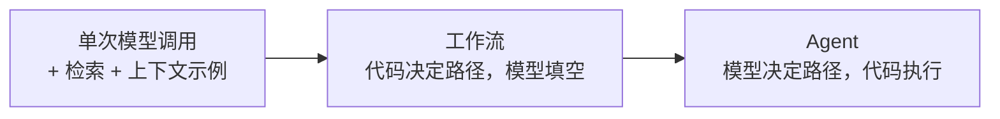
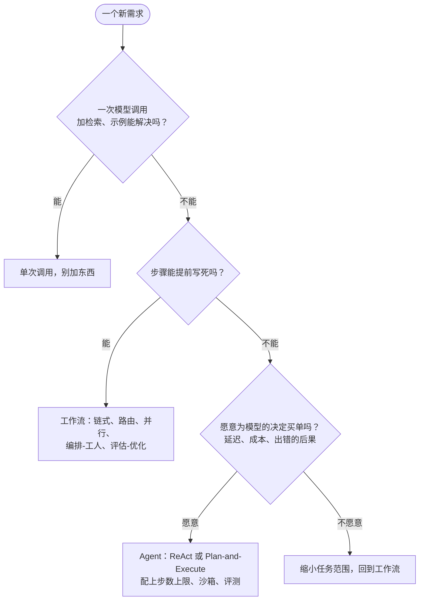
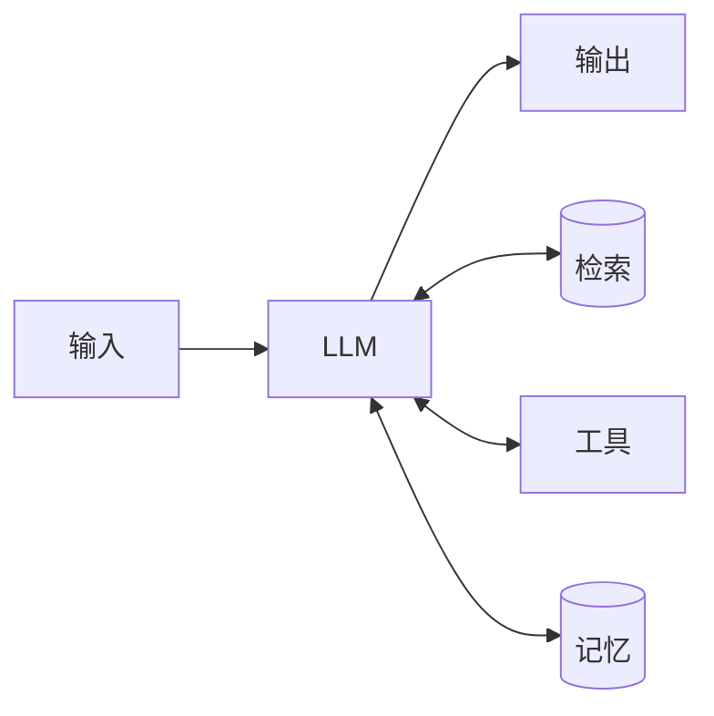
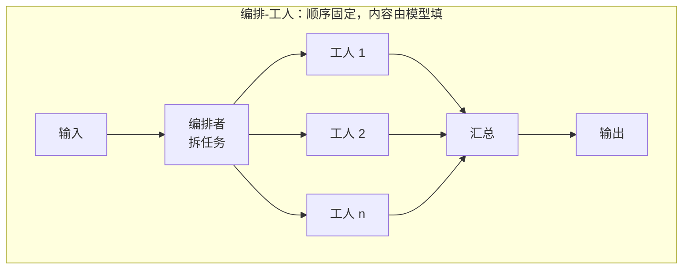
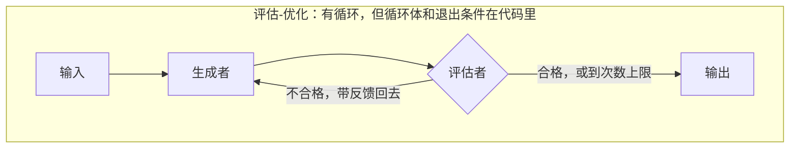
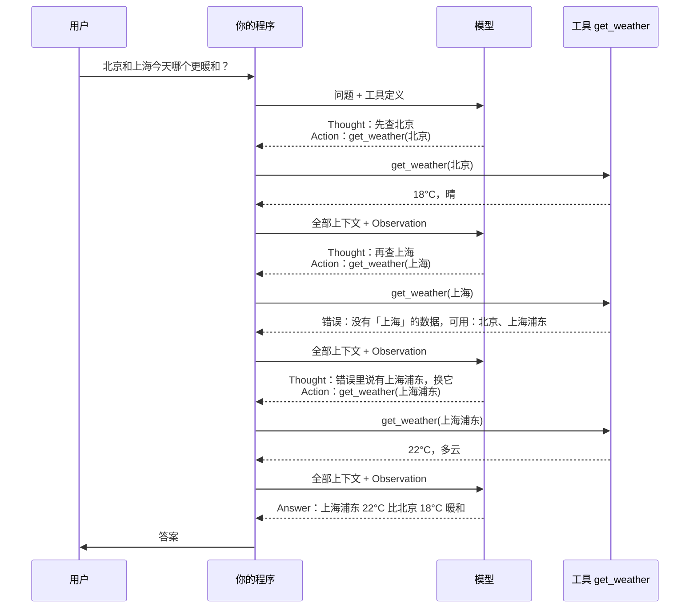
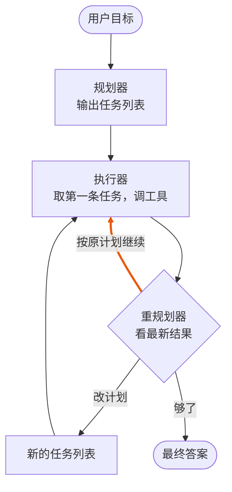
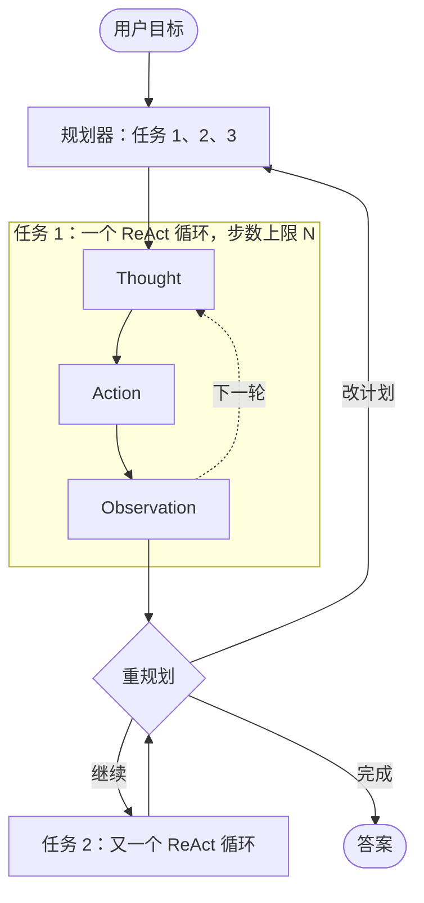
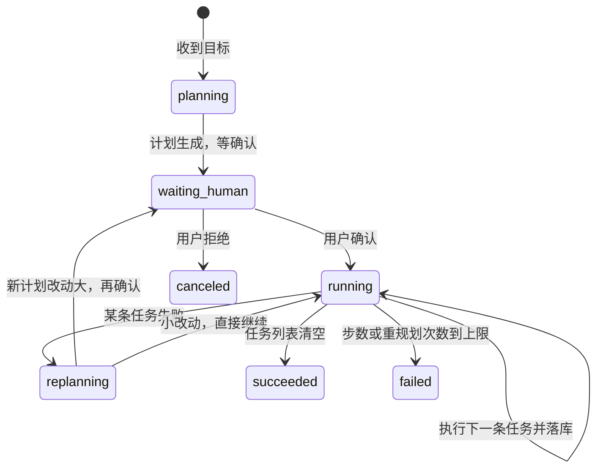

[上一篇](/posts/agent-loop-go/)手写完 Agent loop，下一个问题就来了：讲 Agent 的文章里到处是 ReAct 和 Plan-and-Execute 这两个词，我那个 loop 算哪一种？答案是 ReAct，而且几乎所有「模型调工具」的循环都是 ReAct。Plan-and-Execute 是在这个循环外面再套一层：先让模型列计划，再逐条执行。至于要不要套这一层，甚至要不要 Agent，Anthropic 的《Building effective agents》给了一个我认为最实用的判断：先找最简单的方案，不够用再加复杂度，很多场景一次模型调用加检索就够了。

文中的 Go 代码在 macOS、Go 1.26.0 下跑过，只用标准库，不需要 API Key，输出是真实结果。

## 先问一句：这个场景需要 Agent 吗

Anthropic 那篇文章（2024 年 12 月）把这类系统统称为 agentic systems，里面分两类：

- 工作流（workflow）：模型和工具按预先写好的代码路径跑（原文：LLMs and tools are orchestrated through predefined code paths）。哪一步调模型、哪一步调工具，都是你的代码定的。
- Agent：模型自己决定流程和工具用法（原文：dynamically direct their own processes and tool usage）。下一步干什么，由模型看着上一步的结果临场决定。

分界线只有一条：控制流在谁手里。在代码手里就是工作流，在模型手里就是 Agent。这条标准比「会不会调工具」「有没有循环」都准：工作流也可以调工具，也可以有循环（后面的评估-优化就是循环），但循环几次、循环体里做什么，是代码说了算。



对「什么时候不用 Agent」，文章的原话是 finding the simplest solution possible, and only increasing complexity when needed。Agent 系统的延迟和成本都更高，只有任务真需要那种灵活性时才值得。

它给的分工也清楚：任务边界清楚、步骤能提前定下来的，用工作流；步骤数没法预知、需要模型自己做决定的，才用 Agent。我把这段话画成一个判断顺序：



我的看法：能解释清楚「这个场景为什么不用 Agent」，比会写 Agent 更难，也更有用。Agent 的 demo 谁都能做，能说出「这里本来用工作流就够」的人少。如果你的业务本身就是开放式任务，比如编码助手、能查客户资料还能直接退款的客服（Anthropic 举的正是这两个例子），这句话不适用。

## 五种工作流：长得像 Agent，控制流却在代码里

五种模式底下是同一个基本单元，Anthropic 叫它增强型 LLM（augmented LLM）：接上了检索、工具和记忆的模型。



五种模式放一张表里，重点看「什么时候用」：

| 模式 | 做法 | 什么时候用 | Anthropic 举的例子 |
| --- | --- | --- | --- |
| 链式（prompt chaining） | 任务拆成固定几步，每步一次模型调用，步与步之间可以加代码检查（gate） | 任务能干净地拆成固定子任务，愿意用延迟换准确率 | 先写营销文案再翻译；先写大纲、检查大纲、再写正文 |
| 路由（routing） | 先分类，再分发给专门的提示词或模型 | 输入有明显类别，分类本身可靠 | 客服问题分成常规、退款、技术支持；简单问题给小模型，难题给大模型 |
| 并行（parallelization） | 分片（sectioning）：独立子任务同时跑；投票（voting）：同一任务跑多次取多数 | 要速度，或者多个视角能提高置信度 | 一个模型审查输入是否违规、另一个回答；多个提示词同时审代码漏洞 |
| 编排-工人（orchestrator-workers） | 一个中心模型拆任务、分派给工人模型、汇总结果 | 子任务没法提前预知，要看到输入才知道拆成什么 | 跨多个文件的代码修改；多来源的信息搜集 |
| 评估-优化（evaluator-optimizer） | 一个模型生成，另一个模型评价并给反馈，循环 | 评价标准明确，反复修改确实能提高质量 | 文学翻译；多轮搜索，由评估者决定要不要继续搜 |

后两种最容易和 Agent 混。编排-工人里，中心模型决定拆成哪些子任务，这不就是「模型决定流程」吗？Anthropic 仍然把它归为工作流，因为拆分、分派、汇总这个顺序是代码写死的，模型只决定子任务的内容，不决定「下一步是拆分还是汇总」。评估-优化有循环，但循环体固定（生成、评价），退出条件也是代码定的：评价通过，或者到达次数上限。





拿这条标准回头看 Plan-and-Execute：如果计划生成之后不再改，逐条执行完就结束，它就是一个编排-工人工作流；只有加上「执行完一步回头重新规划」，控制流才真正交到模型手里。

## ReAct：每一步都让模型看一眼再决定

### 名字从哪来

ReAct 是 Reasoning 加 Acting，出自 Yao 等人的论文《ReAct: Synergizing Reasoning and Acting in Language Models》（ICLR 2023）。它要解决的问题很具体：只让模型推理（chain-of-thought）会编造事实，因为它接触不到外部信息；只让模型行动（act-only）又拿不出连贯的答案。论文的做法是让模型交替输出两种东西，一段推理文字（Thought）和一个动作（Action）；动作由程序执行，结果（Observation）追加回提示词，模型接着输出下一段 Thought。在 HotpotQA 问答任务里动作就三个：`search[实体]`、`lookup[字符串]`、`finish[答案]`，背后接的是维基百科的 API。

论文报告 ReAct 在 ALFWorld 和 WebShop 两个交互任务上，成功率比模仿学习和强化学习方法分别高 34 和 10 个百分点，只用了一两个示例。数字是 2022 年的，模型也是当时的。但「想一步、做一步、看一眼」这个结构一直用到现在，所有带工具调用的聊天 API，跑的都是它。

### 和今天的工具调用怎么对应

把论文里的三个角色对到现在的 API 上：

| ReAct 论文 | 现在的工具调用 API（以 Claude 为例） | 谁产生 |
| --- | --- | --- |
| Thought | 回复里 `tool_use` 之前的文本块，或者开启扩展思考后的 thinking 块 | 模型 |
| Action | `tool_use` 块：工具名加 JSON 参数 | 模型 |
| Observation | 你放回上下文的 `tool_result` | 你的程序 |

有一处和论文不一样。论文里的 Thought 是提示词格式强制模型写出来的，现在的模型不一定每次都写：调用 `get_weather` 之前它可能只给一个 `tool_use` 块，一个字的解释都没有。想让它先想再动，要么在系统提示词里要求每次调用前先说明理由，要么开扩展思考（思考内容是否完整返回给你，取决于模型和厂商）。对后端来说，这段 Thought 的价值在于可观测：它落到日志里，出了问题能回看模型当时为什么选这个工具。Anthropic 那篇文章的三条原则里，第二条就是让 Agent 的规划步骤显式可见。

### 走一遍

用[上一篇](/posts/agent-loop-go/)的例子：「北京和上海今天哪个更暖和？」，工具只有一个 `get_weather`。这次我故意让「上海」查不到，看模型怎么办。



注意第二轮工具报错之后发生了什么：错误信息作为 Observation 原样回到模型手里，模型下一个 Thought 就据此换了参数。ReAct 处理意外的方式就这么朴素，不需要专门设计异常分支，意外只是又一个 Observation。这是它最大的优点。

### 代价

每一步都要调一次模型。四轮就是四次完整的模型调用，每次都带着越来越长的上下文。模型每次只看一步，没有全局计划，碰到「先查 A 再查 B 再对比」这种本来能并行的事，它会串着来。现在的模型会在一个回复里一次发出多个 `tool_use`，这是 API 层面的优化，ReAct 的结构本身没变。它还会陷入循环：同一个工具换着参数反复调，或者在两个工具之间来回。所以步数上限必须加。

## Plan-and-Execute：先列计划，再逐条做

### 名字从哪来

这个词在 LangChain 的《Planning Agents》那篇博客里定型，思路来自两处。一处是 Wang 等人的 Plan-and-Solve 提示词论文（ACL 2023），它发现零样本的「Let's think step by step」容易漏步骤，先让模型列计划再按计划解题能减少这类错误。另一处是 Yohei Nakajima 的 BabyAGI，一个把「生成任务、执行任务、重排任务队列」跑成循环的小项目。

结构分三个角色：

- 规划器（planner）：读用户目标，输出一个多步计划，通常是有序的任务列表。
- 执行器（executor）：拿一条任务，调工具完成它。执行器可以是个小模型，也可以是一个小的 ReAct 循环。
- 重规划器（replanner）：每执行完一步，看最新结果，在三件事里选一件：按原计划继续、改计划、直接给最终答案。



LangChain 给的动机有三条：大模型不用每做一步就被问一次，快；子任务可以交给小模型，便宜；强迫模型先把整件事想一遍，质量高。

### 同一篇博客里的另外两个变体

- ReWOO（Reasoning WithOut Observations，Xu 等人，2023）：规划时就把每一步的参数写好，后一步可以引用前一步的输出（`#E1`、`#E2` 这样的变量），执行器不需要模型，纯代码替换变量、调工具，最后由一个 solver 模型看全部结果给答案。大模型的调用从「每步一次」降到「头尾各一次」。
- LLMCompiler（Kim 等人，2023）：规划器输出带依赖关系的任务图，没有依赖的任务并行执行，跑完由 joiner 决定是结束还是重新规划。它针对的是 Plan-and-Execute 只能串行执行的问题。

### 代价

计划会过期。规划器在看到任何工具结果之前就把路线定了，第二步一出意外，后面的计划就作废，所以重规划器少不了。它每步都要调一次大模型，这又把「少调模型」的好处吃回去一部分。LangChain 自己也写了，基础版本「still is restricted by serial tool calling」，而且每个任务都要一次模型调用。

## 同一个问题，两种模式各跑一遍

光说不算，写段代码看。下面这个程序没有真实模型，用一个按规则出牌的假模型模拟两种控制流，统计模型调用次数和工具调用次数。假模型的「决策」是写死的，所以它只能演示控制流，演示不了模型聪不聪明。完整代码 119 行，复制进 `main.go` 就能 `go run`：

```go
package main

import (
	"fmt"
	"slices"
	"strings"
)

var modelCalls, toolCalls int

func getWeather(city string) string {
	toolCalls++
	data := map[string]string{"北京": "18°C，晴", "上海浦东": "22°C，多云"}
	if w, ok := data[city]; ok {
		return w
	}
	return fmt.Sprintf("错误：没有「%s」的数据，可用城市：北京、上海浦东", city)
}

func seen(ctx []string, key string) bool {
	return strings.Contains(strings.Join(ctx, "\n"), key)
}

// ---------- ReAct：每一轮都由模型决定下一步 ----------

type step struct {
	thought, tool, arg, answer string
}

func reactModel(ctx []string) step {
	modelCalls++
	switch {
	case !seen(ctx, "get_weather(北京)"):
		return step{thought: "要比较两地温度，先查北京", tool: "get_weather", arg: "北京"}
	case !seen(ctx, "get_weather(上海)"):
		return step{thought: "再查上海", tool: "get_weather", arg: "上海"}
	case seen(ctx, "get_weather(上海) => 错误") && !seen(ctx, "get_weather(上海浦东)"):
		return step{thought: "上海查不到，错误信息里说有上海浦东，换它再查", tool: "get_weather", arg: "上海浦东"}
	default:
		return step{thought: "两地温度都拿到了，可以回答", answer: "上海浦东 22°C 比北京 18°C 暖和"}
	}
}

func runReAct(question string, maxSteps int) {
	ctx := []string{"问题：" + question}
	for i := 1; i <= maxSteps; i++ {
		s := reactModel(ctx)
		fmt.Printf("第 %d 轮  Thought: %s\n", i, s.thought)
		if s.tool == "" {
			fmt.Printf("        Answer: %s\n", s.answer)
			return
		}
		obs := getWeather(s.arg)
		fmt.Printf("        Action: %s(%s)\n        Observation: %s\n", s.tool, s.arg, obs)
		ctx = append(ctx, fmt.Sprintf("%s(%s) => %s", s.tool, s.arg, obs))
	}
	fmt.Println("达到步数上限，未完成")
}

// ---------- Plan-and-Execute：先出计划，逐步执行，每步之后重新规划 ----------

func planner(question string) []string {
	modelCalls++
	return []string{"查北京天气", "查上海天气"}
}

func executor(task string) string {
	modelCalls++
	city := strings.TrimSuffix(strings.TrimPrefix(task, "查"), "天气")
	return fmt.Sprintf("get_weather(%s) => %s", city, getWeather(city))
}

func replanner(remaining []string, ctx []string) (plan []string, final string) {
	modelCalls++
	last := ctx[len(ctx)-1]
	switch {
	case strings.Contains(last, "get_weather(上海) => 错误"):
		return append([]string{"查上海浦东天气"}, remaining...), ""
	case len(remaining) == 0:
		return nil, "上海浦东 22°C 比北京 18°C 暖和"
	default:
		return remaining, ""
	}
}

func runPlanExecute(question string, maxSteps int) {
	ctx := []string{"问题：" + question}
	plan := planner(question)
	fmt.Printf("计划：%s\n", strings.Join(plan, " → "))
	for i := 1; i <= maxSteps && len(plan) > 0; i++ {
		task, rest := plan[0], plan[1:]
		obs := executor(task)
		ctx = append(ctx, obs)
		fmt.Printf("第 %d 步「%s」：%s\n", i, task, obs)
		var final string
		plan, final = replanner(rest, ctx)
		if final != "" {
			fmt.Printf("        Answer: %s\n", final)
			return
		}
		if !slices.Equal(plan, rest) {
			fmt.Printf("        重新规划：%s\n", strings.Join(plan, " → "))
		}
	}
	fmt.Println("达到步数上限，未完成")
}

func main() {
	q := "北京和上海今天哪个更暖和？"

	fmt.Println("=== ReAct ===")
	runReAct(q, 10)
	fmt.Printf("模型调用 %d 次，工具调用 %d 次\n\n", modelCalls, toolCalls)

	modelCalls, toolCalls = 0, 0
	fmt.Println("=== Plan-and-Execute ===")
	runPlanExecute(q, 10)
	fmt.Printf("模型调用 %d 次，工具调用 %d 次\n", modelCalls, toolCalls)
}
```

输出：

```text
=== ReAct ===
第 1 轮  Thought: 要比较两地温度，先查北京
        Action: get_weather(北京)
        Observation: 18°C，晴
第 2 轮  Thought: 再查上海
        Action: get_weather(上海)
        Observation: 错误：没有「上海」的数据，可用城市：北京、上海浦东
第 3 轮  Thought: 上海查不到，错误信息里说有上海浦东，换它再查
        Action: get_weather(上海浦东)
        Observation: 22°C，多云
第 4 轮  Thought: 两地温度都拿到了，可以回答
        Answer: 上海浦东 22°C 比北京 18°C 暖和
模型调用 4 次，工具调用 3 次

=== Plan-and-Execute ===
计划：查北京天气 → 查上海天气
第 1 步「查北京天气」：get_weather(北京) => 18°C，晴
第 2 步「查上海天气」：get_weather(上海) => 错误：没有「上海」的数据，可用城市：北京、上海浦东
        重新规划：查上海浦东天气
第 3 步「查上海浦东天气」：get_weather(上海浦东) => 22°C，多云
        Answer: 上海浦东 22°C 比北京 18°C 暖和
模型调用 7 次，工具调用 3 次
```

我写之前以为先规划会省模型调用，结果反过来。工具调用次数一样，都是 3 次；模型调用 ReAct 4 次，Plan-and-Execute 7 次，多出来的是规划 1 次和每步之后的重规划 3 次。Plan-and-Execute 省的是大模型的调用，前提是执行器用小模型或者不用模型（ReWOO 那种），而且步骤要多到值得规划。任务只有三步，它就是纯开销。

两种模式都从「上海查不到」里恢复了，方式不同：ReAct 是模型在下一个 Thought 里顺手换参数；Plan-and-Execute 是重规划器改了剩余计划。把 `replanner` 删掉，Plan-and-Execute 会卡在第二步。

假模型里 `executor` 把「查北京天气」翻成 `get_weather(北京)` 靠的是字符串处理，真实系统里这一步要么交给小模型，要么像 ReWOO 那样让规划器直接把参数写好。执行器要不要模型，是 Plan-and-Execute 成本的关键变量。

## 怎么选，怎么组合

先说结论，这是我的经验，没有统计：任务一长，Agent 多半会做成外层 Plan-and-Execute、内层 ReAct。规划器把大任务拆成几条，每条交给一个带步数上限的 ReAct 循环去做，做完一条回到重规划器，由它决定继续、改计划还是结束。Claude Code 先列 todo 再逐项做，就是这个结构。



只用 ReAct 的条件（五步是我的经验值，不是论文结论）：任务通常五步以内，没有人工确认环节，失败了整个重跑也不心疼。要规划层的条件：步骤多，任务之间能并行，要先给人看计划再执行，或者任务要能跨进程恢复。两种模式对着看：

| | ReAct | Plan-and-Execute |
| --- | --- | --- |
| 控制流 | 每步由模型临场决定 | 先定计划，执行中按需重规划 |
| 模型调用 | 每步一次大模型 | 规划和重规划用大模型，执行可用小模型或不用 |
| 对意外的反应 | 下一步自然纠正 | 靠重规划器，没有它就卡住 |
| 并行 | 靠 API 一次返回多个工具调用 | 计划里能标出可并行的任务（LLMCompiler） |
| 可解释性 | 逐步的 Thought | 一份能给人看的计划 |
| 人工确认点 | 只能在某次工具调用前 | 计划生成后可以整体确认 |
| 适合 | 短任务、探索性任务 | 长任务、需要审核或恢复的任务 |

## 后端视角：模式决定状态表长什么样

做 Agent 平台的后端，关心的是任务挂了怎么恢复、重试会不会重复执行、高风险操作在哪暂停等人、出了问题怎么回溯。这几个问题的答案由控制流模式决定，这也是我觉得两种模式最值得比的地方。

ReAct 的状态就是一条消息列表。要做 checkpoint，只能每一步落一行（一次模型调用或一次工具调用），恢复时把消息列表重建出来，从最后一个完成的步骤往后跑。有副作用的工具调用要带幂等键，否则恢复时重放会执行两次。人工确认只能卡在「模型要调某个危险工具」的那一刻，用户看到的是「它想调 `refund`，参数是这些，同意吗」，看不到后面它还打算干什么。

Plan-and-Execute 多出一个一等公民：计划本身。计划可以单独落库，每条任务一行，带自己的状态（待执行、执行中、成功、失败、跳过）。这给后端带来几个好处：

- 计划生成之后、执行之前，是一个天然的暂停点。用户看到完整计划再点确认，比看到单次工具调用更有判断依据。
- 恢复粒度是任务，不是单条消息。进程挂了，找到第一条未完成的任务接着跑，前面任务的结果已经在库里。
- 重规划的每一个版本都可以保存，出了问题能回答「它什么时候、因为什么改了计划」。
- 重规划的次数可以单独设上限，和单条任务的步数上限分开计数，哪个先到都进 failed。



这也是我推荐「外层计划、内层 ReAct」的真正理由，和模型聪不聪明无关：外层给你可落库、可审核、可恢复的状态；内层那几步 ReAct 短到失败了整条任务重跑也无妨。如果你的任务短到不需要恢复，这一节对你没用，ReAct 加步数上限就够了。

## 参考资料

- Anthropic，《Building effective agents》（2024-12-19）：https://www.anthropic.com/engineering/building-effective-agents
- Yao 等，《ReAct: Synergizing Reasoning and Acting in Language Models》，ICLR 2023：https://arxiv.org/abs/2210.03629
- Wang 等，《Plan-and-Solve Prompting: Improving Zero-Shot Chain-of-Thought Reasoning by Large Language Models》，ACL 2023：https://arxiv.org/abs/2305.04091
- LangChain，《Planning Agents》：https://www.langchain.com/blog/planning-agents
- Xu 等，《ReWOO: Decoupling Reasoning from Observations for Efficient Augmented Language Models》：https://arxiv.org/abs/2305.18323
- Kim 等，《An LLM Compiler for Parallel Function Calling》：https://arxiv.org/abs/2312.04511
- 本站：[从零用 Go 写一个 Agent Loop](/posts/agent-loop-go/)、[用 Go 实现大模型工具调用](/posts/go-tool-calling/)
