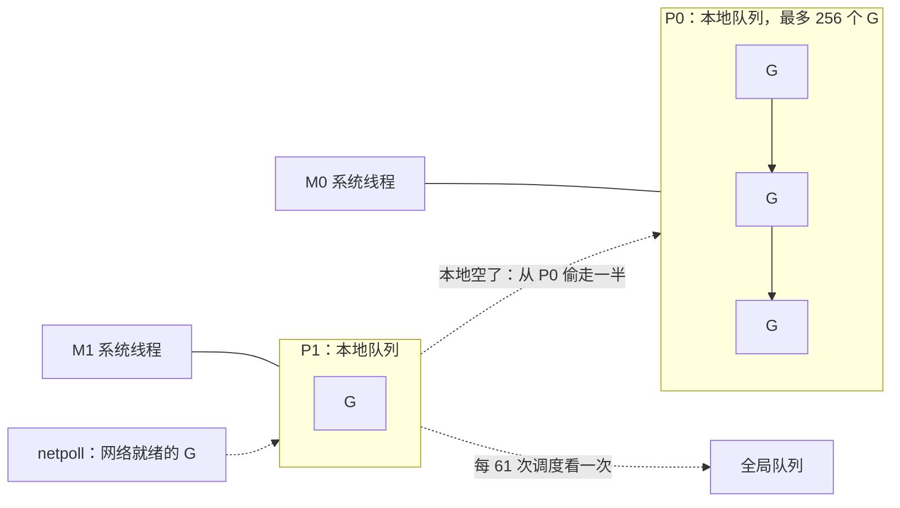
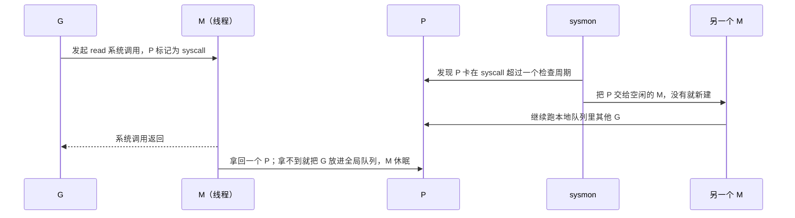
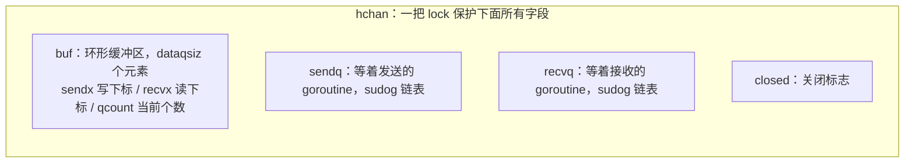
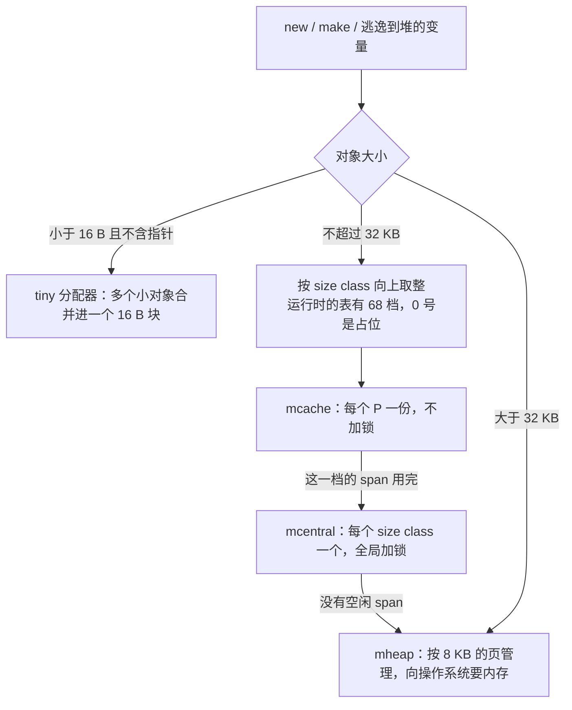
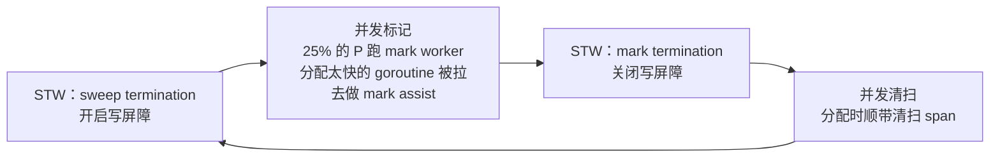
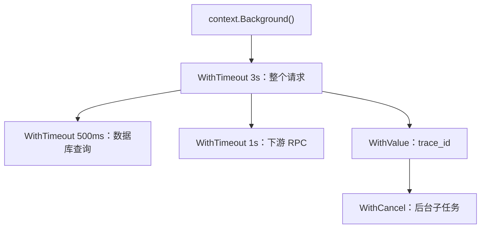
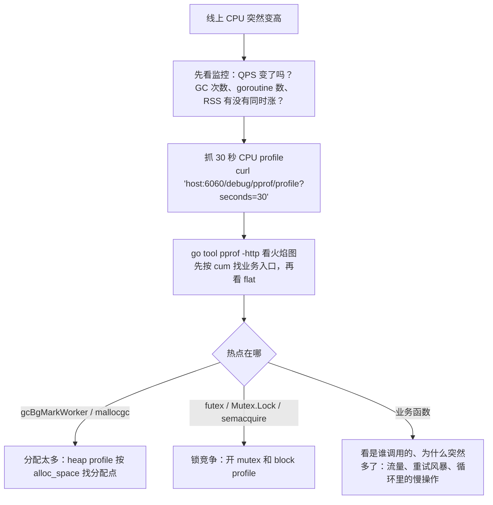
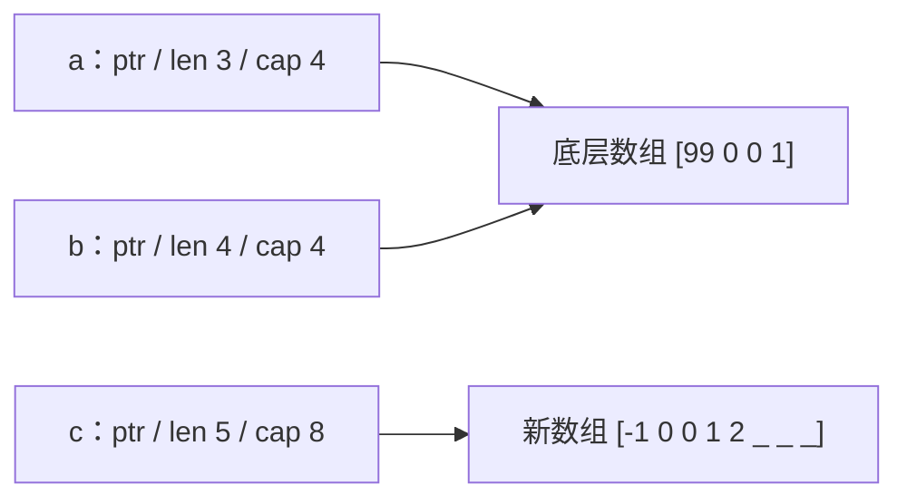
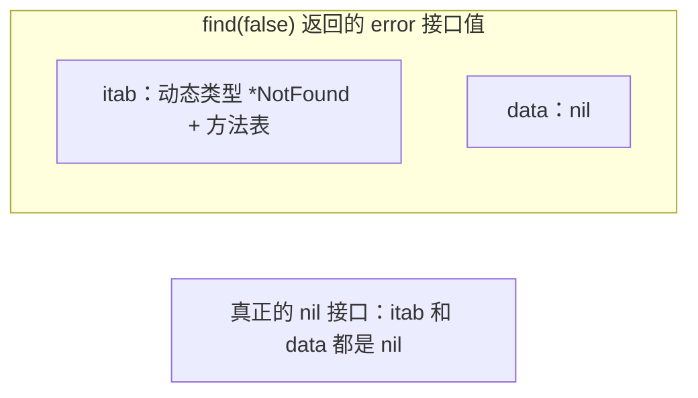

这篇是我整理的 Go 运行时底层原理笔记：GMP 调度、channel 与 sync、内存分配与 GC、context、pprof 与 trace 排障，最后是 slice、map、interface、defer 的几个细节。文中代码在 macOS（Apple M2 Max）、Go 1.26.0 下跑过，输出是真实结果，引用的运行时源码也是这个版本的。每段代码都是独立的 `main` 包，复制进一个 `main.go` 就能 `go run`。

一个建议放在前面：每个主题都动手写一小段代码验证，比只看文章记得牢。GMP、GC 的文章看十篇，不如自己用 pprof 抓一次 goroutine 泄漏。

## 一、调度：GMP

### 原理

G 是 goroutine，M 是系统线程，P 是「处理器」，数量等于 `GOMAXPROCS`，每个 P 带一个本地运行队列（最多 256 个 G）和一份内存分配缓存 mcache。M 必须拿到一个 P 才能跑 G。除了每个 P 的本地队列，还有一个全局队列，和一个存放网络就绪 goroutine 的 netpoll。



调度器找下一个 G 的顺序是：本地队列、全局队列（每 61 次调度强制看一次，防止全局队列饿死）、netpoll，都没有就去别的 P 偷一半，这就是 work stealing。

G 发起阻塞的系统调用时，带着它的 M 一起陷进内核。P 不会被白白占着：进入系统调用时 P 先标记为 syscall 状态，后台线程 sysmon 发现它卡了超过一个检查周期（20 微秒到 10 毫秒之间），就把 P 交给另一个空闲的 M，没有空闲的就新建一个。系统调用返回后，原来的 M 试着拿回一个 P，拿不到就把 G 放进全局队列，自己休眠。



抢占这件事，1.14 之前只发生在函数调用的入口（协作式），一个没有函数调用的死循环能一直占着 P。1.14 起加了基于信号的异步抢占：sysmon 发现某个 G 连续跑了超过 10 毫秒，就给对应的线程发 `SIGURG`，信号处理函数把 G 停下来放回队列。

`GOMAXPROCS` 默认等于启动时看到的逻辑 CPU 数。容器里这点很坑：Go 1.25 之前，容器限了 2 核，宿主机 64 核，程序照样起 64 个 P，调度和 GC 的开销全是按 64 核算的，还会被 CFS 限流。1.25 起 Linux 下的运行时会读 cgroup 的 CPU 配额，而且会跟着配额变化更新。老版本的常见做法是引入 `go.uber.org/automaxprocs`，或者在部署时显式设环境变量。

### 动手验证

先验证异步抢占。只留一个 P，起一个纯死循环的 goroutine，看主 goroutine 睡醒之后还能不能拿回 P：

```go
package main

import (
	"fmt"
	"runtime"
	"time"
)

func main() {
	runtime.GOMAXPROCS(1)
	go func() {
		for {
		}
	}()
	time.Sleep(100 * time.Millisecond)
	fmt.Println("main 还活着：死循环的 goroutine 被抢占了")
}
```

```text
main 还活着：死循环的 goroutine 被抢占了
```

1.14 之前的版本跑这段会永远卡住，主 goroutine 拿不回唯一的 P。

再看 goroutine 到底有多轻。起十万个 goroutine 全部阻塞在一个 channel 上，看栈内存涨了多少：

```go
package main

import (
	"fmt"
	"runtime"
	"sync"
)

func main() {
	const n = 100_000
	var before, after runtime.MemStats
	runtime.GC()
	runtime.ReadMemStats(&before)

	var wg sync.WaitGroup
	block := make(chan struct{})
	wg.Add(n)
	for i := 0; i < n; i++ {
		go func() {
			wg.Done()
			<-block
		}()
	}
	wg.Wait()
	runtime.ReadMemStats(&after)
	stack := after.StackInuse - before.StackInuse
	fmt.Printf("goroutine 数：%d\n", runtime.NumGoroutine())
	fmt.Printf("栈内存增加 %d MiB，平均每个 goroutine %.1f KiB\n", stack>>20, float64(stack)/n/1024)
	close(block)
}
```

```text
goroutine 数：100001
栈内存增加 195 MiB，平均每个 goroutine 2.0 KiB
```

2 KiB 是初始栈，不够会按需扩容（复制到一块两倍大的新栈）。对比一下：Linux 线程默认栈 8 MB，虽然是虚拟内存，十万个线程也不是正常玩法。

最后看一眼调度器的实时状态。随便写个起 20 个 goroutine 互相让出 CPU 的程序，用 `GODEBUG=schedtrace=500` 跑，每 500 毫秒会在 stderr 打一行：

```text
SCHED 504ms: gomaxprocs=12 idleprocs=0 threads=13 spinningthreads=1 needspinning=1 idlethreads=0 runqueue=11 [ 1 0 0 0 0 0 0 0 0 0 0 0 ] schedticks=[ 246873 238354 ... ]
```

`gomaxprocs=12` 是 P 的数量，`threads=13` 是 M 的数量，`runqueue=11` 是全局队列长度，方括号里是每个 P 本地队列的长度。线上怀疑调度有问题时这一行比猜有用。

### 常见问题

**goroutine 为什么比线程轻？** 两件事：栈小且可增长，2 KiB 起步，线程栈是 MB 级；切换在用户态由 Go 的调度器完成，不经过内核，M 和 G 是 M:N 复用的，几个线程就能跑几万个 goroutine。

**一个 goroutine 一直跑死循环，会卡住别的 goroutine 吗？** 1.14 之后不会，上面验证过了。但抢占只是让别人有机会跑，这个死循环还是会吃满一个 P 的 CPU，`GOMAXPROCS=1` 的话其他 goroutine 只能和它轮流分时间片。

**容器里 `GOMAXPROCS` 读的是宿主机还是容器？** 看版本：1.25 之前读宿主机的 CPU 数，1.25 起 Linux 下读 cgroup 配额。P 过多的后果：空闲 P 的 GC mark worker 和自旋线程白白消耗 CPU，再加上 CFS 配额用完被限流，延迟会抖。

## 二、channel 与并发原语

### 原理

channel 在运行时就是一个 `hchan` 结构，Go 1.26 的 `src/runtime/chan.go` 里是这样（省了几个和 timer、测试相关的字段）：

```go
type hchan struct {
	qcount   uint           // total data in the queue
	dataqsiz uint           // size of the circular queue
	buf      unsafe.Pointer // points to an array of dataqsiz elements
	elemsize uint16
	closed   uint32
	elemtype *_type // element type
	sendx    uint   // send index
	recvx    uint   // receive index
	recvq    waitq  // list of recv waiters
	sendq    waitq  // list of send waiters

	// lock protects all fields in hchan, as well as several
	// fields in sudogs blocked on this channel.
	lock mutex
}
```



发送的流程：先加锁；`recvq` 里有等着的接收者，就把数据直接拷进它的栈，唤醒它，这是无缓冲 channel 的常态，整个过程只拷贝一次；没有接收者但缓冲区没满，就写进 `buf`；缓冲区满了，当前 goroutine 包成一个 sudog 挂到 `sendq` 上，让出 P。接收反过来。所以无缓冲 channel 和有缓冲 channel 的区别，就是 `dataqsiz` 是不是 0，有缓冲的发送方在缓冲没满之前不用等。

关闭 channel 时会把 `recvq` 和 `sendq` 上的 goroutine 全部唤醒：接收者拿到零值和 `ok == false`，发送者 panic。关闭 nil channel、重复关闭也都 panic。

`select` 会把所有 case 随机打乱顺序再逐个检查，避免总是偏向前面的分支。nil channel 上的收发永远不会就绪，`select` 永远不会选中它，这可以用来动态关掉某个分支。

`sync` 包里每个东西的适用场景：

| 原语 | 用在哪 | 要能讲的细节 |
| --- | --- | --- |
| `Mutex` | 保护一块共享状态 | 正常模式下新来的 goroutine 和被唤醒的排队者一起抢锁，排队者常抢不过；一个排队者等了超过 1 毫秒就切到饥饿模式，锁直接交给队头，不再自旋；队列空了或者等待时间短于 1 毫秒再切回来 |
| `RWMutex` | 读多写少 | 有写者在等时新读者会被挡住，防止写者饿死；读临界区里别再拿写锁 |
| `WaitGroup` | 等一组 goroutine 结束 | `Add` 要在 `go` 之前调用；1.25 起有 `wg.Go(f)` 一步到位 |
| `Once` | 只初始化一次 | `Do` 里 panic 也算执行过了，后续调用不会重试 |
| `Pool` | 复用临时对象，减轻 GC | 每个 P 一份本地池，GC 时清掉（1.13 起留一轮 victim 缓存），别用它存有状态的连接 |
| `sync.Map` | 读多写少、key 集合基本不变 | 一般业务 map 加 `RWMutex` 就够了，它不是通用的并发 map |
| `atomic` | 计数器、标志位 | 比锁便宜，但只能保护单个变量 |

扩展包里两个常被问到：`golang.org/x/sync/errgroup` 把 WaitGroup、第一个错误、context 取消和并发上限（`SetLimit`）打包在一起；`singleflight` 把同一个 key 的并发调用合并成一次，缓存击穿时用。

### 动手验证

已关闭 channel 的行为：

```go
package main

import "fmt"

func main() {
	ch := make(chan int, 1)
	ch <- 1
	close(ch)

	v, ok := <-ch
	fmt.Println("关闭后先取出缓冲里剩下的：", v, ok)
	v, ok = <-ch
	fmt.Println("缓冲空了之后：", v, ok)

	defer func() { fmt.Println("recover:", recover()) }()
	ch <- 2
}
```

```text
关闭后先取出缓冲里剩下的： 1 true
缓冲空了之后： 0 false
recover: send on closed channel
```

注意第一行：关闭并不丢弃缓冲里已有的数据，接收方先把剩的取完，之后才开始拿零值。

nil channel 关掉 `select` 分支。把两个 channel 合并成一个，哪个关了就把它置成 nil，这样 `select` 不会在已关闭的 channel 上空转：

```go
package main

import "fmt"

func merge(a, b <-chan int) <-chan int {
	out := make(chan int)
	go func() {
		defer close(out)
		for a != nil || b != nil {
			select {
			case v, ok := <-a:
				if !ok {
					a = nil
					continue
				}
				out <- v
			case v, ok := <-b:
				if !ok {
					b = nil
					continue
				}
				out <- v
			}
		}
	}()
	return out
}

func main() {
	a, b := make(chan int), make(chan int)
	go func() { a <- 1; a <- 2; close(a) }()
	go func() { b <- 10; close(b) }()
	for v := range merge(a, b) {
		fmt.Print(v, " ")
	}
	fmt.Println()
}
```

跑两次，顺序不一样，这本身就说明 `select` 是随机的：

```text
10 1 2
1 10 2
```

去掉 `a = nil` 那两行，已关闭的 `a` 会一直就绪，循环空转到 `b` 也关闭为止，`out` 里还会混进零值。

限制并发数的 worker pool，用一个带缓冲的 channel 当信号量：

```go
package main

import (
	"fmt"
	"sync"
	"sync/atomic"
	"time"
)

func main() {
	const limit = 3
	sem := make(chan struct{}, limit)
	var wg sync.WaitGroup
	var running, peak atomic.Int32

	for i := 0; i < 10; i++ {
		sem <- struct{}{}
		wg.Add(1)
		go func(id int) {
			defer wg.Done()
			defer func() { <-sem }()
			n := running.Add(1)
			for p := peak.Load(); n > p && !peak.CompareAndSwap(p, n); p = peak.Load() {
			}
			time.Sleep(20 * time.Millisecond)
			running.Add(-1)
		}(i)
	}
	wg.Wait()
	fmt.Println("同时运行过的最大 goroutine 数：", peak.Load())
}
```

```text
同时运行过的最大 goroutine 数： 3
```

另一种写法是固定起 N 个 worker 从一个 jobs channel 里取任务，任务数远大于并发数时更省 goroutine。生产代码里我会直接用 `errgroup` 的 `SetLimit`，它顺便把错误和取消也处理了。

### 常见问题

**什么时候用 channel，什么时候用锁？** 我的标准：要把数据的所有权从一个 goroutine 交给另一个，或者要表达「某件事发生了」（完成了、超时了），用 channel；多个 goroutine 共同读写同一块状态（计数器、缓存 map、连接池），用锁。业务代码里锁用得比 channel 多得多，channel 主要出现在流水线和超时控制里。如果你写的是流式数据处理，这个比例会反过来。

**向已关闭的 channel 发送为什么是 panic 而不是返回错误？** 因为关闭是发送方的事，「接收方关闭 channel」或者「多个发送方中的一个关闭」在设计上就是错的，运行时选择让它早点炸。多发送方的场景用一个额外的 done channel 或 context 通知退出，channel 本身不关或者由唯一的协调者关。

## 三、内存分配与 GC

### 原理

先说逃逸分析。变量能不能放栈上由编译器决定：返回了它的地址、被闭包捕获、转成 interface、大小在编译期不确定，或者太大，都会分配到堆上。`go build -gcflags=-m` 能把判定打出来，下面验证。

分配器把分配分成三条路：



绝大多数分配在 mcache 这一层就结束了，不加锁，这是 Go 分配快的原因。size class 取整也解释了为什么 `make([]int, 0, 832)` 实际拿到的容量是 848：下面 slice 一节会看到。

GC 是并发标记清扫，用三色抽象来描述：




标记和程序并发执行，程序随时可能改指针，光靠三色不变式会漏标：黑对象新指向一个白对象，同时灰对象到它的引用被删掉，这个白对象就被回收了。写屏障就是为了堵这个洞：1.8 起用的是混合写屏障，覆盖指针时把旧值和新值都标灰，栈上的写不拦（栈在开始时整体标黑），代价是不用重新扫栈，STW 只剩两个很短的点。

两个可调的环境变量。`GOGC` 默认 100，含义是堆涨到上次标记后存活量的两倍时触发下一轮（1.18 起公式里还算上了栈和全局变量）。`GOMEMLIMIT` 是 1.19 加的软上限，总内存接近它时 GC 会更频繁，哪怕 `GOGC=off`；为了不让程序被 GC 吃死，运行时把 GC 占用的 CPU 限制在 50% 以内。

减少 GC 压力的常用手段：`sync.Pool` 复用对象；切片和 map 预分配容量；大的、长期存活的数据结构里少放指针（`[]*T` 换成 `[]T`，`map[string]*T` 换成索引），因为标记阶段要追着指针跑，没有指针的内存块直接跳过。

### 动手验证

逃逸分析：

```go
package main

import "fmt"

type user struct{ name string }

func stackUser() int {
	u := user{name: "a"}
	return len(u.name)
}

func heapUser() *user {
	u := user{name: "b"}
	return &u
}

func printInt(n int) {
	fmt.Println(n)
}

func main() {
	_ = stackUser()
	_ = heapUser()
	printInt(1)
}
```

```text
$ go build -gcflags=-m -o /dev/null .
./main.go:13:2: moved to heap: u
./main.go:18:14: n escapes to heap
./main.go:24:10: 1 escapes to heap
```

`stackUser` 里的 `u` 没出现在输出里，留在栈上；`heapUser` 返回了地址，`u` 被搬到堆；`fmt.Println(n)` 把 `n` 转成了 `any`，也逃逸了。热路径上一个 `Println` 就是一次堆分配，这是日志库都提供 `Int("key", n)` 这类字段函数的原因。

`GOGC` 和 `GOMEMLIMIT` 的效果。程序分配 2000 个 1 MiB 的块，始终只保留最近 20 个，也就是存活堆大约 20 MiB：

```go
package main

import (
	"fmt"
	"os"
	"runtime"
)

var live [][]byte

func main() {
	for i := 0; i < 2000; i++ {
		b := make([]byte, 1<<20)
		b[0] = 1
		if i%10 == 0 {
			live = append(live, b)
			if len(live) > 20 {
				live = live[1:]
			}
		}
	}
	var ms runtime.MemStats
	runtime.ReadMemStats(&ms)
	fmt.Printf("GOGC=%-4s GOMEMLIMIT=%-6s 共分配 %d MiB，GC 跑了 %d 次\n",
		os.Getenv("GOGC"), os.Getenv("GOMEMLIMIT"), ms.TotalAlloc>>20, ms.NumGC)
}
```

同一个二进制换环境变量跑：

| 环境变量 | GC 次数 |
| --- | --- |
| `GOGC=100` | 81 |
| `GOGC=400` | 20 |
| `GOGC=off GOMEMLIMIT=64MiB` | 94 |
| `GOGC=off GOMEMLIMIT=256MiB` | 9 |
| `GOGC=off GOMEMLIMIT=1GiB` | 2 |

`GOGC` 从 100 调到 400，GC 次数降到四分之一，代价是堆峰值变成存活量的五倍。`GOMEMLIMIT=64MiB` 那一行我本来以为会比 `GOGC=100` 少，结果反而多：存活 20 MiB 加上栈和运行时自己的开销，离 64 MiB 没剩多少余量，GC 只能一轮接一轮地跑。这是 GC 指南里警告过的情况，上限设得太贴近存活量，程序就会把 CPU 花在 GC 上。它的用途是兜底防 OOM，不是用来省 GC 次数的。

加上 `GODEBUG=gctrace=1`，每轮 GC 打一行：

```text
gc 2 @0.000s 4%: 0.008+0.042+0.003 ms clock, 0.10+0.013/0.067/0.001+0.036 ms cpu, 6->6->1 MB, 6 MB goal, 0 MB stacks, 0 MB globals, 12 P
```

三段时间对应 STW 清扫结束、并发标记、STW 标记结束；`6->6->1 MB` 是 GC 开始时的堆、结束时的堆、存活的堆；`6 MB goal` 是这一轮的触发目标。线上看到两个 STW 段变长、或者 goal 不断被突破，就是 GC 跟不上分配速度了。

预分配的收益，用 benchmark 看（`b.Loop` 是 1.24 加的）：

```go
package prealloc

import "testing"

const n = 10_000

func BenchmarkAppendGrow(b *testing.B) {
	for b.Loop() {
		var s []int
		for i := 0; i < n; i++ {
			s = append(s, i)
		}
	}
}

func BenchmarkAppendPrealloc(b *testing.B) {
	for b.Loop() {
		s := make([]int, 0, n)
		for i := 0; i < n; i++ {
			s = append(s, i)
		}
	}
}
```

```text
$ go test -bench . -benchmem
cpu: Apple M2 Max
BenchmarkAppendGrow-12        	   26056	     44998 ns/op	  357625 B/op	      19 allocs/op
BenchmarkAppendPrealloc-12    	   51097	     23583 ns/op	   81920 B/op	       1 allocs/op
```

不预分配的版本扩容了 18 次，分配的总字节数是最终大小的四倍多，时间差了一倍。

### 常见问题

**服务内存一直涨，怎么判断是泄漏还是 GC 没跟上？** 先分清是 Go 堆在涨还是进程 RSS 在涨，`runtime/metrics` 或 expvar 可以把 `HeapInuse`、`HeapSys`、`NumGC` 暴露成指标。堆的 inuse 单调上涨、GC 之后也不降，是泄漏。用 heap profile 的 `inuse_space` 看谁持有着这些内存，隔一段时间抓两份，用 `-base` 对比增量。堆 inuse 稳定但 RSS 高，多半是 Go 向操作系统归还内存比较懒（scavenger 在后台慢慢还），也可能是 cgo 或 mmap 的内存；设 `GOMEMLIMIT` 能让它还得积极些。分配速率极高、gctrace 里 GC 一轮接一轮、assist 时间占比高，那是 GC 跟不上，去 `alloc_space` 找分配点。

**GC 导致延迟抖动怎么办？** 先用 trace 或 gctrace 确认抖动和 GC 周期对得上。然后按顺序：减少分配（最有效，profile 的 `alloc_objects` 排序）；调大 `GOGC` 用内存换 GC 次数；设 `GOMEMLIMIT` 防止调大之后 OOM；大堆上减少指针密度；`sync.Pool` 复用大对象。STW 本身一般是亚毫秒级，抖动更多来自 mark assist 抢了业务 goroutine 的 CPU。

## 四、context

### 原理

context 是一棵树，取消只往下传：父节点取消，所有子孙都取消；子节点取消不影响父节点。子节点的 deadline 不能晚于父节点，`WithTimeout` 传一个比父节点更晚的时间会被父节点的截断。



四个构造函数：`WithCancel` 手动取消；`WithTimeout` 和 `WithDeadline` 到点自动取消，前者是后者的语法糖；`WithValue` 挂请求范围的元数据。1.20 起有 `WithCancelCause` 和 `context.Cause`，取消时能带上原因，排查「到底是谁取消的」时很有用；1.21 加了 `WithoutCancel`（派生一个不随父节点取消的子节点，给异步任务用）和 `AfterFunc`。

`WithValue` 只放请求范围的元数据：trace_id、用户 ID。业务参数走函数参数。key 用自定义的未导出类型，避免不同包撞 key。

超时在调用链上传递的方式就是一路把 `ctx` 当第一个参数传下去，每一层只在自己的 I/O 处 `select` 它的 `Done()`，或者把它交给支持 context 的库函数（`QueryContext`、`http.NewRequestWithContext`、`Dial` 系列）。

### 动手验证

三层调用，handler 设 100 毫秒超时，底层「查询」要 1 秒。分别用看 ctx 和不看 ctx 的查询跑一遍：

```go
package main

import (
	"context"
	"errors"
	"fmt"
	"time"
)

func handler(ctx context.Context, query func(context.Context) error) error {
	ctx, cancel := context.WithTimeout(ctx, 100*time.Millisecond)
	defer cancel()
	return service(ctx, query)
}

func service(ctx context.Context, query func(context.Context) error) error {
	if err := query(ctx); err != nil {
		return fmt.Errorf("service: %w", err)
	}
	return nil
}

func queryWithCtx(ctx context.Context) error {
	select {
	case <-time.After(time.Second):
		return nil
	case <-ctx.Done():
		return fmt.Errorf("repo: %w", ctx.Err())
	}
}

func queryIgnoringCtx(ctx context.Context) error {
	time.Sleep(time.Second)
	return nil
}

func run(name string, query func(context.Context) error) {
	start := time.Now()
	err := handler(context.Background(), query)
	fmt.Printf("%-14s 耗时 %5v  err=%v  超时=%t\n", name,
		time.Since(start).Round(time.Millisecond), err, errors.Is(err, context.DeadlineExceeded))
}

func main() {
	run("下游看 ctx", queryWithCtx)
	run("下游不看 ctx", queryIgnoringCtx)

	parent, cancel := context.WithCancelCause(context.Background())
	child, stop := context.WithTimeout(parent, time.Hour)
	defer stop()
	cancel(errors.New("用户关掉了页面"))
	<-child.Done()
	fmt.Printf("父取消后子的 Err=%v  Cause=%v\n", child.Err(), context.Cause(child))
}
```

```text
下游看 ctx        耗时 101ms  err=service: repo: context deadline exceeded  超时=true
下游不看 ctx       耗时    1s  err=<nil>  超时=false
父取消后子的 Err=context canceled  Cause=用户关掉了页面
```

第二行是重点：超时只对看 `ctx.Done()` 的代码有效。`handler` 的 100 毫秒到了，`queryIgnoringCtx` 照样睡满 1 秒，上层只能干等。第三行是父取消传播到子节点，子节点的 `Err()` 只说「被取消了」，`Cause` 才说得出为什么。

### 常见问题

**HTTP 请求超时了，下游的数据库查询会停下来吗？** 要三个前提同时成立。第一，handler 拿的是 `r.Context()`，一路传到了底层；客户端断开或超时时它会被取消。第二，查询用的是 `QueryContext` 这类带 ctx 的方法，`database/sql` 会把取消交给驱动。第三，驱动真的处理了取消：有的驱动是给数据库发一个取消请求，有的是直接关掉这条连接，数据库那边的语句未必立刻停，长 SQL 可能还会在服务端跑完。三个前提缺一个，上层超时返回了，下游还在跑，连接池里的连接也还被占着。

**`WithValue` 为什么不能放业务参数？** 它是 `any` 到 `any` 的查找，没有类型检查，读的人看函数签名看不出依赖什么；每层 `WithValue` 是链表上加一个节点，查找是线性的。

## 五、性能分析与排障

这一块光看文章记不住，得亲手走一遍：从指标看到异常、抓 profile、定位到某一行。下面两个练习就是干这个的。

### 原理

`net/http/pprof` 匿名导入后，在 `/debug/pprof/` 下暴露这些 profile：

| profile | 看什么 | 怎么采 |
| --- | --- | --- |
| `profile` | CPU 时间花在哪 | `curl 'host:6060/debug/pprof/profile?seconds=30' > cpu.pprof`，默认采 30 秒 |
| `heap` | 当前存活的堆内存（`inuse_space`）和累计分配（`alloc_space`） | 瞬时快照；查泄漏看 inuse，查 GC 压力看 alloc |
| `goroutine` | 每个 goroutine 现在卡在哪一行 | `?debug=1` 按调用栈聚合成文本，`?debug=2` 是完整 dump |
| `mutex` | 锁等待的时间花在哪些锁上 | 要先 `runtime.SetMutexProfileFraction(n)` |
| `block` | goroutine 阻塞在 channel、select、锁上的时间 | 要先 `runtime.SetBlockProfileRate(n)` |
| `allocs` | 和 heap 一样的数据，默认按分配量排 | 查哪里分配多 |
| `trace` | 调度、GC、阻塞的时间线 | `?seconds=5`，用 `go tool trace` 打开 |

抓下来的文件用 `go tool pprof -http=:8080 cpu.pprof` 打开，浏览器里有火焰图、调用图和源码视图。看的时候先看 `cum`（包含被调用者的累计时间）找到业务入口，再看 `flat`（自身时间）找真正干活的函数。

`runtime/trace` 和 pprof 的区别：pprof 是采样统计，回答「哪个函数占比高」；trace 是事件记录，回答「这 50 毫秒里每个 P 在干什么、GC 什么时候开始、这个 goroutine 为什么等了 30 毫秒才被调度」。排延迟抖动用 trace，排 CPU 和内存用 pprof。

goroutine 泄漏的典型原因就那几种：往没人接收的 channel 发送（或者从没人发送的 channel 接收）；没设超时的网络调用；忘了 cancel 的 context；`for range` 一个永远不关闭的 channel。

### 练习一：故意写一个 goroutine 泄漏，用 pprof 找到它

handler 起一个 goroutine 算结果，往无缓冲 channel 发，自己却直接返回了：

```go
package main

import (
	"fmt"
	"net/http"
	_ "net/http/pprof"
	"runtime"
)

func compute() int { return 42 }

func leak(w http.ResponseWriter, r *http.Request) {
	ch := make(chan int)
	go func() {
		ch <- compute()
	}()
	fmt.Fprintf(w, "goroutines=%d\n", runtime.NumGoroutine())
}

func main() {
	http.HandleFunc("/leak", leak)
	http.ListenAndServe("127.0.0.1:16060", nil)
}
```

请求 50 次，再看 goroutine profile：

```text
$ for i in $(seq 50); do curl -s http://127.0.0.1:16060/leak >/dev/null; done
$ curl -s http://127.0.0.1:16060/leak
goroutines=54
$ curl -s 'http://127.0.0.1:16060/debug/pprof/goroutine?debug=1' | head -4
goroutine profile: total 54
51 @ 0x1025a9a0c 0x10253da78 0x10253d688 0x102742fac 0x1025b1004
#	0x102742fab	main.leak.func1+0x2b	/path/to/leak/main.go:15
```

51 个 goroutine 停在同一行 `main.go:15`，就是那个 `ch <- compute()`。`debug=1` 把相同调用栈的 goroutine 聚在一起，泄漏的那组数量最多，一眼就能看到。

`go tool pprof -png` 画出来是这样（用 `-focus=main.leak` 只保留相关路径）：


一个弯路：我先试的是 `go tool pprof -top`，结果最上面是 `runtime.gopark 98%`，看不出任何东西。goroutine profile 里所有阻塞的 goroutine 最终都停在 `gopark`，要看的是它上面那一层是谁。`debug=1` 的文本或者调用图都比 `-top` 直观。

修法有三种，按场景选：channel 给 1 的缓冲，发送方不会卡住，没人收就让 GC 收走；goroutine 里 `select` 上 `ctx.Done()`，请求结束就退出；或者干脆别起这个 goroutine。

### 练习二：CPU 热点

另一个经典错误，在循环里编译正则：

```go
package main

import (
	"fmt"
	"os"
	"regexp"
	"runtime/pprof"
	"strings"
)

const pattern = `^[a-z0-9._%+-]+@[a-z0-9.-]+\.[a-z]{2,}$`

func countValid(emails []string) int {
	n := 0
	for _, e := range emails {
		if regexp.MustCompile(pattern).MatchString(e) {
			n++
		}
	}
	return n
}

func main() {
	f, err := os.Create("cpu.pprof")
	if err != nil {
		panic(err)
	}
	pprof.StartCPUProfile(f)
	defer pprof.StopCPUProfile()

	emails := strings.Fields(strings.Repeat("a@b.com bad@ x.y@z.io ", 1000))
	total := 0
	for i := 0; i < 300; i++ {
		total += countValid(emails)
	}
	fmt.Println("valid:", total)
}
```

第一次看 `-top` 我又走了弯路：

```text
$ go tool pprof -top -nodecount=8 cpu cpu.pprof
      flat  flat%   sum%        cum   cum%
     900ms 28.21% 28.21%      900ms 28.21%  runtime.kevent
     390ms 12.23% 40.44%      390ms 12.23%  runtime.pthread_cond_wait
     270ms  8.46% 48.90%      270ms  8.46%  runtime.usleep
     240ms  7.52% 56.43%      240ms  7.52%  runtime.pthread_kill
```

按 `flat` 排，前几名全是运行时：每次编译正则分配一堆小对象，GC 频繁启停，`kevent`、`usleep` 这些是 GC 和调度器在忙。业务函数一个都没露面。换成按 `cum` 排，或者用 `-peek` 看某个函数的上下游，才看到真相：

```text
$ go tool pprof -peek 'main.countValid$' cpu cpu.pprof
      flat  flat%   sum%        cum   cum%   calls calls% + context
                                             0.87s   100% |   main.main
         0     0%     0%      0.87s 27.27%                | main.countValid
                                             0.81s 93.10% |   regexp.MustCompile
                                             0.06s  6.90% |   regexp.(*Regexp).MatchString (inline)
```

`countValid` 的时间里 93% 花在 `MustCompile`，真正匹配只占 7%。火焰图里更直观，中间那一列从 `main.countValid` 往下全是 `regexp.Compile` 和 `syntax.Parse`：


修法是把正则提到包级别 `var emailRe = regexp.MustCompile(pattern)`，编译一次。这个例子的教训比修法值钱：`-top` 默认按 `flat` 排，运行时的函数经常把业务函数挤出榜单；先按 `cum` 找到自己的入口，再往下看。

### 线上排障的顺序



goroutine 数量一直增长的排法：先看 `runtime.NumGoroutine` 的指标曲线确认是单调涨而不是随流量波动；抓 `goroutine?debug=1`，数量最多的那组调用栈就是嫌疑人；隔几分钟再抓一次，看哪组在涨；对着那一行代码问「它在等谁，谁本该通知它」。

## 六、slice、map、interface、defer 和其他细节

### slice

slice 是三个字：指向底层数组的指针、长度、容量。`append` 时容量够就在原数组上写，不够就分配一块新的并拷贝。容量够的情况下，两个 slice 共享底层数组，改一个另一个跟着变：

```go
package main

import "fmt"

func main() {
	a := make([]int, 3, 4)
	b := append(a, 1)
	b[0] = 99
	fmt.Println("容量够，共享底层数组：a =", a, " b =", b)

	c := append(b, 2)
	c[0] = -1
	fmt.Println("扩容后各自一份：     b =", b, " c =", c)

	var s []int
	last := -1
	fmt.Print("cap 变化：")
	for i := 0; i < 2000; i++ {
		s = append(s, i)
		if cap(s) != last {
			last = cap(s)
			fmt.Print(last, " ")
		}
	}
	fmt.Println()
}
```

```text
容量够，共享底层数组：a = [99 0 0]  b = [99 0 0 1]
扩容后各自一份：     b = [99 0 0 1]  c = [-1 0 0 1 2]
cap 变化：1 2 4 8 16 32 64 128 256 512 848 1280 1792 2560
```



扩容规则（1.18 起）：容量小于 256 时翻倍，之后每次增加「原容量加 768 的四分之一」，再向上取整到分配器的 size class。所以 512 之后不是 1024，而是 848：按公式算出 832 个 int，832 × 8 = 6656 字节，向上取整到 6784 字节的档位，正好是 848 个。

### map

map 不是并发安全的，并发读写不是 panic，是 `fatal error`，`recover` 不住，整个进程直接退出：

```go
package main

func main() {
	m := map[int]int{}
	go func() {
		for i := 0; ; i++ {
			m[i] = i
		}
	}()
	for i := 0; ; i++ {
		_ = m[i]
	}
}
```

```text
fatal error: concurrent map read and map write
```

遍历顺序是随机的，每次 `range` 的起始桶都不一样，语言故意这么做，不让你依赖顺序。1.24 起 map 换成了 Swiss Table 实现，查找和内存占用都比旧的桶链好一些，但接口和这两条性质没变。

### interface

interface 值是两个字：类型信息和数据指针。带方法的接口（`iface`）第一个字是 itab，里面有动态类型和方法表；空接口（`eface`）第一个字直接是类型。接口等于 nil 的条件是两个字都是 nil。一个值为 nil 的指针赋给接口之后，类型字已经有值了，接口不等于 nil：

```go
package main

import "fmt"

type NotFound struct{}

func (*NotFound) Error() string { return "not found" }

func find(fail bool) error {
	var e *NotFound
	if fail {
		e = &NotFound{}
	}
	return e
}

func main() {
	err := find(false)
	fmt.Println("err == nil ?", err == nil)
	fmt.Printf("动态类型 %T，内部指针是 nil 吗 %t\n", err, err.(*NotFound) == nil)
}
```

```text
err == nil ? false
动态类型 *main.NotFound，内部指针是 nil 吗 true
```



这个坑的实际形态是：函数声明返回 `error`，内部用一个具体错误类型的指针变量，没出错时 `return e`，调用方 `if err != nil` 永远为真。规则是返回 `error` 的函数在没错时写 `return nil`，不要返回一个可能为 nil 的具体类型。

### defer

defer 后进先出。它和返回值的关系取决于返回值有没有名字：命名返回值是一个变量，`return 21` 先把 21 赋给它，defer 再改它，调用方拿到改过的；匿名返回值在 `return` 时已经拷贝走了，defer 改局部变量影响不到：

```go
package main

import "fmt"

func order() {
	for i := 0; i < 3; i++ {
		defer fmt.Print(i, " ")
	}
}

func named() (n int) {
	defer func() { n *= 2 }()
	return 21
}

func unnamed() int {
	n := 21
	defer func() { n *= 2 }()
	return n
}

func main() {
	order()
	fmt.Println()
	fmt.Println("命名返回值：", named(), " 匿名返回值：", unnamed())
}
```

```text
2 1 0
命名返回值： 42  匿名返回值： 21
```

顺带一提，1.14 起大多数 defer 被编译成普通的函数调用（open-coded defer），开销接近直接调用，「defer 很慢」是老黄历了。

### 泛型和循环变量

泛型（1.18 起）适合的场景：容器和算法（`Map`、`Filter`、有序 map、对象池）、不同数值类型共用一个函数。约束用 `cmp.Ordered` 或自己写接口，`any` 约束下不能做比较和运算。不适合用泛型的地方：靠接口和方法就能表达的多态。

循环变量是 1.22 的一个行为变更：之前 `for i := ...` 的 `i` 整个循环共用一个变量，在循环体里起 goroutine 捕获它会全拿到最后一个值；1.22 起每次迭代一个新变量，这个经典坑没了。`go.mod` 里 `go` 指令低于 1.22 的模块还是旧行为。

## 资料

- Go 内存模型：<https://go.dev/ref/mem>
- Go GC 指南，讲 `GOGC` 和 `GOMEMLIMIT` 怎么配合：<https://go.dev/doc/gc-guide>
- 诊断工具总览，pprof、trace、gctrace 都在这里：<https://go.dev/doc/diagnostics>
- Profiling Go Programs：<https://go.dev/blog/pprof>
- Go 1.25 发布说明里关于容器感知 `GOMAXPROCS` 的部分：<https://go.dev/doc/go1.25>
- 《Go 语言设计与实现》，调度、channel、GC 讲得细：<https://draveness.me/golang/>
- Effective Go：<https://go.dev/doc/effective_go>
