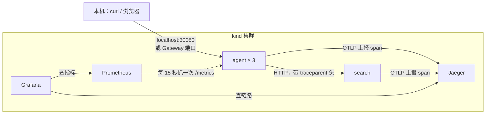
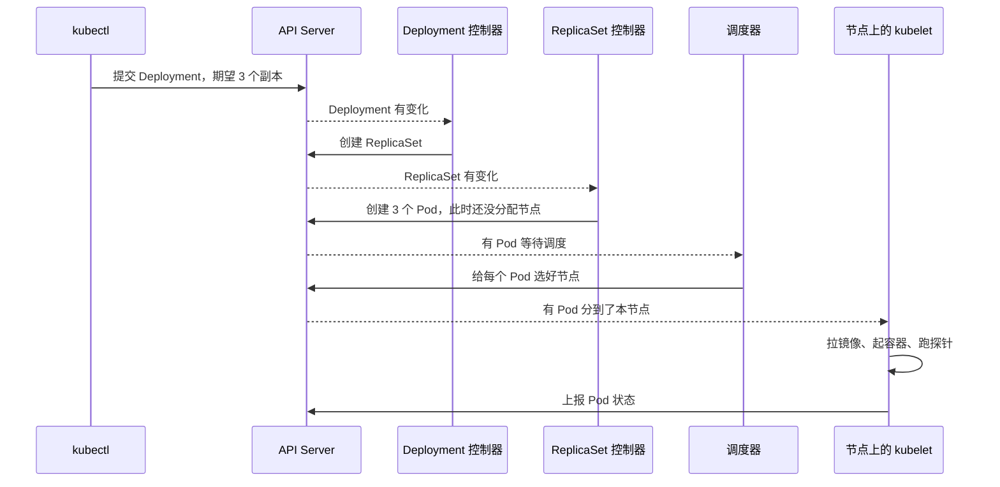
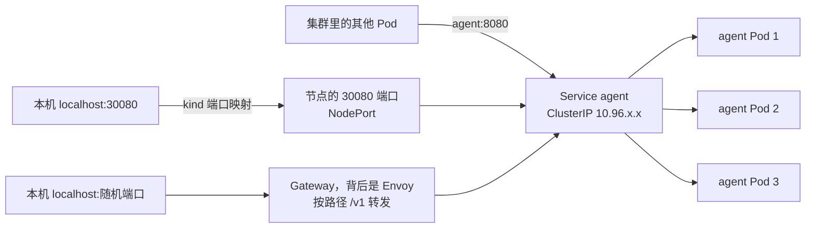
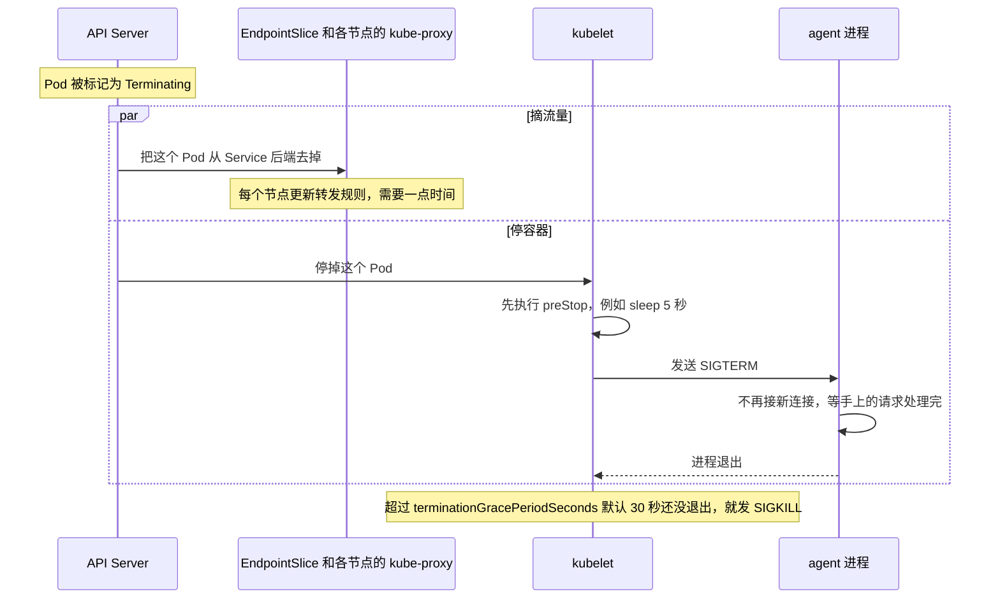
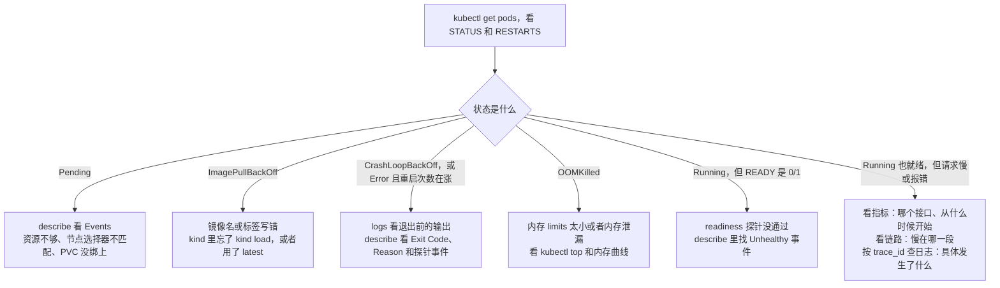
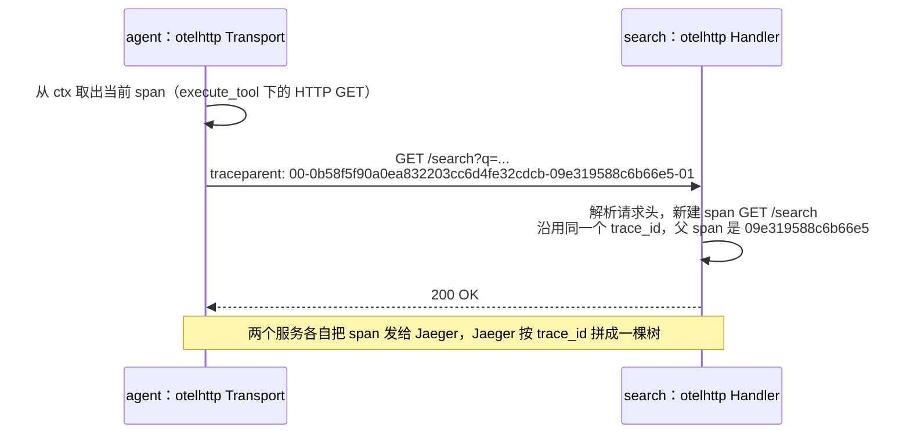

[之前那篇](/posts/agent-loop-go/)写的 Agent 只在本机 `go run` 过。这篇把一个结构相同的 Go 服务搬上 Kubernetes（下文简称 K8s），再给它装上指标、链路追踪和结构化日志，最后故意让其中一个工具变慢，只靠看板、链路和日志把它找出来。

先说几个跟着做下来最有用的结论：

- 滚动更新时请求报错，主要是 Pod 退出和流量摘除之间有个时间差。只配 readiness 探针，600 个请求里还是失败 11 个；加上 5 秒的 `preStop`，失败数变成 0。
- 把 5% 的文档查询拖慢 2 秒，任务平均耗时从 0.229 秒涨到 0.263 秒，几乎看不出来；P99 从 0.494 秒涨到 1.64 秒，告警两分钟后触发。
- 从告警到定位只用了三步：看板按工具拆开，看出是 `search_docs`；在 Jaeger 里按耗时筛选，看出慢在 search 服务的查询那一段；拿 trace_id 去 grep 日志，找到那条慢查询记录。

文中所有命令都在 macOS（Apple Silicon）上实际跑过，贴出来的输出是真实结果。环境版本：Docker Desktop 29.6.2（给了 8 核、16 GB 内存）、kind v0.33.0、Kubernetes v1.37.0、kubectl v1.37.0、Helm v4.3.1、Go 1.26。整套东西跑在本机的 Docker 里，做完一条命令就能删干净，不需要云账号。

## 这篇适合谁

- 会写基础 Go，知道 `net/http` 怎么起一个服务。
- 听说过 Docker 和 K8s，但没自己部署过东西。
- 想知道线上服务出问题时，指标、链路、日志各该怎么用。

不需要先懂 K8s 的架构原理。etcd 怎么存数据、调度器怎么打分，这些等会用、会排障以后再看也不迟。这篇的目标就两件事：会用，会排障。

做完以后，你手上会有：

1. 一个三节点的本地集群，上面跑着两个 Go 服务，配好了探针、资源限制、自动扩缩容和对外入口。
2. 一套 Prometheus + Grafana + Jaeger，以及一个能看出问题的看板和两条告警规则。
3. 几次亲手做过的故障实验：镜像拉不下来、容器反复崩溃、内存超限被杀、滚动更新丢请求、下游服务变慢。

## 全景：最后会搭出什么



`agent` 是主角，一个模拟出来的 Agent 服务：收到问题后先「调用模型」决定要不要用工具，再调工具，最后「调用模型」生成回答。模型是假的，按关键词做决定，所以不需要 API Key。它有两个工具：`get_weather` 在进程内查一张写死的表；`search_docs` 要通过 HTTP 调另一个服务 `search`。多一个服务，是为了演示请求跨服务时链路怎么串起来，也方便后面让「下游变慢」。

## 先认几个词

K8s 里的东西都叫「对象」，用 YAML 描述。这篇会用到下面这些，先有个印象，用到时再细说：

| 对象 | 一句话解释 | 在本文里干什么 |
| --- | --- | --- |
| Pod | 最小的调度单位，里面跑一个或几个容器，共享网络 | 每个 agent 实例就是一个 Pod |
| Deployment | 声明「我要几个什么样的 Pod」，负责滚动更新和回滚 | 管理 agent 和 search |
| ReplicaSet | Deployment 每个版本对应一个，负责把 Pod 数量维持在期望值 | 滚动更新时能看到新旧两个 |
| Service | 给一组 Pod 一个固定的名字和虚拟 IP，做负载均衡 | `http://search:8080` 就是靠它 |
| ConfigMap / Secret | 把配置和密钥从镜像里拿出来，注入成环境变量或文件 | 放 `SEARCH_URL` 和假的 API Key |
| HorizontalPodAutoscaler | 按指标自动调整副本数 | 按 CPU 在 3 到 6 个副本之间伸缩 |
| Gateway / HTTPRoute | 集群的 HTTP 入口，按域名、路径把流量分给 Service | 对外暴露 `/v1`，做按比例灰度 |

K8s 的工作方式可以概括成一句话：你提交「期望状态」，一堆控制器不停地把「实际状态」往期望状态上拉。执行 `kubectl apply` 时，背后大概发生了这些事：



这张图记住一点就够了：`kubectl apply` 返回「created」只说明 API Server 收下了你的 YAML，Pod 能不能真跑起来是后面一串组件的事。所以 apply 之后一定要再看一眼状态。

## 准备工具

需要四样东西：Docker、kind、kubectl、Helm。macOS 上用 Homebrew 装：

```bash
brew install kind kubectl helm
```

Docker 用 Docker Desktop 或者 OrbStack 都行。后面要装 Prometheus 全家桶，建议在 Docker 设置里给至少 4 核、8 GB 内存，我给的是 8 核、16 GB。Linux 和 Windows 的装法见各自官网：[kind](https://kind.sigs.k8s.io/docs/user/quick-start/#installation)、[kubectl](https://kubernetes.io/docs/tasks/tools/)、[Helm](https://helm.sh/docs/intro/install/)。

装完确认一下版本：

```text
$ kind version
kind v0.33.0 go1.26.7 darwin/arm64
$ kubectl version --client
Client Version: v1.37.0
Kustomize Version: v5.8.1
$ helm version
version.BuildInfo{Version:"v4.3.1", GitCommit:"c0d08d0d6d9424d4a14febb5e8a3e51b0dd00dff", GitTreeState:"clean", GoVersion:"go1.27.2", KubeClientVersion:"v1.37"}
```

kind 是「Kubernetes in Docker」的缩写，它把 Docker 容器当成 K8s 节点。和 minikube 比，kind 更轻，删了重建只要二十来秒，适合反复折腾。

## 用 kind 起一个三节点集群

新建项目目录，在根目录放一个 `kind.yaml`：

```yaml
kind: Cluster
apiVersion: kind.x-k8s.io/v1alpha4
name: demo
nodes:
  - role: control-plane
    extraPortMappings:
      - containerPort: 30080
        hostPort: 30080
  - role: worker
  - role: worker
```

一个控制平面节点、两个工作节点。`extraPortMappings` 把本机的 30080 端口映射到控制平面节点的 30080 端口，后面用 NodePort 从本机访问服务时要用到。这个映射只能在建集群时配，建好以后改不了。

```text
$ kind create cluster --config kind.yaml
Creating cluster "demo" ...
 ✓ Ensuring node image (kindest/node:v1.37.0) 🖼
 ✓ Preparing nodes 📦 📦 📦
 ✓ Writing configuration 📜
 ✓ Starting control-plane 🕹️
 ✓ Installing CNI 🔌
 ✓ Installing StorageClass 💾
 ✓ Joining worker nodes 🚜
Set kubectl context to "kind-demo"
```

第一次要下载节点镜像，我这里花了 2 分 17 秒；镜像缓存下来以后再建只要 20 秒左右。kind 会顺手把 kubectl 的当前上下文切到 `kind-demo`，之后的 kubectl 命令都发给这个集群。

刚建好时节点是 `NotReady`，等十几秒网络插件起来就好了：

```text
$ kubectl get nodes
NAME                 STATUS   ROLES           AGE   VERSION
demo-control-plane   Ready    control-plane   36s   v1.37.0
demo-worker          Ready    <none>          21s   v1.37.0
demo-worker2         Ready    <none>          21s   v1.37.0
```

所谓「节点」，就是三个 Docker 容器：

```text
$ docker ps --format 'table {{.Names}}\t{{.Image}}\t{{.Ports}}'
NAMES                 IMAGE                  PORTS
demo-control-plane    kindest/node:v1.37.0   0.0.0.0:30080->30080/tcp, 127.0.0.1:58677->6443/tcp
demo-worker           kindest/node:v1.37.0
demo-worker2          kindest/node:v1.37.0
```

`127.0.0.1:58677->6443` 是 API Server 的端口，kubectl 就是连的它。

## 示例服务：一个假装是 Agent 的 Go 程序

初始化模块，建两个 `main` 包：

```bash
go mod init agentdemo
mkdir -p cmd/agent cmd/search deploy
```

最后的目录结构是这样，现在只需要前三个 Go 文件：

```text
agent-demo/
├── kind.yaml
├── Dockerfile
├── go.mod
├── cmd/
│   ├── agent/
│   │   ├── main.go       HTTP 服务、探针接口、退出逻辑
│   │   ├── agent.go      假模型、工具、Agent 循环
│   │   └── metrics.go    Prometheus 指标（加可观测性时再建）
│   └── search/
│       └── main.go       文档检索服务
├── internal/telemetry/   链路追踪和日志的初始化（同上）
└── deploy/               所有 K8s YAML
```

### search：一个很小的文档检索服务

`cmd/search/main.go`：

```go
package main

import (
	"encoding/json"
	"log"
	"net/http"
	"os"
	"strings"
	"time"
)

type Doc struct {
	Title   string `json:"title"`
	Snippet string `json:"snippet"`
}

var docs = []Doc{
	{"探针", "readinessProbe 失败时 Pod 会被摘出 Service 的后端，livenessProbe 失败时容器会被重启。"},
	{"滚动更新", "Deployment 默认 maxSurge 和 maxUnavailable 都是 25%，新旧 Pod 交替替换。"},
	{"资源限制", "内存用量超过 limits 会被 OOMKilled，CPU 超过 limits 会被限流。"},
	{"扩缩容", "HorizontalPodAutoscaler 按 CPU 使用率或自定义指标调整副本数。"},
}

func search(w http.ResponseWriter, r *http.Request) {
	time.Sleep(20 * time.Millisecond)
	q := r.URL.Query().Get("q")
	hits := []Doc{}
	for _, d := range docs {
		if strings.Contains(q, d.Title) {
			hits = append(hits, d)
		}
	}
	w.Header().Set("Content-Type", "application/json")
	json.NewEncoder(w).Encode(hits)
}

func main() {
	http.HandleFunc("GET /search", search)
	http.HandleFunc("GET /healthz", func(w http.ResponseWriter, r *http.Request) {
		w.Write([]byte("ok"))
	})
	port := os.Getenv("PORT")
	if port == "" {
		port = "8080"
	}
	log.Println("search listening on :" + port)
	log.Fatal(http.ListenAndServe(":"+port, nil))
}
```

它按标题做子串匹配，返回命中的文档。`time.Sleep` 假装在查数据库。`PORT` 环境变量只是为了在本机同时跑两个服务时错开端口，在 K8s 里每个 Pod 有自己的 IP，都用 8080 不会冲突。

### agent：假模型 + 两个工具 + 循环

`cmd/agent/agent.go`：

```go
package main

import (
	"context"
	"encoding/json"
	"errors"
	"fmt"
	"math/rand/v2"
	"net/http"
	"net/url"
	"strings"
	"time"
)

const maxSteps = 5

var cities = []string{"北京", "上海", "广州", "杭州"}

var weather = map[string]string{
	"北京": "晴，18°C",
	"上海": "多云，22°C",
	"广州": "小雨，26°C",
}

type toolCall struct {
	Name string
	Arg  string
}

type TaskResult struct {
	Answer  string   `json:"answer"`
	Steps   int      `json:"steps"`
	Tools   []string `json:"tools"`
	Pod     string   `json:"pod"`
	Version string   `json:"version"`
}

type Agent struct {
	searchURL string
	client    *http.Client
}

func think(ctx context.Context, question string, observations []string) ([]toolCall, string, error) {
	select {
	case <-time.After(time.Duration(80+rand.IntN(70)) * time.Millisecond):
	case <-ctx.Done():
		return nil, "", ctx.Err()
	}
	if len(observations) > 0 {
		return nil, "查到了：" + strings.Join(observations, "；"), nil
	}
	var calls []toolCall
	for _, c := range cities {
		if strings.Contains(question, c) {
			calls = append(calls, toolCall{"get_weather", c})
		}
	}
	if strings.Contains(question, "怎么") || strings.Contains(question, "什么") {
		calls = append(calls, toolCall{"search_docs", question})
	}
	if len(calls) == 0 {
		return nil, "我只会查天气和 K8s 文档。", nil
	}
	return calls, "", nil
}

func (a *Agent) Run(ctx context.Context, question string) (*TaskResult, error) {
	res := &TaskResult{Tools: []string{}}
	var observations []string
	for step := 1; step <= maxSteps; step++ {
		res.Steps = step
		calls, answer, err := think(ctx, question, observations)
		if err != nil {
			return nil, err
		}
		if len(calls) == 0 {
			res.Answer = answer
			return res, nil
		}
		for _, c := range calls {
			res.Tools = append(res.Tools, c.Name)
			out, err := a.callTool(ctx, c)
			if err != nil {
				out = c.Name + " 出错：" + err.Error()
			}
			observations = append(observations, out)
		}
	}
	return nil, errors.New("超过最大步数")
}

func (a *Agent) callTool(ctx context.Context, c toolCall) (string, error) {
	switch c.Name {
	case "get_weather":
		return getWeather(ctx, c.Arg)
	case "search_docs":
		return a.searchDocs(ctx, c.Arg)
	}
	return "", fmt.Errorf("未知工具 %s", c.Name)
}

func getWeather(ctx context.Context, city string) (string, error) {
	select {
	case <-time.After(10 * time.Millisecond):
	case <-ctx.Done():
		return "", ctx.Err()
	}
	w, ok := weather[city]
	if !ok {
		return "", fmt.Errorf("没有%s的天气数据", city)
	}
	return city + w, nil
}

func (a *Agent) searchDocs(ctx context.Context, q string) (string, error) {
	u := a.searchURL + "/search?q=" + url.QueryEscape(q)
	req, err := http.NewRequestWithContext(ctx, http.MethodGet, u, nil)
	if err != nil {
		return "", err
	}
	resp, err := a.client.Do(req)
	if err != nil {
		return "", err
	}
	defer resp.Body.Close()
	if resp.StatusCode != http.StatusOK {
		return "", fmt.Errorf("search 返回 %s", resp.Status)
	}
	var docs []struct{ Title, Snippet string }
	if err := json.NewDecoder(resp.Body).Decode(&docs); err != nil {
		return "", err
	}
	if len(docs) == 0 {
		return "文档里没找到相关内容", nil
	}
	return docs[0].Title + "：" + docs[0].Snippet, nil
}
```

`think` 就是那个假模型：先睡 80～150 毫秒假装在推理，然后看问题里有没有城市名、有没有「怎么」「什么」，决定调哪些工具。`cities` 里有杭州，`weather` 表里却没有，问杭州天气时工具会报错，后面正好用来演示工具失败的指标。工具出错不会让任务失败，错误信息会作为观察结果交回给模型，和真实 Agent 的做法一样。

`cmd/agent/main.go`：

```go
package main

import (
	"context"
	"encoding/json"
	"errors"
	"log"
	"net/http"
	"os"
	"sync/atomic"
	"time"
)

var version = "dev"

type Server struct {
	agent *Agent
	pod   string
	ready atomic.Bool
}

func (s *Server) handleTask(w http.ResponseWriter, r *http.Request) {
	if !s.ready.Load() {
		http.Error(w, "warming up", http.StatusServiceUnavailable)
		return
	}
	var req struct {
		Question string `json:"question"`
	}
	err := json.NewDecoder(http.MaxBytesReader(w, r.Body, 1<<20)).Decode(&req)
	if err != nil || req.Question == "" {
		http.Error(w, `请求体应为 {"question": "..."}`, http.StatusBadRequest)
		return
	}
	ctx, cancel := context.WithTimeout(r.Context(), 5*time.Second)
	defer cancel()
	res, err := s.agent.Run(ctx, req.Question)
	if errors.Is(err, context.DeadlineExceeded) {
		http.Error(w, "task timeout", http.StatusGatewayTimeout)
		return
	}
	if err != nil {
		http.Error(w, err.Error(), http.StatusInternalServerError)
		return
	}
	res.Pod, res.Version = s.pod, version
	w.Header().Set("Content-Type", "application/json")
	json.NewEncoder(w).Encode(res)
}

func (s *Server) handleReady(w http.ResponseWriter, r *http.Request) {
	if !s.ready.Load() {
		http.Error(w, "warming up", http.StatusServiceUnavailable)
		return
	}
	w.Write([]byte("ok"))
}

func main() {
	searchURL := os.Getenv("SEARCH_URL")
	if searchURL == "" {
		log.Fatal("缺少环境变量 SEARCH_URL")
	}
	pod, _ := os.Hostname()
	s := &Server{agent: &Agent{searchURL: searchURL, client: &http.Client{}}, pod: pod}
	go func() {
		time.Sleep(3 * time.Second)
		s.ready.Store(true)
		log.Println("warm-up done")
	}()

	mux := http.NewServeMux()
	mux.HandleFunc("POST /v1/tasks", s.handleTask)
	mux.HandleFunc("GET /readyz", s.handleReady)
	mux.HandleFunc("GET /healthz", func(w http.ResponseWriter, r *http.Request) {
		w.Write([]byte("ok"))
	})
	log.Printf("agent %s listening on :8080", version)
	log.Fatal(http.ListenAndServe(":8080", mux))
}
```

这里有三个后面会用到的设计：

- 启动后要「预热」3 秒，假装在加载提示词模板。这 3 秒里进程已经在监听端口，但任务接口返回 503。很多真实服务都是这样，要先建连接池、加载缓存，才能接活。
- 两个健康检查接口。`/healthz` 只要进程还能响应就返回 ok；`/readyz` 要等预热完成才返回 ok。为什么要分两个，讲探针时细说。
- 没设 `SEARCH_URL` 就直接退出。缺关键配置时宁可起不来，也别带着错误配置跑。

### 在本机跑一下

开两个终端：

```bash
PORT=8081 go run ./cmd/search
SEARCH_URL=http://localhost:8081 go run ./cmd/agent
```

再开一个终端发请求（`jq` 只是为了去掉本机主机名那一栏）：

```text
$ curl -s -X POST localhost:8080/v1/tasks -d '{"question":"北京天气怎么样"}' | jq -c '{answer, steps, tools}'
{"answer":"查到了：北京晴，18°C；文档里没找到相关内容","steps":2,"tools":["get_weather","search_docs"]}
$ curl -s -X POST localhost:8080/v1/tasks -d '{"question":"杭州天气"}' | jq -c '{answer, steps, tools}'
{"answer":"查到了：get_weather 出错：没有杭州的天气数据","steps":2,"tools":["get_weather"]}
$ curl -s -X POST localhost:8080/v1/tasks -d '{"question":"滚动更新怎么配置"}' | jq -c '{answer, steps, tools}'
{"answer":"查到了：滚动更新：Deployment 默认 maxSurge 和 maxUnavailable 都是 25%，新旧 Pod 交替替换。","steps":2,"tools":["search_docs"]}
$ curl -s -X POST localhost:8080/v1/tasks -d '{"question":"你好"}' | jq -c '{answer, steps, tools}'
{"answer":"我只会查天气和 K8s 文档。","steps":1,"tools":[]}
```

「北京天气怎么样」里有「怎么」，所以两个工具都调了，这是假模型的规则，不用在意。启动后 3 秒内发请求会拿到 `warming up`，请求体不是 JSON 会拿到 400。

## 打包成镜像

`Dockerfile` 用多阶段构建：第一阶段在完整的 Go 镜像里编译，第二阶段只把二进制拷进一个几乎什么都没有的基础镜像。

```dockerfile
FROM golang:1.26 AS build
WORKDIR /src
COPY go.* ./
RUN go mod download
COPY . .
ARG VERSION=dev
RUN CGO_ENABLED=0 go build -trimpath -ldflags "-s -w -X main.version=${VERSION}" -o /out/agent ./cmd/agent
RUN CGO_ENABLED=0 go build -trimpath -ldflags "-s -w" -o /out/search ./cmd/search

FROM gcr.io/distroless/static-debian13:nonroot
COPY --from=build /out/ /
EXPOSE 8080
ENTRYPOINT ["/agent"]
```

逐行看几个要点：

- `COPY go.* ./` 再 `go mod download`，依赖单独成一层。只改业务代码时这一层走缓存，不用重新下载依赖。现在还没有第三方依赖，`go.sum` 不存在，用通配符正好两种情况都兼容。
- `CGO_ENABLED=0` 编出纯静态二进制，不依赖 libc，这样才能放进 distroless 的 static 镜像。
- `-ldflags "-X main.version=${VERSION}"` 在编译时把版本号写进 `version` 变量，接口返回里的 `version` 字段就是它，滚动更新时用来分辨新旧版本。
- `gcr.io/distroless/static-debian13:nonroot` 里只有 CA 证书、时区数据和一个非 root 用户，没有 shell，没有包管理器。镜像小，攻击面也小。
- 两个服务打进同一个镜像，默认入口是 `/agent`，search 的 Deployment 里用 `command` 换成 `/search`。省得维护两个 Dockerfile。

再加一个 `.dockerignore`，别把 YAML 也送进构建上下文：

```text
deploy/
*.md
```

构建：

```text
$ docker build --build-arg VERSION=v1 -t agent-demo:v1 .
$ docker images agent-demo
IMAGE           ID             DISK USAGE   CONTENT SIZE   EXTRA
agent-demo:v1   c9a1905efd59         14MB             0B
```

14 MB。编译用的 `golang:1.26` 镜像是 889 MB，多阶段构建省下的就是这个差。

### 把镜像送进 kind

kind 的节点是容器，它们看不到你本机 Docker 里的镜像，要用 `kind load` 拷进去：

```text
$ kind load docker-image agent-demo:v1 --name demo
Image: "agent-demo:v1" with ID "sha256:c9a1905efd5973c3e3884055cca59f8d8bf28d16321c322b5858a7e42d213b7d" not yet present on node "demo-control-plane", loading...
Image: "agent-demo:v1" with ID "sha256:c9a1905efd5973c3e3884055cca59f8d8bf28d16321c322b5858a7e42d213b7d" not yet present on node "demo-worker", loading...
Image: "agent-demo:v1" with ID "sha256:c9a1905efd5973c3e3884055cca59f8d8bf28d16321c322b5858a7e42d213b7d" not yet present on node "demo-worker2", loading...
```

**别用 `latest` 标签。** 我试过把镜像打成 `agent-demo:latest` 再 load 进去，Pod 一直起不来：

```text
$ kubectl create deployment latest-test --image=agent-demo:latest
$ kubectl get pods -l app=latest-test
NAME                           READY   STATUS             RESTARTS   AGE
latest-test-6f76d9bcc9-r4l7n   0/1     ImagePullBackOff   0          25s
$ kubectl describe pod -l app=latest-test
...
  Warning  Failed     7s (x2 over 23s)  kubelet  spec.containers{agent-demo}: Failed to pull image "agent-demo:latest": failed to pull and unpack image "docker.io/library/agent-demo:latest": failed to resolve reference "docker.io/library/agent-demo:latest": pull access denied, repository does not exist or may require authorization: server message: insufficient_scope: authorization failed
```

原因是镜像标签为 `latest`（或者不写标签）时，`imagePullPolicy` 默认是 `Always`，kubelet 不管本地有没有，都要去 Docker Hub 拉一次，而 Docker Hub 上并没有这个镜像。换成 `v1` 这种明确的标签，默认策略就变成 `IfNotPresent`，直接用节点上已有的镜像。线上也一样，明确的版本号才能回滚到确定的东西。

## 第一次部署：Deployment 和 Service

`deploy/search.yaml`：

```yaml
apiVersion: apps/v1
kind: Deployment
metadata:
  name: search
spec:
  replicas: 1
  selector:
    matchLabels:
      app: search
  template:
    metadata:
      labels:
        app: search
    spec:
      containers:
        - name: search
          image: agent-demo:v1
          command: ["/search"]
          ports:
            - name: http
              containerPort: 8080
---
apiVersion: v1
kind: Service
metadata:
  name: search
spec:
  selector:
    app: search
  ports:
    - name: http
      port: 8080
      targetPort: http
```

`deploy/agent.yaml`：

```yaml
apiVersion: apps/v1
kind: Deployment
metadata:
  name: agent
spec:
  replicas: 1
  selector:
    matchLabels:
      app: agent
  template:
    metadata:
      labels:
        app: agent
    spec:
      containers:
        - name: agent
          image: agent-demo:v1
          ports:
            - name: http
              containerPort: 8080
          env:
            - name: SEARCH_URL
              value: http://search:8080
---
apiVersion: v1
kind: Service
metadata:
  name: agent
  labels:
    app: agent
spec:
  selector:
    app: agent
  ports:
    - name: http
      port: 8080
      targetPort: http
```

两个文件结构一样，以 agent 为例，几个容易混的字段：

| 字段 | 作用 |
| --- | --- |
| `spec.selector.matchLabels` | Deployment 靠这组标签认领「自己的」Pod，必须和 `template.metadata.labels` 对得上，否则 apply 直接报错 |
| `spec.template` | Pod 的模板。它一改（换镜像、改环境变量），就会触发一次滚动更新 |
| `containers[].ports[].name` | 给端口起个名字，Service 的 `targetPort` 和后面的探针都可以按名字引用，改端口号时只改一处 |
| Service 的 `selector` | Service 把流量发给带 `app: agent` 标签的 Pod。它不认 Deployment，只认标签 |
| Service 的 `metadata.labels` | 给 Service 自己打标签。现在用不到，后面 Prometheus 找抓取目标时靠它 |
| `SEARCH_URL` 里的 `search` | 就是 search 这个 Service 的名字，集群 DNS 会把它解析成 Service 的虚拟 IP |

`kubectl apply -f deploy/` 会提交目录下所有 YAML。顺便说一个我踩到的小坑：一开始我把 `kind.yaml` 也放在 `deploy/` 里，apply 时报了 `no matches for kind "Cluster" in version "kind.x-k8s.io/v1alpha4"`。kind 的配置不是 K8s 对象，放到项目根目录就好。

```text
$ kubectl apply -f deploy/
deployment.apps/agent created
service/agent created
deployment.apps/search created
service/search created
$ kubectl get deploy,rs,pod,svc -o wide
NAME                     READY   UP-TO-DATE   AVAILABLE   AGE   CONTAINERS   IMAGES          SELECTOR
deployment.apps/agent    1/1     1            1           13s   agent        agent-demo:v1   app=agent
deployment.apps/search   1/1     1            1           13s   search       agent-demo:v1   app=search

NAME                                DESIRED   CURRENT   READY   AGE   CONTAINERS   IMAGES          SELECTOR
replicaset.apps/agent-5b6cf9bc4c    1         1         1       13s   agent        agent-demo:v1   app=agent,pod-template-hash=5b6cf9bc4c
replicaset.apps/search-74f97b49bf   1         1         1       13s   search       agent-demo:v1   app=search,pod-template-hash=74f97b49bf

NAME                          READY   STATUS    RESTARTS   AGE   IP           NODE           NOMINATED NODE   READINESS GATES
pod/agent-5b6cf9bc4c-flzs4    1/1     Running   0          13s   10.244.2.2   demo-worker    <none>           <none>
pod/search-74f97b49bf-2w7cr   1/1     Running   0          13s   10.244.1.2   demo-worker2   <none>           <none>

NAME                 TYPE        CLUSTER-IP      EXTERNAL-IP   PORT(S)    AGE   SELECTOR
service/agent        ClusterIP   10.96.231.220   <none>        8080/TCP   13s   app=agent
service/kubernetes   ClusterIP   10.96.0.1       <none>        443/TCP    82s   <none>
service/search       ClusterIP   10.96.222.171   <none>        8080/TCP   13s   app=search
```

注意名字的层层嵌套：Deployment `agent` 建了 ReplicaSet `agent-5b6cf9bc4c`，ReplicaSet 又建了 Pod `agent-5b6cf9bc4c-flzs4`。中间那段哈希来自 Pod 模板的内容，模板一变，哈希就变，于是有了新的 ReplicaSet。

### 从本机访问：port-forward

Service 的 `ClusterIP` 只在集群里有效。本机想访问，最简单的办法是 `port-forward`：

```text
$ kubectl port-forward svc/agent 8080:8080
Forwarding from 127.0.0.1:8080 -> 8080
Forwarding from [::1]:8080 -> 8080
```

另开一个终端：

```text
$ curl -s -X POST localhost:8080/v1/tasks -d '{"question":"北京天气怎么样"}'
{"answer":"查到了：北京晴，18°C；文档里没找到相关内容","steps":2,"tools":["get_weather","search_docs"],"pod":"agent-5b6cf9bc4c-flzs4","version":"v1"}
```

`pod` 字段就是 Pod 名，agent 调 search 也通了。`port-forward svc/...` 只是借 Service 找到一个 Pod，然后一直连着这一个，不做负载均衡，调试够用，压测别用它。

### 五个最常用的排查命令

```bash
kubectl get pods -o wide             # 状态、重启次数、在哪个节点
kubectl describe pod <pod名>          # 详细配置和最近的事件（Events）
kubectl logs <pod名>                  # 容器的标准输出
kubectl logs <pod名> --previous       # 上一个容器的日志，容器被重启过才有用
kubectl get events --sort-by=.lastTimestamp
```

`describe` 最有用的是最后的 Events，Pod 从调度到启动的每一步都在里面：

```text
Events:
  Type    Reason     Age   From               Message
  ----    ------     ----  ----               -------
  Normal  Scheduled  23s   default-scheduler  Successfully assigned default/agent-5b6cf9bc4c-flzs4 to demo-worker
  Normal  Pulled     23s   kubelet            spec.containers{agent}: Container image "agent-demo:v1" already present on machine and can be accessed by the pod
  Normal  Created    22s   kubelet            spec.containers{agent}: Container created
  Normal  Started    22s   kubelet            spec.containers{agent}: Container started
```

日志是我们程序打的那两行：

```text
$ kubectl logs deploy/agent
2026/10/23 02:08:02 agent v1 listening on :8080
2026/10/23 02:08:05 warm-up done
```

### distroless 里没有 shell，怎么进去看

习惯了 `kubectl exec -it ... -- sh` 的人会碰壁：

```text
$ kubectl exec agent-5b6cf9bc4c-flzs4 -- sh
error: Internal error occurred: Internal error occurred: error executing command in container: failed to exec in container: failed to start exec "16c367b15090da0702979f02cf6bf1fad246eb224f420f4ae1799d084d718508": OCI runtime exec failed: exec failed: unable to start container process: exec: "sh": executable file not found in $PATH
```

镜像里本来就没有 `sh`。这时用 `kubectl debug` 往 Pod 里临时加一个带工具的容器，`--target` 让它和 agent 容器共享进程空间：

```text
$ kubectl debug -it agent-5b6cf9bc4c-flzs4 --image=busybox:1.37.0 --target=agent -- sh -c 'ps; wget -qO- localhost:8080/readyz; echo'
PID   USER     TIME  COMMAND
    1 65532     0:00 /agent
   21 root      0:00 sh -c ps; wget -qO- localhost:8080/readyz; echo
   31 root      0:00 ps
ok
```

去掉 `sh -c '...'` 就是一个交互式 shell，想敲什么命令都行。

能看到 `/agent` 是 1 号进程，用户是 65532，也就是 distroless 的 nonroot 用户。

想从集群里另一个 Pod 的视角测一下，可以起个临时 Pod（`%E6%8E%A2%E9%92%88` 是「探针」的 URL 编码）：

```text
$ kubectl run tmp --rm -it --restart=Never --image=busybox:1.37.0 -- sh -c 'nslookup search; wget -qO- "http://search:8080/search?q=%E6%8E%A2%E9%92%88"'
Server:		10.96.0.10
Address:	10.96.0.10:53
...
Name:	search.default.svc.cluster.local
Address: 10.96.222.171
...
[{"title":"探针","snippet":"readinessProbe 失败时 Pod 会被摘出 Service 的后端，livenessProbe 失败时容器会被重启。"}]
```

省略的几行是 `search.svc.cluster.local` 之类的 NXDOMAIN：Pod 里的 DNS 配置带了好几个搜索域，短名会挨个拼上去试，试到 `search.default.svc.cluster.local` 才命中。

`search` 的全名是 `search.default.svc.cluster.local`，`default` 是命名空间。同一个命名空间里写短名就行，跨命名空间要写 `服务名.命名空间`，后面连 Jaeger 时会用到。

## 流量怎么进来：ClusterIP、NodePort 和 Gateway



三种方式是叠起来的：NodePort 在 ClusterIP 的基础上，在每个节点上多开一个端口；Gateway 是 Service 前面的一层 HTTP 网关，可以按域名、路径、权重转发。

### NodePort，顺便扩到 3 个副本

把 `deploy/agent.yaml` 里的副本数改成 3，Service 改成 NodePort：

```yaml
spec:
  replicas: 3
```

```yaml
spec:
  type: NodePort
  selector:
    app: agent
  ports:
    - name: http
      port: 8080
      targetPort: http
      nodePort: 30080
```

NodePort 的端口范围默认是 30000～32767。30080 正好是建集群时映射出来的那个，所以本机可以直接访问：

```text
$ kubectl apply -f deploy/agent.yaml
$ kubectl get pods -l app=agent -o wide
NAME                     READY   STATUS    RESTARTS   AGE   IP           NODE           NOMINATED NODE   READINESS GATES
agent-5b6cf9bc4c-4czv5   1/1     Running   0          1s    10.244.1.3   demo-worker2   <none>           <none>
agent-5b6cf9bc4c-flzs4   1/1     Running   0          58s   10.244.2.2   demo-worker    <none>           <none>
agent-5b6cf9bc4c-t499j   1/1     Running   0          1s    10.244.2.4   demo-worker    <none>           <none>
$ for i in 1 2 3 4 5 6; do curl -s -X POST localhost:30080/v1/tasks -d '{"question":"广州天气"}' | jq -c '{answer,pod}'; done
{"answer":"查到了：广州小雨，26°C","pod":"agent-5b6cf9bc4c-4czv5"}
{"answer":"查到了：广州小雨，26°C","pod":"agent-5b6cf9bc4c-4czv5"}
{"answer":"查到了：广州小雨，26°C","pod":"agent-5b6cf9bc4c-flzs4"}
{"answer":"查到了：广州小雨，26°C","pod":"agent-5b6cf9bc4c-4czv5"}
{"answer":"查到了：广州小雨，26°C","pod":"agent-5b6cf9bc4c-4czv5"}
{"answer":"查到了：广州小雨，26°C","pod":"agent-5b6cf9bc4c-t499j"}
```

请求落到了不同的 Pod 上。分配是随机的，不是轮询，短时间内不均匀很正常。Service 背后有哪些 Pod，记在 EndpointSlice 里：

```text
$ kubectl get endpointslices -l kubernetes.io/service-name=agent
NAME          ADDRESSTYPE   PORTS   ENDPOINTS                          AGE
agent-txzlk   IPv4          8080    10.244.2.2,10.244.1.3,10.244.2.4   64s
```

后面讲探针和滚动更新时，「Pod 在不在这个列表里」是关键。

### Gateway API：Ingress 的接班人

传统做法是 Ingress 加 ingress-nginx 控制器。但 ingress-nginx 已经在 2026 年 3 月停止维护（[官方公告](https://kubernetes.io/blog/2025/11/11/ingress-nginx-retirement/)），之后不再发版、不修安全漏洞，官方建议迁到 Gateway API。Ingress 这个 API 本身还在，没有移除计划，只是那个最常用的实现退役了。新项目我建议直接学 Gateway API。

kind 官方现在推荐用 [cloud-provider-kind](https://github.com/kubernetes-sigs/cloud-provider-kind) 提供 LoadBalancer 和 Gateway。它在集群外运行，监听集群里的 Gateway 对象，为每个 Gateway 起一个 Envoy 容器。macOS 上可以用容器方式运行，不用 sudo：

```bash
docker run -d --name cloud-provider-kind --network kind \
  -v /var/run/docker.sock:/var/run/docker.sock \
  registry.k8s.io/cloud-provider-kind/cloud-controller-manager:v0.12.0 \
  --enable-lb-port-mapping
```

它要操作 Docker，所以挂了 docker.sock，相当于给了它本机 Docker 的完整权限，只在本地实验时这么用。`--enable-lb-port-mapping` 是 macOS、Windows 才需要的：Docker 跑在虚拟机里，本机访问不到容器网络的 IP，只能把 Envoy 的端口映射到本机。

它启动后会自动装好 Gateway API 的 CRD，并注册一个叫 `cloud-provider-kind` 的 GatewayClass：

```text
$ kubectl get gatewayclass
NAME                  CONTROLLER                            ACCEPTED   AGE
cloud-provider-kind   kind.sigs.k8s.io/gateway-controller   True       8s
```

`deploy/gateway.yaml`：

```yaml
apiVersion: gateway.networking.k8s.io/v1
kind: Gateway
metadata:
  name: web
spec:
  gatewayClassName: cloud-provider-kind
  listeners:
    - name: http
      protocol: HTTP
      port: 80
---
apiVersion: gateway.networking.k8s.io/v1
kind: HTTPRoute
metadata:
  name: agent
spec:
  parentRefs:
    - name: web
  rules:
    - matches:
        - path:
            type: PathPrefix
            value: /v1
      backendRefs:
        - name: agent
          port: 8080
```

Gateway 是「入口」，HTTPRoute 是「规则」：路径以 `/v1` 开头的请求转给 agent Service。拆成两个对象，是为了让管集群的人管入口，写业务的人管自己的路由。

```text
$ kubectl apply -f deploy/gateway.yaml
$ kubectl get gateway,httproute
NAME                                    CLASS                 ADDRESS      PROGRAMMED   AGE
gateway.gateway.networking.k8s.io/web   cloud-provider-kind   172.19.0.6   True         40s

NAME                                        HOSTNAMES   AGE
httproute.gateway.networking.k8s.io/agent               40s
$ docker ps --format 'table {{.Names}}\t{{.Image}}\t{{.Ports}}' | grep -E 'NAMES|kindccm'
NAMES                     IMAGE                      PORTS
kindccm-gw-7d437b4c5b1a   envoyproxy/envoy:v1.33.2   0.0.0.0:59038->80/tcp, [::]:59038->80/tcp, 0.0.0.0:55003->10000/tcp, [::]:55003->10000/tcp
```

`ADDRESS` 那个 172.19.0.6 在 macOS 上访问不到，要用映射出来的端口，我这里是 59038，你的会不一样：

```text
$ curl -s -X POST localhost:59038/v1/tasks -d '{"question":"上海天气"}'
{"answer":"查到了：上海多云，22°C","steps":2,"tools":["get_weather"],"pod":"agent-5b6cf9bc4c-4czv5","version":"v1"}
$ curl -s -i localhost:59038/healthz | head -1
HTTP/1.1 404 Not Found
```

`/healthz` 没被路由规则匹配，网关直接回 404。内部用的接口不暴露出去，这是网关的另一个用处。Linux 上不需要端口映射，直接访问 `ADDRESS` 那个 IP 就行。

## 滚动更新和回滚

改一点代码，发个新版本。为了先看清楚滚动更新本身，这次代码不动，只把版本号打成 v2：

```bash
docker build --build-arg VERSION=v2 -t agent-demo:v2 .
kind load docker-image agent-demo:v2 --name demo
```

把 `deploy/agent.yaml` 里的镜像改成 `agent-demo:v2`，apply，同时开一个终端看 ReplicaSet 的变化：

```text
$ kubectl annotate deploy/agent kubernetes.io/change-cause="v1 初始版本"
$ kubectl apply -f deploy/agent.yaml
$ kubectl annotate deploy/agent kubernetes.io/change-cause="v2 只改了版本号"
$ kubectl get rs -l app=agent -w
NAME               DESIRED   CURRENT   READY   AGE
agent-5b6cf9bc4c   3         3         3       2m20s
agent-677b68b444   1         0         0       0s
agent-677b68b444   1         1         1       1s
agent-5b6cf9bc4c   2         3         3       2m21s
agent-677b68b444   2         2         2       1s
agent-5b6cf9bc4c   1         2         2       2m21s
agent-677b68b444   3         3         3       2s
agent-5b6cf9bc4c   0         1         1       2m22s
agent-5b6cf9bc4c   0         0         0       2m22s
```

（`-w` 的原始输出有二十多行，这里删掉了一些中间状态。）

新 ReplicaSet 一个个加，旧的一个个减。节奏由 Deployment 的两个参数控制，默认都是 25%：`maxSurge` 是最多能比期望副本数多出几个，`maxUnavailable` 是最多允许几个不可用。3 个副本时，25% 向上取整是 1，向下取整是 0，所以过程是「先多起一个新的，就绪后再删一个旧的」。

旧的 ReplicaSet 没有被删，副本数变成 0 留着，回滚就靠它：

```text
$ kubectl get rs -l app=agent
NAME               DESIRED   CURRENT   READY   AGE
agent-5b6cf9bc4c   0         0         0       2m25s
agent-677b68b444   3         3         3       5s
$ kubectl rollout history deploy/agent
deployment.apps/agent
REVISION  CHANGE-CAUSE
1         v1 初始版本
2         v2 只改了版本号
$ kubectl rollout undo deploy/agent
deployment.apps/agent rolled back
$ kubectl rollout history deploy/agent
deployment.apps/agent
REVISION  CHANGE-CAUSE
2         v2 只改了版本号
3         v1 初始版本
$ curl -s -X POST localhost:30080/v1/tasks -d '{"question":"你好"}'
{"answer":"我只会查天气和 K8s 文档。","steps":1,"tools":[],"pod":"agent-5b6cf9bc4c-qrph9","version":"v1"}
```

回滚其实是「把旧模板再发布一次」，所以 revision 1 变成了 3。`CHANGE-CAUSE` 来自那个注解，不写就是 `<none>`，到时候只能对着一串数字猜每个版本改了什么。

`rollout undo` 适合救急。救完要记得把 YAML 也改回去：集群里跑的是 v1，`deploy/agent.yaml` 里写的还是 v2，下次 apply 又会滚回 v2。kubectl 执行 undo 时也会提醒这一点（`Rolling back will not update the kubectl.kubernetes.io/last-applied-configuration annotation`）。用 Git 管 YAML 的团队，更常见的做法是 revert 那次提交再 apply。

还有个现象值得留意：这次滚动更新从开始到结束只用了 2 秒。新 Pod 起来 1 秒就被当成「就绪」，旧 Pod 随即被删，可我们的服务要预热 3 秒才能接活。这个问题先记着，讲探针时用压测把它暴露出来。

## 配置和密钥：ConfigMap、Secret

`SEARCH_URL` 写死在 Deployment 里不方便，不同环境要不同的值。把配置挪进 ConfigMap，密钥放进 Secret，`deploy/agent-config.yaml`：

```yaml
apiVersion: v1
kind: ConfigMap
metadata:
  name: agent-config
data:
  SEARCH_URL: http://search:8080
---
apiVersion: v1
kind: Secret
metadata:
  name: agent-secret
type: Opaque
stringData:
  LLM_API_KEY: sk-demo-not-a-real-key
```

`LLM_API_KEY` 是假的，演示用，代码里也没读它。接真实模型时，API Key 就该这样注入，不要写进镜像或代码。

`deploy/agent.yaml` 里原来的 `env` 换成：

```yaml
          envFrom:
            - configMapRef:
                name: agent-config
          env:
            - name: LLM_API_KEY
              valueFrom:
                secretKeyRef:
                  name: agent-secret
                  key: LLM_API_KEY
```

`envFrom` 把 ConfigMap 里所有键都变成环境变量；`secretKeyRef` 只取 Secret 里的一个键。apply 后用 debug 容器看看进程实际拿到的环境变量：

```text
$ kubectl apply -f deploy/agent-config.yaml -f deploy/agent.yaml
$ kubectl debug <agent的pod名> --image=busybox:1.37.0 --target=agent -it -- sh -c 'tr "\0" "\n" < /proc/1/environ | grep -E "^(SEARCH_URL|LLM_API_KEY)"'
LLM_API_KEY=sk-demo-not-a-real-key
SEARCH_URL=http://search:8080
```

关于 Secret，新手最容易误会的一点：它默认只是 base64 编码，不是加密。

```text
$ kubectl get secret agent-secret -o jsonpath='{.data}'
{"LLM_API_KEY":"c2stZGVtby1ub3QtYS1yZWFsLWtleQ=="}
$ kubectl get secret agent-secret -o jsonpath='{.data.LLM_API_KEY}' | base64 -d
sk-demo-not-a-real-key
```

能 `get secret` 的人就能看到明文。Secret 的价值在于它是单独的对象，可以用 RBAC 单独控制谁能读，也可以在 etcd 层开启静态加密。生产环境的密钥一般放在外部密钥管理系统里，再用 External Secrets 之类的工具同步进来；`agent-secret.yaml` 这种带明文的文件，别提交到 Git 仓库。

还有两点：

- 环境变量只在容器启动时读一次。改了 ConfigMap，跑着的 Pod 不会变，要 `kubectl rollout restart deploy/agent` 才生效。挂成文件的 ConfigMap 会自动更新，但程序得自己重新读。
- 进程里除了这两个，还能看到 `SEARCH_SERVICE_HOST`、`SEARCH_PORT` 这类变量。这是 K8s 为同命名空间的每个 Service 自动注入的老机制，现在都用 DNS，不用管它。Service 多了嫌乱，可以在 Pod 上设 `enableServiceLinks: false` 关掉。

## 资源：requests 和 limits

先装 metrics-server，`kubectl top` 和后面的 HPA 都靠它提供 CPU、内存数据：

```bash
kubectl apply -f https://github.com/kubernetes-sigs/metrics-server/releases/download/v0.9.0/components.yaml
```

在 kind 上直接装会起不来，日志里是这样的：

```text
E1023 01:23:03.751911       1 scraper.go:149] "Failed to scrape node" err="Get \"https://172.19.0.4:10250/metrics/resource\": tls: failed to verify certificate: x509: cannot validate certificate for 172.19.0.4 because it doesn't contain any IP SANs" node="demo-worker2"
```

kind 节点上 kubelet 的证书是自签的，里面没写 IP。本地集群加个 `--kubelet-insecure-tls` 跳过校验就行，生产集群别这么干：

```bash
kubectl -n kube-system patch deployment metrics-server --type=json \
  -p '[{"op":"add","path":"/spec/template/spec/containers/0/args/-","value":"--kubelet-insecure-tls"}]'
```

```text
$ kubectl top pods
NAME                      CPU(cores)   MEMORY(bytes)
agent-7f6d685d4d-5ps2l    0m           4Mi
agent-7f6d685d4d-ddzcn    0m           4Mi
agent-7f6d685d4d-dfps8    0m           2Mi
search-74f97b49bf-2w7cr   0m           4Mi
```

空闲时几乎不占资源。后面用 16 个并发压它，每个 agent Pod 大约 16～19m CPU（m 是千分之一核）、12～14 Mi 内存。有了这组数，再给 `deploy/agent.yaml` 的容器加上：

```yaml
            - name: GOMEMLIMIT
              value: 56MiB
          resources:
            requests:
              cpu: 20m
              memory: 32Mi
            limits:
              memory: 64Mi
```

（`GOMEMLIMIT` 接在 `env` 列表的末尾，`resources` 和 `env` 同级。）

requests 和 limits 管的是两件不同的事：

| | requests | limits |
| --- | --- | --- |
| 谁看它 | 调度器 | 节点上的内核（cgroup） |
| 管什么 | 选节点：节点剩余的可分配量得放得下所有容器的 requests | 运行时的上限 |
| CPU 超了 | 没关系，空闲 CPU 可以多用 | 被限流（throttle），进程变慢，不会被杀 |
| 内存超了 | 没关系，节点内存紧张时优先被驱逐 | 被 OOMKilled，容器重启 |

不设 requests，调度器按 0 计算，可能把一堆 Pod 挤到同一个节点上，节点内存一紧，先被驱逐的就是它们。K8s 把这种没设资源的 Pod 归为 `BestEffort`，前面 `describe` 输出里的 `QoS Class: BestEffort` 就是这个意思。设了 requests 以后变成 `Burstable`；每个容器的 CPU 和内存都设了 limits，并且和 requests 相等，才是 `Guaranteed`，节点紧张时最后才轮到它被驱逐。

```text
$ kubectl describe pod <agent的pod名> | grep -E 'Limits:|Requests:|QoS' -A2
    Limits:
      memory:  64Mi
    Requests:
      cpu:     20m
      memory:  32Mi
QoS Class:                   Burstable
```

### 内存超了会怎样：OOMKilled

拿一个 busybox 演示，限 64 Mi，却在 shell 变量里塞 200 MB：

```yaml
apiVersion: v1
kind: Pod
metadata:
  name: memory-hog
spec:
  restartPolicy: Never
  containers:
    - name: hog
      image: busybox:1.37.0
      command: ["sh", "-c", "x=$(head -c 200000000 /dev/zero | tr '\\0' a); echo done"]
      resources:
        requests:
          memory: 64Mi
        limits:
          memory: 64Mi
```

```text
$ kubectl apply -f memory-hog.yaml
$ kubectl get pod memory-hog
NAME         READY   STATUS      RESTARTS   AGE
memory-hog   0/1     OOMKilled   0          15s
$ kubectl describe pod memory-hog | sed -n '/State:/,/Restart Count/p'
    State:          Terminated
      Reason:       OOMKilled
      Exit Code:    137
```

退出码 137 = 128 + 9，也就是被 SIGKILL 杀掉的，进程连打日志的机会都没有。所以碰到 OOMKilled，日志里往往什么都看不到，要看 `describe` 里的 `Reason`。真碰上了，先分清两种情况：内存一直涨，是泄漏，调大 limits 只能推迟它；内存稳定在某个水平但超过了 limits，那就是 limits 定小了。

Go 程序还要多一步：Go 的 GC 默认不知道容器的内存上限，堆还没到触发 GC 的阈值，容器可能已经被杀了。`GOMEMLIMIT` 告诉运行时「总内存尽量别超过这个数」，接近时 GC 会更积极。我设成 limits 的九成左右，给栈、运行时自身留点余量。它是软限制，挡不住真正的泄漏。

### CPU 的 limits，我这里不设

CPU 超 limits 不会被杀，而是被限流：Linux 的 CFS 按 100 毫秒一个周期分配 CPU 时间，配额用完就得等下一个周期。对延迟敏感的服务，这会表现成莫名其妙的长尾延迟。Prometheus 里可以用 `container_cpu_cfs_throttled_periods_total` 除以 `container_cpu_cfs_periods_total` 看被限流的比例。

所以我的做法是：内存设 limits，CPU 只设 requests，让它在节点空闲时可以多用。这是有前提的：节点上都是你自己团队的服务，大家都老老实实设了 requests。如果是多租户集群，或者平台要求必须设 CPU limits，就照规矩设，只是要盯着限流指标。

如果设了 CPU limits，Go 1.25 之后有个好消息：运行时会按容器的 CPU limits 自动设置 `GOMAXPROCS`。以前一个限 2 核的容器跑在 64 核机器上，`GOMAXPROCS` 是 64，限流会很严重，要靠 `automaxprocs` 这类库来修正，现在不用了。

## 滚动更新为什么会丢请求

这一节是 K8s 部分我最想让你亲手做一遍的。上面那次滚动更新看起来很顺，因为没有流量。现在一边压测一边滚动重启，看看会发生什么。

### 压测脚本

本机的请求要绕过 NodePort，不如直接在集群里起一个 Pod 发请求，走的是 Service，和服务之间互相调用是同一条路。项目根目录放一个 `load.sh`：

```bash
#!/bin/sh
kubectl run load --rm -i --restart=Never --quiet --image=curlimages/curl:8.23.0 -- sh -c "
for w in \$(seq $1); do
  (for i in \$(seq $2); do
    curl -s -o /dev/null -w '%{http_code}\n' -m 10 -X POST http://agent:8080/v1/tasks -d '{\"question\":\"北京天气怎么样\"}'
  done) &
done | sort | uniq -c"
```

`load.sh 4 150` 表示 4 个并发，每个连发 150 个请求，最后按状态码统计。`000` 表示 curl 根本没拿到 HTTP 响应：连接被拒、被重置，或者超时。

测试方法：先开始压测，8 秒后执行 `kubectl rollout restart deploy/agent`。它会给 Pod 模板加一个时间戳注解，触发一次完整的滚动更新，3 个 Pod 全换一遍。

```bash
./load.sh 4 150 &
sleep 8
kubectl rollout restart deploy/agent
```

先说一个让我白跑了一轮的坑：新集群里第一次 `kubectl run` 要从 Docker Hub 拉 curl 镜像，我那次拉了好一会儿。等压测 Pod 真跑起来，滚动更新早就结束了，3 个新 Pod 正好都在预热，600 个请求全是 503。所以正式测之前，先跑一次 `./load.sh 4 20` 把镜像拉下来。

### 结果

我在同一个集群上按顺序改配置，每种配置测一次，都是 600 个请求：

| 配置 | 成功 | 503 | 连接失败（000） |
| --- | --- | --- | --- |
| 没有探针 | 583 | 8 | 9 |
| 加 readiness 探针 | 589 | 0 | 11 |
| readiness + 程序处理 SIGTERM 优雅退出 | 595 | 0 | 5 |
| readiness + `preStop` 等 5 秒 | 600 | 0 | 0 |
| readiness + `preStop` + 优雅退出 | 600 | 0 | 0 |

失败数量每次会有点波动，前面做探索时我跑过同样的测试，量级一致。两种错误要分开解释。

### 503：新 Pod 还没准备好就接了流量

没有 readiness 探针时，容器一启动 K8s 就认为 Pod 就绪，马上把它加进 Service 的后端。我们的服务要预热 3 秒，这 3 秒里进来的请求只能拿到 503。前面那次「2 秒就滚完」的更新也是这个原因：K8s 以为新 Pod 早就好了。

readiness 探针就是告诉 K8s「什么时候可以给我流量」。在 `deploy/agent.yaml` 的容器里加上：

```yaml
          readinessProbe:
            httpGet:
              path: /readyz
              port: http
            periodSeconds: 2
```

kubelet 每 2 秒访问一次 `/readyz`，返回 200～399 才算通过。没通过的 Pod 不进 Service 的后端，滚动更新也会等新 Pod 就绪了才删旧的。加上以后 503 消失了，但连接失败还在。

### 000：Pod 已经开始退出，流量还在往里送

删除一个 Pod 时，有两件事是同时开始的，而且互相不等：



左边「摘流量」要经过 EndpointSlice 控制器、再到每个节点上的 kube-proxy 改 iptables 规则，有延迟；右边「停容器」几乎是立刻的。v1 的程序没处理 SIGTERM，Go 程序收到它默认直接退出，于是出现一个窗口：进程已经没了，转发规则还没改，新连接打过去就被拒绝，正在处理的请求被切断。

这个窗口有两种补法，效果从表里能看出来。

第一种，程序自己处理 SIGTERM。`cmd/agent/main.go` 的改动如下（这就是 v3，`agent.go` 不用动）：

```diff
@@ -7,7 +7,9 @@
 	"log"
 	"net/http"
 	"os"
+	"os/signal"
 	"sync/atomic"
+	"syscall"
 	"time"
 )
 
@@ -75,6 +77,22 @@
 	mux.HandleFunc("GET /healthz", func(w http.ResponseWriter, r *http.Request) {
 		w.Write([]byte("ok"))
 	})
-	log.Printf("agent %s listening on :8080", version)
-	log.Fatal(http.ListenAndServe(":8080", mux))
+	srv := &http.Server{Addr: ":8080", Handler: mux}
+	go func() {
+		log.Printf("agent %s listening on :8080", version)
+		if err := srv.ListenAndServe(); !errors.Is(err, http.ErrServerClosed) {
+			log.Fatal(err)
+		}
+	}()
+
+	ctx, stop := signal.NotifyContext(context.Background(), syscall.SIGTERM, os.Interrupt)
+	defer stop()
+	<-ctx.Done()
+	log.Println("收到退出信号，等待进行中的请求处理完")
+	shutdownCtx, cancel := context.WithTimeout(context.Background(), 20*time.Second)
+	defer cancel()
+	if err := srv.Shutdown(shutdownCtx); err != nil {
+		log.Printf("没能在超时前处理完: %v", err)
+	}
+	log.Println("已退出")
 }
```

`signal.NotifyContext` 在收到 SIGTERM 时取消 ctx；`srv.Shutdown` 先关掉监听，再等所有进行中的请求处理完，最多等 20 秒。这个 20 秒要留在 Pod 的 `terminationGracePeriodSeconds`（默认 30 秒）之内，下面要加的 `preStop` 等待时间也算在这 30 秒里，超时了就会被 SIGKILL。

但它只解决了一半：手上的请求能处理完，可监听一关，那些还被路由过来的新连接照样被拒。表里第三行还有 5 个失败。

第二种，用 `preStop` 先等几秒再发 SIGTERM。在容器上加：

```yaml
          lifecycle:
            preStop:
              sleep:
                seconds: 5
```

kubelet 会先执行这个钩子，5 秒后才发 SIGTERM。这 5 秒里进程照常干活，转发规则有足够的时间更新，等 SIGTERM 来时已经没有新流量了。表里第四、五行都是 0。

`sleep` 是 K8s 原生的钩子动作，1.34 起正式 GA。以前大家写 `exec: command: ["sleep", "5"]`，在 distroless 镜像里行不通，因为镜像里没有 `sleep` 这个程序。5 秒是经验值，集群越大、节点越多，规则同步越慢，可以适当加长。

那优雅退出还要不要？表里第四行，没有优雅退出也是 0，因为这个服务的任务只有两三百毫秒，preStop 那 5 秒里早就处理完了。真实的 Agent 任务一次调模型就可能要十几秒，SIGTERM 到来时手上一定还有没做完的任务，这时候就得靠 `Shutdown` 等它们。程序退出前要做的事也不止这一件：把缓冲区里的日志、链路数据发出去，后面加可观测性时你会看到 `main` 里多了一步。我的建议是两样都做：preStop 负责摘流量，程序负责收尾。

### liveness 和 startup 探针

K8s 一共有三种探针，失败的后果不一样：

| 探针 | 失败了会怎样 | 该检查什么 |
| --- | --- | --- |
| readinessProbe | Pod 被移出 Service 后端，不重启 | 现在能不能接活：预热完了没有，是不是过载了 |
| livenessProbe | 容器被杀掉重启 | 进程还活着没有，有没有卡死。只查自己，别查依赖 |
| startupProbe | 启动阶段一直失败，容器被重启；通过之前，另外两个探针都不执行 | 给启动慢的服务一个宽限期 |

liveness 配错的代价比 readiness 大得多。我故意做了一个错误示范：把 liveness 指向 `/readyz`，每秒查一次，连续失败 2 次就重启。

```yaml
          livenessProbe:
            httpGet:
              path: /readyz
              port: 8080
            periodSeconds: 1
            failureThreshold: 2
```

服务要预热 3 秒，探针 2 秒就判它死刑，于是永远起不来：

```text
$ kubectl get pods -l app=bad-liveness
NAME                           READY   STATUS             RESTARTS      AGE
bad-liveness-6db8d6bf5-jbkzw   0/1     CrashLoopBackOff   4 (30s ago)   75s
$ kubectl describe pod -l app=bad-liveness
...
  Warning  Unhealthy  30s (x10 over 74s)  kubelet  spec.containers{agent}: Liveness probe failed: HTTP probe failed with statuscode: 503
  Normal   Killing    30s (x5 over 73s)   kubelet  spec.containers{agent}: Container agent failed liveness probe, will be restarted
  Warning  BackOff    29s (x6 over 69s)   kubelet  spec.containers{agent}: Back-off restarting failed container agent in pod bad-liveness-6db8d6bf5-jbkzw_default(ac7c7ec8-44a8-4950-8a5d-92178e3f09c6)
```

现实里更常见的错法是在 liveness 里检查数据库。数据库一抖，所有 Pod 的 liveness 一起失败，K8s 把它们全部重启，重启后又一起去连数据库，小故障就这么滚成了大故障。依赖不可用时该做的是让 readiness 失败、少接点流量，或者在请求里返回错误，进程本身没坏，重启它没有意义。

最终的探针配置：

```yaml
          startupProbe:
            httpGet:
              path: /healthz
              port: http
            periodSeconds: 1
            failureThreshold: 30
          livenessProbe:
            httpGet:
              path: /healthz
              port: http
            periodSeconds: 10
            failureThreshold: 3
          readinessProbe:
            httpGet:
              path: /readyz
              port: http
            periodSeconds: 2
            failureThreshold: 2
```

startupProbe 给了最多 30 秒的启动时间；通过以后 liveness 接手，30 秒没响应才重启；readiness 连续 2 次失败就摘流量。

到这里，`deploy/agent.yaml` 的完整内容是这样（镜像换成了带优雅退出的 v3）：

```yaml
apiVersion: apps/v1
kind: Deployment
metadata:
  name: agent
spec:
  replicas: 3
  selector:
    matchLabels:
      app: agent
  template:
    metadata:
      labels:
        app: agent
    spec:
      terminationGracePeriodSeconds: 30
      containers:
        - name: agent
          image: agent-demo:v3
          ports:
            - name: http
              containerPort: 8080
          envFrom:
            - configMapRef:
                name: agent-config
          env:
            - name: LLM_API_KEY
              valueFrom:
                secretKeyRef:
                  name: agent-secret
                  key: LLM_API_KEY
            - name: GOMEMLIMIT
              value: 56MiB
          resources:
            requests:
              cpu: 20m
              memory: 32Mi
            limits:
              memory: 64Mi
          startupProbe:
            httpGet:
              path: /healthz
              port: http
            periodSeconds: 1
            failureThreshold: 30
          livenessProbe:
            httpGet:
              path: /healthz
              port: http
            periodSeconds: 10
            failureThreshold: 3
          readinessProbe:
            httpGet:
              path: /readyz
              port: http
            periodSeconds: 2
            failureThreshold: 2
          lifecycle:
            preStop:
              sleep:
                seconds: 5
---
apiVersion: v1
kind: Service
metadata:
  name: agent
  labels:
    app: agent
spec:
  type: NodePort
  selector:
    app: agent
  ports:
    - name: http
      port: 8080
      targetPort: http
      nodePort: 30080
```

## 按 CPU 自动扩缩容：HPA

`deploy/agent-hpa.yaml`：

```yaml
apiVersion: autoscaling/v2
kind: HorizontalPodAutoscaler
metadata:
  name: agent
spec:
  scaleTargetRef:
    apiVersion: apps/v1
    kind: Deployment
    name: agent
  minReplicas: 3
  maxReplicas: 6
  metrics:
    - type: Resource
      resource:
        name: cpu
        target:
          type: Utilization
          averageUtilization: 50
```

意思是：让所有 agent Pod 的平均 CPU 使用率保持在 requests 的 50% 左右，副本数在 3 到 6 之间调整。我们的 requests 是 20m，也就是平均超过 10m 就扩容。算法很直接：期望副本数 = 当前副本数 × 当前使用率 / 目标使用率，向上取整。

用 16 个并发压它，同时观察 HPA：

```text
$ kubectl apply -f deploy/agent-hpa.yaml
$ ./load.sh 16 400 &
$ kubectl get hpa agent -w
NAME    REFERENCE          TARGETS       MINPODS   MAXPODS   REPLICAS   AGE
agent   Deployment/agent   cpu: 5%/50%   3         6         3          45s
agent   Deployment/agent   cpu: 10%/50%   3         6         3          60s
agent   Deployment/agent   cpu: 61%/50%   3         6         3          75s
agent   Deployment/agent   cpu: 80%/50%   3         6         4          90s
agent   Deployment/agent   cpu: 70%/50%   3         6         5          105s
agent   Deployment/agent   cpu: 50%/50%   3         6         5          2m
agent   Deployment/agent   cpu: 43%/50%   3         6         5          2m15s
agent   Deployment/agent   cpu: 51%/50%   3         6         5          2m30s
agent   Deployment/agent   cpu: 48%/50%   3         6         5          2m45s
agent   Deployment/agent   cpu: 11%/50%   3         6         5          3m
agent   Deployment/agent   cpu: 5%/50%    3         6         5          3m15s
$ kubectl describe hpa agent
...
  Normal  SuccessfulRescale  2m30s  horizontal-pod-autoscaler  New size: 4; reason: cpu resource utilization (percentage of request) above target
  Normal  SuccessfulRescale  2m15s  horizontal-pod-autoscaler  New size: 5; reason: cpu resource utilization (percentage of request) above target
```

3 个扩到 4 个，再到 5 个。压测结束后不会马上缩回去：缩容默认有 5 分钟的稳定窗口，防止流量一抖就来回伸缩。我过了几分钟再看，又回到了 3 个。

两点提醒：

- 用了 HPA，就把 Deployment YAML 里的 `replicas` 删掉。否则每次 `kubectl apply` 都会把副本数重置成 YAML 里写的值，和 HPA 互相打架。
- CPU 对这个服务其实不是好的扩容信号。为了让演示能触发，我把 requests 设得很低。Agent 类服务大部分时间在等模型返回，CPU 很闲，真正排队的是「进行中的任务数」。更合适的做法是按自定义指标扩容，比如后面会加的 `agent_tasks_in_flight`，借助 Prometheus Adapter 或 KEDA 喂给 HPA。这一步本文没有做，留给你练手。

## 有状态服务：StatefulSet 和 PVC

Deployment 的 Pod 是可以互相替换的，名字随机，重建后数据就没了。数据库、消息队列这类服务要的是固定的身份和自己的磁盘，这时候用 StatefulSet：Pod 名字是固定的 `db-0`、`db-1`，按顺序启动和删除；每个 Pod 通过 `volumeClaimTemplates` 申请自己的 PVC（PersistentVolumeClaim），Pod 重建后还挂回原来那块盘。kind 自带一个 `standard` StorageClass，能在节点本地目录上动态创建卷，想试的话够用了。

这部分了解即可。很多公司的数据库并不放在 K8s 里，而是用云厂商托管的服务；业务服务做成无状态的，状态都放进外部存储，扩缩容和滚动更新都简单得多。

## Pod 出问题时，按什么顺序查

前面零零散散碰到了好几种故障，这里串起来。我的排查顺序是：Pod 状态 → 事件 → 日志 → 指标 → 链路。前三步靠 kubectl，后两步要等下面装好可观测性。



CrashLoopBackOff 最常见，单独演示一次。不给 agent 设 `SEARCH_URL`，让它一启动就退出：

```text
$ kubectl create deployment crash --image=agent-demo:v1
$ kubectl get pods -l app=crash -w
NAME                    READY   STATUS              RESTARTS      AGE
crash-cf4ddffb8-htc8d   0/1     ContainerCreating   0             0s
crash-cf4ddffb8-htc8d   1/1     Running             0             0s
crash-cf4ddffb8-htc8d   0/1     Error               0             1s
crash-cf4ddffb8-htc8d   1/1     Running             1 (1s ago)    1s
crash-cf4ddffb8-htc8d   0/1     Error               1 (2s ago)    2s
crash-cf4ddffb8-htc8d   0/1     CrashLoopBackOff    1 (13s ago)   14s
crash-cf4ddffb8-htc8d   1/1     Running             2 (13s ago)   14s
crash-cf4ddffb8-htc8d   0/1     Error               2 (14s ago)   15s
crash-cf4ddffb8-htc8d   0/1     CrashLoopBackOff    2 (22s ago)   36s
crash-cf4ddffb8-htc8d   1/1     Running             3 (22s ago)   36s
crash-cf4ddffb8-htc8d   0/1     Error               3 (23s ago)   37s
crash-cf4ddffb8-htc8d   0/1     CrashLoopBackOff    3 (46s ago)   82s
```

CrashLoopBackOff 不是一种错误，而是 kubelet 在「等一会儿再重启」。每次失败后等待时间翻倍，从 10 秒左右开始，最长 5 分钟。所以一个崩溃的 Pod 你什么时候 `get`，看到的可能是 `Error`，也可能是 `CrashLoopBackOff`，`RESTARTS` 那一列一直在涨才是关键信号。

原因在日志里。这里有个和很多教程说法不一样的地方，我在 1.37 上实测是这样的：

```text
$ kubectl get pods -l app=crash
NAME                    READY   STATUS   RESTARTS      AGE
crash-cf4ddffb8-722gg   0/1     Error    2 (30s ago)   30s
$ kubectl logs deploy/crash
2026/10/23 03:02:13 缺少环境变量 SEARCH_URL
$ kubectl logs deploy/crash --previous
unable to retrieve container logs for containerd://79e36245667431beb23bd4a431bda879c0f843e505d13948c331f88f35121a48
```

容器退出后、等待重启的这段时间，「当前容器」就是刚崩掉的那个，直接 `kubectl logs` 就能看到它退出前打的东西。`--previous` 指的是再往前一个容器，它已经被 kubelet 清理掉了，所以拿不到。`--previous` 真正派上用场的时候，是新容器已经跑起来了，比如被 liveness 杀掉重启以后，你想看被杀的那一个。两个都试一下，哪个有输出看哪个。

几种状态的速查：

| 现象 | 先看哪里 | 常见原因 |
| --- | --- | --- |
| `Pending` 很久 | `describe` 的 Events | requests 太大，没有节点放得下；节点选择器、污点不匹配 |
| `ImagePullBackOff` / `ErrImagePull` | `describe` 的 Events | 镜像名、标签写错；私有仓库没配凭证；kind 里用了 `latest` |
| `CrashLoopBackOff` 或 `Error` 且重启次数在涨 | `logs`（新容器已经在跑时加 `--previous`），`describe` 的 Last State | 程序启动就退出：缺配置、连不上依赖、panic；liveness 配错 |
| `OOMKilled`，退出码 137 | `describe` 的 Last State，内存监控 | limits 太小，或者内存泄漏 |
| `Running` 但 `0/1` | `describe` 里的 Unhealthy 事件 | readiness 探针失败：还没预热完，或者路径、端口写错 |
| 一切正常但请求慢 | 指标和链路 | 下一节的内容 |

## 可观测性：指标、链路、日志各管什么

到这里，服务能部署、能扩容、更新不丢请求了。可它跑得好不好，现在只能靠 `kubectl logs` 一行行翻。可观测性要回答的是三个问题，对应三样东西：

| | 回答什么问题 | 长什么样 | 本文用的工具 |
| --- | --- | --- | --- |
| 指标 Metrics | 有没有问题？从什么时候开始？影响多大？ | 按时间聚合的数字：每秒请求数、错误率、P99 延迟 | Prometheus 采集，Grafana 画图，告警规则 |
| 链路 Traces | 一个请求慢在哪一段、错在哪一步？ | 一棵 span 树，每个 span 有开始时间和耗时 | OpenTelemetry SDK 埋点，Jaeger 存储和展示 |
| 日志 Logs | 那一刻具体发生了什么？ | 一条条事件记录，带上下文字段 | `log/slog` 输出 JSON，`kubectl logs` 查看 |

三者是配合着用的：指标告诉你出事了、大概在哪；链路告诉你慢在哪一段；日志告诉你那一段里具体发生了什么。把它们串起来的是 trace_id：链路里有它，日志里也有它。

新手最常见的问题是只装工具，不加业务指标。Prometheus 装好以后，CPU、内存、Pod 重启次数这些都有了，可「任务成功率多少」「哪个工具最慢」「一个任务用了多少 token」，只有你自己的代码知道。下面的代码改动，全是为了让服务自己把这些说出来。

### 先装依赖

```bash
go get github.com/prometheus/client_golang@v1.25.0 \
  go.opentelemetry.io/otel@v1.47.0 \
  go.opentelemetry.io/otel/sdk@v1.47.0 \
  go.opentelemetry.io/otel/exporters/otlp/otlptrace/otlptracehttp@v1.47.0 \
  go.opentelemetry.io/contrib/instrumentation/net/http/otelhttp@v0.72.0
```

写完下面的代码后再执行一次 `go mod tidy`。OpenTelemetry 的核心模块是 1.x，contrib 里的 `otelhttp` 版本号是 0.x，两边是配套发布的，这两个版本号是同一批。

## 指标：Prometheus 的 Go 客户端

### 三种指标类型

| 类型 | 特点 | 例子 |
| --- | --- | --- |
| Counter | 只增不减，进程重启才归零 | 请求总数、错误总数、消耗的 token 总数 |
| Gauge | 可增可减，表示「当前值」 | 正在执行的任务数、队列长度、内存占用 |
| Histogram | 把观测值按区间（桶）计数 | 请求耗时、每个任务的步数 |

Counter 本身的值没什么意义，「累计 12345 个请求」说明不了什么。有用的是它的增长速度，Prometheus 用 `rate()` 来算，这是 Counter 只增不减的原因：重启归零时 `rate()` 能识别出来并自动修正。

延迟为什么要用 Histogram，不用平均值？平均值会把少数很慢的请求摊薄。后面的练习里，5% 的请求慢了 2 秒，平均值只涨了 15%，看板上几乎看不出来；可对那 5% 的用户来说，每次都要多等两秒。P99 的意思是「99% 的请求比这个快」，它盯的就是最慢的那一小撮。Histogram 记录的是落在每个区间里的请求有多少，从中可以估算任意分位数，并且多个 Pod 的数据能直接相加。

### metrics.go

新建 `cmd/agent/metrics.go`：

```go
package main

import (
	"net/http"

	"github.com/prometheus/client_golang/prometheus"
	"github.com/prometheus/client_golang/prometheus/promauto"
	"github.com/prometheus/client_golang/prometheus/promhttp"
)

var (
	httpRequests = promauto.NewCounterVec(prometheus.CounterOpts{
		Name: "http_requests_total",
		Help: "按路由和状态码统计的 HTTP 请求数",
	}, []string{"route", "code"})

	httpDuration = promauto.NewHistogramVec(prometheus.HistogramOpts{
		Name:    "http_request_duration_seconds",
		Help:    "HTTP 请求耗时",
		Buckets: []float64{0.05, 0.1, 0.25, 0.5, 1, 2.5, 5, 10},
	}, []string{"route"})

	tasksInFlight = promauto.NewGauge(prometheus.GaugeOpts{
		Name: "agent_tasks_in_flight",
		Help: "正在执行的任务数",
	})

	tasksTotal = promauto.NewCounterVec(prometheus.CounterOpts{
		Name: "agent_tasks_total",
		Help: "结束的任务数，result 为 ok 或 error",
	}, []string{"result"})

	taskSteps = promauto.NewHistogram(prometheus.HistogramOpts{
		Name:    "agent_task_steps",
		Help:    "每个任务调用了几轮模型",
		Buckets: []float64{1, 2, 3, 4, 5},
	})

	llmTokens = promauto.NewCounterVec(prometheus.CounterOpts{
		Name: "agent_llm_tokens_total",
		Help: "模型调用消耗的 token，type 为 input 或 output",
	}, []string{"type"})

	toolCalls = promauto.NewCounterVec(prometheus.CounterOpts{
		Name: "agent_tool_calls_total",
		Help: "工具调用次数，result 为 ok 或 error",
	}, []string{"tool", "result"})

	toolDuration = promauto.NewHistogramVec(prometheus.HistogramOpts{
		Name:    "agent_tool_duration_seconds",
		Help:    "工具调用耗时",
		Buckets: []float64{0.01, 0.025, 0.05, 0.1, 0.25, 0.5, 1, 2.5, 5},
	}, []string{"tool"})
)

func instrument(route string, h http.Handler) http.Handler {
	labels := prometheus.Labels{"route": route}
	return promhttp.InstrumentHandlerCounter(httpRequests.MustCurryWith(labels),
		promhttp.InstrumentHandlerDuration(httpDuration.MustCurryWith(labels), h))
}
```

两组指标：

- HTTP 层：`http_requests_total` 按路由和状态码计数，`http_request_duration_seconds` 记耗时。`instrument` 用 client_golang 自带的 `promhttp.InstrumentHandlerCounter` 和 `InstrumentHandlerDuration` 包一层 handler，状态码是它自动记录的。
- 业务层：进行中的任务数、任务结果、步数、token、每个工具的调用次数和耗时。这些是 Agent 服务特有的，Prometheus 不会替你想到。

几个容易踩的点：

- 标签别放高基数的值。`tool` 只有两三个取值，没问题。千万别把用户 ID、问题原文、trace_id 当标签，每个不同的值都会生成一条新的时间序列，Prometheus 的内存会被撑爆。
- 桶要按实际延迟来分。任务耗时大多在 0.1～0.5 秒，工具耗时在 0.01～0.05 秒，所以两个 Histogram 的桶不一样。桶划粗了，分位数就不准，后面会看到一个真实的例子。
- `promauto` 会把指标注册到默认的 registry，`promhttp.Handler()` 暴露的就是这个 registry，它还自带 Go 运行时指标，比如 goroutine 数量、GC 耗时，不用额外写代码。

## 链路追踪：OpenTelemetry

### trace、span、context

- 一个 trace 代表一次完整的请求，比如一次 `POST /v1/tasks`，用 32 位十六进制的 trace_id 标识。
- 一个 span 是其中的一段工作：一次模型调用、一次工具调用、一次 HTTP 请求。span 有开始时间、耗时、属性，还有一个父 span，于是一个 trace 里的 span 连成一棵树。
- 在 Go 里，「当前 span」放在 `context.Context` 里传递。`tracer.Start(ctx, ...)` 从 ctx 里找到父 span，创建一个子 span，再返回一个带着子 span 的新 ctx。

最后一点是关键：你本来就该把 ctx 一路往下传，好让超时和取消生效，链路追踪就是搭这趟车。ctx 断在哪里，链路就断在哪里。

一次 agent 任务天然是一棵树：

```text
POST /v1/tasks
└── invoke_agent demo-agent
    ├── chat mock-model              第 1 轮：决定调哪些工具
    ├── execute_tool get_weather
    ├── execute_tool search_docs
    │   └── HTTP GET                 调 search 服务
    │       └── GET /search          （search 服务里）
    │           └── query docs       （search 服务里，假装查库）
    └── chat mock-model              第 2 轮：生成回答
```

span 的名字和属性，我用的是 OpenTelemetry 的 [GenAI 语义约定](https://github.com/open-telemetry/semantic-conventions-genai)：模型调用叫 `chat {模型名}`，工具调用叫 `execute_tool {工具名}`，Agent 调用叫 `invoke_agent {Agent 名}`，token 用量放在 `gen_ai.usage.input_tokens` 和 `gen_ai.usage.output_tokens` 里。这套约定目前还是 Development 状态，以后可能会改名。按约定来的好处是工具认得：后面你会看到 Jaeger 界面上多出一个「GenAI View」。

### telemetry：初始化链路和日志

agent 和 search 都要用，放进 `internal/telemetry/telemetry.go`：

```go
package telemetry

import (
	"context"
	"log/slog"
	"os"

	"go.opentelemetry.io/otel"
	"go.opentelemetry.io/otel/exporters/otlp/otlptrace/otlptracehttp"
	"go.opentelemetry.io/otel/propagation"
	"go.opentelemetry.io/otel/sdk/resource"
	sdktrace "go.opentelemetry.io/otel/sdk/trace"
	"go.opentelemetry.io/otel/trace"
)

func Setup(ctx context.Context) (func(context.Context) error, error) {
	slog.SetDefault(slog.New(traceHandler{slog.NewJSONHandler(os.Stdout, nil)}))

	opts := []sdktrace.TracerProviderOption{sdktrace.WithResource(resource.Default())}
	if os.Getenv("OTEL_EXPORTER_OTLP_ENDPOINT") != "" {
		exporter, err := otlptracehttp.New(ctx)
		if err != nil {
			return nil, err
		}
		opts = append(opts, sdktrace.WithBatcher(exporter))
	}
	tp := sdktrace.NewTracerProvider(opts...)
	otel.SetTracerProvider(tp)
	otel.SetTextMapPropagator(propagation.TraceContext{})
	return tp.Shutdown, nil
}

type traceHandler struct{ slog.Handler }

func (h traceHandler) Handle(ctx context.Context, r slog.Record) error {
	if sc := trace.SpanContextFromContext(ctx); sc.IsValid() {
		r.AddAttrs(
			slog.String("trace_id", sc.TraceID().String()),
			slog.String("span_id", sc.SpanID().String()),
		)
	}
	return h.Handler.Handle(ctx, r)
}

func (h traceHandler) WithAttrs(attrs []slog.Attr) slog.Handler {
	return traceHandler{h.Handler.WithAttrs(attrs)}
}

func (h traceHandler) WithGroup(name string) slog.Handler {
	return traceHandler{h.Handler.WithGroup(name)}
}
```

`Setup` 做三件事：

1. 把默认 logger 换成输出 JSON 的 `slog`，外面再包一层 `traceHandler`。
2. 创建 TracerProvider。设置了 `OTEL_EXPORTER_OTLP_ENDPOINT` 环境变量，就用 OTLP over HTTP 把 span 批量发出去；没设就只生成不导出。本机调试时不用装 Jaeger，日志里照样有 trace_id。
3. 设置传播格式为 W3C Trace Context，也就是跨服务时用 `traceparent` 请求头传递 trace_id。

服务名从哪来？`resource.Default()` 会读 `OTEL_SERVICE_NAME` 环境变量，导出器会读 `OTEL_EXPORTER_OTLP_ENDPOINT`，这两个都是 OpenTelemetry 的标准环境变量，所以代码里一个地址都不用写，部署时在 YAML 里配。

`traceHandler` 是日志和链路之间的桥：每次 `slog.InfoContext(ctx, ...)` 时，从 ctx 里取出当前 span，把 trace_id 和 span_id 加进这条日志。必须用带 `Context` 的那组函数，`slog.Info` 没有 ctx，取不到 span。`WithAttrs` 和 `WithGroup` 也要包一下，否则 `slog.With(...)` 之后返回的 logger 会丢掉这层包装。

### agent.go 加上埋点

`cmd/agent/agent.go` 整个替换成：

```go
package main

import (
	"context"
	"encoding/json"
	"errors"
	"fmt"
	"log/slog"
	"math/rand/v2"
	"net/http"
	"net/url"
	"strings"
	"time"
	"unicode/utf8"

	"go.opentelemetry.io/otel"
	"go.opentelemetry.io/otel/attribute"
	"go.opentelemetry.io/otel/codes"
	"go.opentelemetry.io/otel/trace"
)

const (
	maxSteps  = 5
	agentName = "demo-agent"
	modelName = "mock-model"
)

var tracer = otel.Tracer("agentdemo/agent")

var cities = []string{"北京", "上海", "广州", "杭州"}

var weather = map[string]string{
	"北京": "晴，18°C",
	"上海": "多云，22°C",
	"广州": "小雨，26°C",
}

type toolCall struct {
	Name string
	Arg  string
}

type TaskResult struct {
	Answer  string   `json:"answer"`
	Steps   int      `json:"steps"`
	Tools   []string `json:"tools"`
	Pod     string   `json:"pod"`
	Version string   `json:"version"`
	TraceID string   `json:"trace_id"`
}

type Agent struct {
	searchURL string
	client    *http.Client
}

func think(ctx context.Context, question string, observations []string) ([]toolCall, string, error) {
	ctx, span := tracer.Start(ctx, "chat "+modelName, trace.WithAttributes(
		attribute.String("gen_ai.operation.name", "chat"),
		attribute.String("gen_ai.request.model", modelName),
	))
	defer span.End()

	select {
	case <-time.After(time.Duration(80+rand.IntN(70)) * time.Millisecond):
	case <-ctx.Done():
		span.SetStatus(codes.Error, ctx.Err().Error())
		return nil, "", ctx.Err()
	}

	calls, answer := decide(question, observations)
	in := utf8.RuneCountInString(question + strings.Join(observations, ""))
	out := utf8.RuneCountInString(answer) + 20*len(calls)
	llmTokens.WithLabelValues("input").Add(float64(in))
	llmTokens.WithLabelValues("output").Add(float64(out))
	span.SetAttributes(
		attribute.Int("gen_ai.usage.input_tokens", in),
		attribute.Int("gen_ai.usage.output_tokens", out),
	)
	return calls, answer, nil
}

func decide(question string, observations []string) ([]toolCall, string) {
	if len(observations) > 0 {
		return nil, "查到了：" + strings.Join(observations, "；")
	}
	var calls []toolCall
	for _, c := range cities {
		if strings.Contains(question, c) {
			calls = append(calls, toolCall{"get_weather", c})
		}
	}
	if strings.Contains(question, "怎么") || strings.Contains(question, "什么") {
		calls = append(calls, toolCall{"search_docs", question})
	}
	if len(calls) == 0 {
		return nil, "我只会查天气和 K8s 文档。"
	}
	return calls, ""
}

func (a *Agent) Run(ctx context.Context, question string) (*TaskResult, error) {
	ctx, span := tracer.Start(ctx, "invoke_agent "+agentName, trace.WithAttributes(
		attribute.String("gen_ai.operation.name", "invoke_agent"),
		attribute.String("gen_ai.agent.name", agentName),
	))
	defer span.End()
	tasksInFlight.Inc()
	defer tasksInFlight.Dec()

	res, err := a.loop(ctx, question)
	if err != nil {
		tasksTotal.WithLabelValues("error").Inc()
		span.SetStatus(codes.Error, err.Error())
		return nil, err
	}
	tasksTotal.WithLabelValues("ok").Inc()
	taskSteps.Observe(float64(res.Steps))
	res.TraceID = span.SpanContext().TraceID().String()
	return res, nil
}

func (a *Agent) loop(ctx context.Context, question string) (*TaskResult, error) {
	res := &TaskResult{Tools: []string{}}
	var observations []string
	for step := 1; step <= maxSteps; step++ {
		res.Steps = step
		calls, answer, err := think(ctx, question, observations)
		if err != nil {
			return nil, err
		}
		if len(calls) == 0 {
			res.Answer = answer
			return res, nil
		}
		for _, c := range calls {
			res.Tools = append(res.Tools, c.Name)
			out, err := a.callTool(ctx, c)
			if err != nil {
				out = c.Name + " 出错：" + err.Error()
			}
			observations = append(observations, out)
		}
	}
	return nil, errors.New("超过最大步数")
}

func (a *Agent) callTool(ctx context.Context, c toolCall) (string, error) {
	ctx, span := tracer.Start(ctx, "execute_tool "+c.Name, trace.WithAttributes(
		attribute.String("gen_ai.operation.name", "execute_tool"),
		attribute.String("gen_ai.tool.name", c.Name),
	))
	defer span.End()
	start := time.Now()

	var out string
	var err error
	switch c.Name {
	case "get_weather":
		out, err = getWeather(ctx, c.Arg)
	case "search_docs":
		out, err = a.searchDocs(ctx, c.Arg)
	default:
		err = fmt.Errorf("未知工具 %s", c.Name)
	}

	toolDuration.WithLabelValues(c.Name).Observe(time.Since(start).Seconds())
	if err != nil {
		toolCalls.WithLabelValues(c.Name, "error").Inc()
		span.SetStatus(codes.Error, err.Error())
		slog.WarnContext(ctx, "tool failed", "tool", c.Name, "arg", c.Arg, "err", err)
		return "", err
	}
	toolCalls.WithLabelValues(c.Name, "ok").Inc()
	return out, nil
}

func getWeather(ctx context.Context, city string) (string, error) {
	select {
	case <-time.After(10 * time.Millisecond):
	case <-ctx.Done():
		return "", ctx.Err()
	}
	w, ok := weather[city]
	if !ok {
		return "", fmt.Errorf("没有%s的天气数据", city)
	}
	return city + w, nil
}

func (a *Agent) searchDocs(ctx context.Context, q string) (string, error) {
	u := a.searchURL + "/search?q=" + url.QueryEscape(q)
	req, err := http.NewRequestWithContext(ctx, http.MethodGet, u, nil)
	if err != nil {
		return "", err
	}
	resp, err := a.client.Do(req)
	if err != nil {
		return "", err
	}
	defer resp.Body.Close()
	if resp.StatusCode != http.StatusOK {
		return "", fmt.Errorf("search 返回 %s", resp.Status)
	}
	var docs []struct{ Title, Snippet string }
	if err := json.NewDecoder(resp.Body).Decode(&docs); err != nil {
		return "", err
	}
	if len(docs) == 0 {
		return "文档里没找到相关内容", nil
	}
	return docs[0].Title + "：" + docs[0].Snippet, nil
}
```

和 v1 比，逻辑没变，多了这些：

- `think` 拆成了 `think` 和 `decide`：`think` 负责「调用模型」这件事本身，包括 span、延迟、token 计数；`decide` 只管按规则做决定，纯函数，方便测试。token 是按字数粗算的，真实模型的 API 响应里会直接告诉你用量。
- `Run` 开了 `invoke_agent` span，维护进行中任务数这个 Gauge，记录任务结果和步数。原来的循环挪到了 `loop` 里。
- `callTool` 开 `execute_tool` span，记录每个工具的耗时和成败；失败时把 span 状态设成 Error，再打一条 WARN 日志。
- `TaskResult` 多了 `trace_id` 字段，返回给调用方。用户报障时带上这个 ID，你就能直接找到那次请求的链路。

### main.go 接上

`cmd/agent/main.go` 也整个替换：

```go
package main

import (
	"context"
	"encoding/json"
	"errors"
	"log/slog"
	"net/http"
	"os"
	"os/signal"
	"sync/atomic"
	"syscall"
	"time"

	"github.com/prometheus/client_golang/prometheus/promhttp"
	"go.opentelemetry.io/contrib/instrumentation/net/http/otelhttp"

	"agentdemo/internal/telemetry"
)

var version = "dev"

type Server struct {
	agent *Agent
	pod   string
	ready atomic.Bool
}

func (s *Server) handleTask(w http.ResponseWriter, r *http.Request) {
	if !s.ready.Load() {
		http.Error(w, "warming up", http.StatusServiceUnavailable)
		return
	}
	var req struct {
		Question string `json:"question"`
	}
	err := json.NewDecoder(http.MaxBytesReader(w, r.Body, 1<<20)).Decode(&req)
	if err != nil || req.Question == "" {
		http.Error(w, `请求体应为 {"question": "..."}`, http.StatusBadRequest)
		return
	}
	ctx, cancel := context.WithTimeout(r.Context(), 5*time.Second)
	defer cancel()
	start := time.Now()
	res, err := s.agent.Run(ctx, req.Question)
	if err != nil {
		slog.ErrorContext(ctx, "task failed", "question", req.Question, "err", err)
		status := http.StatusInternalServerError
		if errors.Is(err, context.DeadlineExceeded) {
			status = http.StatusGatewayTimeout
		}
		http.Error(w, err.Error(), status)
		return
	}
	slog.InfoContext(ctx, "task done", "steps", res.Steps, "tools", res.Tools,
		"duration_ms", time.Since(start).Milliseconds())
	res.Pod, res.Version = s.pod, version
	w.Header().Set("Content-Type", "application/json")
	json.NewEncoder(w).Encode(res)
}

func (s *Server) handleReady(w http.ResponseWriter, r *http.Request) {
	if !s.ready.Load() {
		http.Error(w, "warming up", http.StatusServiceUnavailable)
		return
	}
	w.Write([]byte("ok"))
}

func (s *Server) routes() http.Handler {
	mux := http.NewServeMux()
	mux.Handle("POST /v1/tasks", otelhttp.NewHandler(
		instrument("/v1/tasks", http.HandlerFunc(s.handleTask)), "POST /v1/tasks"))
	mux.Handle("GET /metrics", promhttp.Handler())
	mux.HandleFunc("GET /readyz", s.handleReady)
	mux.HandleFunc("GET /healthz", func(w http.ResponseWriter, r *http.Request) {
		w.Write([]byte("ok"))
	})
	return mux
}

func main() {
	ctx, stop := signal.NotifyContext(context.Background(), syscall.SIGTERM, os.Interrupt)
	defer stop()
	shutdownTracing, err := telemetry.Setup(ctx)
	if err != nil {
		slog.Error("初始化链路追踪失败", "err", err)
		os.Exit(1)
	}
	searchURL := os.Getenv("SEARCH_URL")
	if searchURL == "" {
		slog.Error("缺少环境变量 SEARCH_URL")
		os.Exit(1)
	}
	client := &http.Client{Transport: otelhttp.NewTransport(http.DefaultTransport)}
	pod, _ := os.Hostname()
	s := &Server{agent: &Agent{searchURL: searchURL, client: client}, pod: pod}
	go func() {
		time.Sleep(3 * time.Second)
		s.ready.Store(true)
		slog.Info("warm-up done")
	}()

	srv := &http.Server{Addr: ":8080", Handler: s.routes()}
	go func() {
		slog.Info("agent listening on :8080", "version", version)
		if err := srv.ListenAndServe(); !errors.Is(err, http.ErrServerClosed) {
			slog.Error("listen failed", "err", err)
			os.Exit(1)
		}
	}()

	<-ctx.Done()
	slog.Info("收到退出信号，等待进行中的请求处理完")
	shutdownCtx, cancel := context.WithTimeout(context.Background(), 20*time.Second)
	defer cancel()
	if err := srv.Shutdown(shutdownCtx); err != nil {
		slog.Warn("没能在超时前处理完", "err", err)
	}
	if err := shutdownTracing(shutdownCtx); err != nil {
		slog.Warn("上报剩余 span 失败", "err", err)
	}
	slog.Info("已退出")
}
```

变化有四处：

- `log` 换成了 `slog`，任务成功、失败各打一条结构化日志。
- 只给 `/v1/tasks` 包了 `otelhttp.NewHandler`（建 span）和 `instrument`（记指标）。探针接口每两秒就被访问一次，给它们建 span、记指标只会制造噪音。
- 调 search 的 HTTP 客户端换成了 `otelhttp.NewTransport`。它会为每个出站请求建一个 span，并把 `traceparent` 头塞进请求里。
- 退出时，HTTP 服务关闭之后，再调 `shutdownTracing` 把缓冲区里还没发出去的 span 发完。批量导出器默认攒一批再发，进程直接退出的话，最后几秒的链路数据就丢了。这就是前面说的「程序负责收尾」。

### search 服务

`cmd/search/main.go` 也换成带埋点的版本，同时加一个「制造慢查询」的开关，后面练习要用：

```go
package main

import (
	"context"
	"encoding/json"
	"log/slog"
	"math/rand/v2"
	"net/http"
	"os"
	"strconv"
	"strings"
	"time"

	"go.opentelemetry.io/contrib/instrumentation/net/http/otelhttp"
	"go.opentelemetry.io/otel"
	"go.opentelemetry.io/otel/attribute"

	"agentdemo/internal/telemetry"
)

type Doc struct {
	Title   string `json:"title"`
	Snippet string `json:"snippet"`
}

var docs = []Doc{
	{"探针", "readinessProbe 失败时 Pod 会被摘出 Service 的后端，livenessProbe 失败时容器会被重启。"},
	{"滚动更新", "Deployment 默认 maxSurge 和 maxUnavailable 都是 25%，新旧 Pod 交替替换。"},
	{"资源限制", "内存用量超过 limits 会被 OOMKilled，CPU 超过 limits 会被限流。"},
	{"扩缩容", "HorizontalPodAutoscaler 按 CPU 使用率或自定义指标调整副本数。"},
}

var tracer = otel.Tracer("agentdemo/search")

type slowConfig struct {
	ratio float64
	delay time.Duration
}

func (cfg slowConfig) query(ctx context.Context, q string) []Doc {
	ctx, span := tracer.Start(ctx, "query docs")
	defer span.End()
	d := 20 * time.Millisecond
	if rand.Float64() < cfg.ratio {
		d += cfg.delay
		slog.WarnContext(ctx, "slow query", "q", q, "delay_ms", d.Milliseconds())
	}
	time.Sleep(d)
	hits := []Doc{}
	for _, doc := range docs {
		if strings.Contains(q, doc.Title) {
			hits = append(hits, doc)
		}
	}
	span.SetAttributes(attribute.Int("docs.hits", len(hits)))
	return hits
}

func loadSlowConfig() (slowConfig, error) {
	var cfg slowConfig
	var err error
	if v := os.Getenv("SLOW_RATIO"); v != "" {
		if cfg.ratio, err = strconv.ParseFloat(v, 64); err != nil {
			return cfg, err
		}
	}
	if v := os.Getenv("SLOW_DELAY"); v != "" {
		if cfg.delay, err = time.ParseDuration(v); err != nil {
			return cfg, err
		}
	}
	return cfg, nil
}

func main() {
	if _, err := telemetry.Setup(context.Background()); err != nil {
		slog.Error("初始化链路追踪失败", "err", err)
		os.Exit(1)
	}
	cfg, err := loadSlowConfig()
	if err != nil {
		slog.Error("SLOW_RATIO 或 SLOW_DELAY 格式不对", "err", err)
		os.Exit(1)
	}

	search := func(w http.ResponseWriter, r *http.Request) {
		hits := cfg.query(r.Context(), r.URL.Query().Get("q"))
		w.Header().Set("Content-Type", "application/json")
		json.NewEncoder(w).Encode(hits)
	}
	http.Handle("GET /search", otelhttp.NewHandler(http.HandlerFunc(search), "GET /search"))
	http.HandleFunc("GET /healthz", func(w http.ResponseWriter, r *http.Request) {
		w.Write([]byte("ok"))
	})
	port := os.Getenv("PORT")
	if port == "" {
		port = "8080"
	}
	slog.Info("search listening on :"+port, "slow_ratio", cfg.ratio, "slow_delay", cfg.delay.String())
	if err := http.ListenAndServe(":"+port, nil); err != nil {
		slog.Error("listen failed", "err", err)
		os.Exit(1)
	}
}
```

`SLOW_RATIO` 是变慢的比例，`SLOW_DELAY` 是多慢。默认都是 0，一切正常。变慢的那次查询会打一条 `slow query` 的 WARN 日志，带着 trace_id，真实系统里的慢查询日志也是这样。

search 这边只做了两件事：用 `otelhttp.NewHandler` 包住 handler，它会从请求头里读出 `traceparent`，把新 span 接到 agent 那边的 span 下面；查询本身再开一个子 span。跨服务传递的过程是这样的：



`traceparent` 的四段依次是：版本号 `00`、trace_id、调用方 span 的 ID、采样标志 `01`。图里的值是我后面练习时那条慢请求的真实数据。只要调用链上每个服务都认这个请求头，链路就能一直串下去。

### 给决策逻辑写个测试

`decide` 有分支，写个表驱动测试，`cmd/agent/agent_test.go`：

```go
package main

import (
	"slices"
	"testing"
)

func TestDecide(t *testing.T) {
	cases := []struct {
		question string
		tools    []string
	}{
		{"北京天气怎么样", []string{"get_weather", "search_docs"}},
		{"杭州天气", []string{"get_weather"}},
		{"探针是什么", []string{"search_docs"}},
		{"你好", nil},
	}
	for _, c := range cases {
		calls, answer := decide(c.question, nil)
		var tools []string
		for _, call := range calls {
			tools = append(tools, call.Name)
		}
		if !slices.Equal(tools, c.tools) {
			t.Errorf("decide(%q) 调用了 %v，期望 %v", c.question, tools, c.tools)
		}
		if len(calls) == 0 && answer == "" {
			t.Errorf("decide(%q) 既没调工具也没回答", c.question)
		}
	}

	if calls, answer := decide("北京天气", []string{"北京晴"}); len(calls) != 0 || answer == "" {
		t.Errorf("拿到工具结果后应该直接回答，实际 calls=%v answer=%q", calls, answer)
	}
}
```

```text
$ go test ./...
ok  	agentdemo/cmd/agent	1.024s
?   	agentdemo/cmd/search	[no test files]
?   	agentdemo/internal/telemetry	[no test files]
```

### 本机先看一眼

和之前一样在本机跑两个服务（不设 `OTEL_EXPORTER_OTLP_ENDPOINT`，链路只生成不导出），发两个请求：

```text
$ curl -s -X POST localhost:8080/v1/tasks -d '{"question":"杭州天气"}' | jq -c 'del(.pod)'
{"answer":"查到了：get_weather 出错：没有杭州的天气数据","steps":2,"tools":["get_weather"],"version":"dev","trace_id":"a6dd3e4c34d31a403eac0442fbbb3a53"}
```

agent 的日志变成了 JSON，WARN 和 INFO 两条带着同一个 trace_id：

```text
{"time":"2026-10-23T10:26:25.612687+08:00","level":"WARN","msg":"tool failed","tool":"get_weather","arg":"杭州","err":"没有杭州的天气数据","trace_id":"a6dd3e4c34d31a403eac0442fbbb3a53","span_id":"4c917395d9024acd"}
{"time":"2026-10-23T10:26:25.72378+08:00","level":"INFO","msg":"task done","steps":2,"tools":["get_weather"],"duration_ms":229,"trace_id":"a6dd3e4c34d31a403eac0442fbbb3a53","span_id":"c7587fd4694a781c"}
```

`/metrics` 是 Prometheus 的文本格式，挑几行看：

```text
$ curl -s localhost:8080/metrics | grep -E '^agent_(tool_calls|tasks|llm)'
agent_llm_tokens_total{type="input"} 112
agent_llm_tokens_total{type="output"} 136
agent_tasks_in_flight 0
agent_tasks_total{result="ok"} 2
agent_tool_calls_total{result="error",tool="get_weather"} 1
agent_tool_calls_total{result="ok",tool="search_docs"} 1
$ curl -s localhost:8080/metrics | grep 'agent_tool_duration_seconds.*search_docs'
agent_tool_duration_seconds_bucket{tool="search_docs",le="0.01"} 0
agent_tool_duration_seconds_bucket{tool="search_docs",le="0.025"} 0
agent_tool_duration_seconds_bucket{tool="search_docs",le="0.05"} 1
agent_tool_duration_seconds_bucket{tool="search_docs",le="0.1"} 1
agent_tool_duration_seconds_bucket{tool="search_docs",le="0.25"} 1
agent_tool_duration_seconds_bucket{tool="search_docs",le="0.5"} 1
agent_tool_duration_seconds_bucket{tool="search_docs",le="1"} 1
agent_tool_duration_seconds_bucket{tool="search_docs",le="2.5"} 1
agent_tool_duration_seconds_bucket{tool="search_docs",le="5"} 1
agent_tool_duration_seconds_bucket{tool="search_docs",le="+Inf"} 1
agent_tool_duration_seconds_sum{tool="search_docs"} 0.033372542
agent_tool_duration_seconds_count{tool="search_docs"} 1
```

Histogram 的样子要看懂：`le` 是「小于等于」，每个桶是累计的。这次 search_docs 用了 33 毫秒，所以从 `le="0.05"` 开始往后都是 1。`_sum` 是总耗时，`_count` 是总次数，两者相除就是平均值。

按 Ctrl+C 停掉 agent，最后两行日志是 `收到退出信号，等待进行中的请求处理完` 和 `已退出`，优雅退出的流程也走通了。

## 在集群里装上 Prometheus、Grafana 和 Jaeger

### Helm 和 kube-prometheus-stack

Helm 是 K8s 的包管理器，一个「chart」就是一套参数化的 YAML 模板。kube-prometheus-stack 这个 chart 一次装好 Prometheus、Alertmanager、Grafana、node-exporter、kube-state-metrics，外加 Prometheus Operator 和一套现成的告警规则、看板。

Prometheus Operator 引入了几个自定义资源（CRD），最常用的两个：`ServiceMonitor` 告诉 Prometheus「去抓哪些 Service 的指标」，`PrometheusRule` 写告警规则。你不用改 Prometheus 的配置文件，写 YAML 提交就行。

先写参数文件 `monitoring-values.yaml`，放在项目根目录（它不是 K8s 对象，别放进 `deploy/`）：

```yaml
prometheus:
  prometheusSpec:
    scrapeInterval: 15s
    serviceMonitorSelectorNilUsesHelmValues: false
    ruleSelectorNilUsesHelmValues: false
grafana:
  additionalDataSources:
    - name: Jaeger
      type: jaeger
      uid: jaeger
      url: http://jaeger.monitoring:16686
kubeEtcd:
  enabled: false
kubeControllerManager:
  enabled: false
kubeScheduler:
  enabled: false
kubeProxy:
  enabled: false
defaultRules:
  disabled:
    NodeClockNotSynchronising: true
```

每一项都有原因：

- `serviceMonitorSelectorNilUsesHelmValues: false`：默认情况下，这个 chart 装的 Prometheus 只认带 `release: monitoring` 标签的 ServiceMonitor。不改这一项，你自己写的 ServiceMonitor 不带这个标签，会被静悄悄地忽略，这是新手最常卡住的地方。`ruleSelectorNilUsesHelmValues` 对告警规则同理。
- `scrapeInterval: 15s`：默认 30 秒，本地实验调短一点，看板反应快。
- `additionalDataSources`：顺手把 Jaeger 加成 Grafana 的数据源。
- 后面那几个 `enabled: false` 是给 kind 准备的。第一次装时我没加，Prometheus 的抓取目标里有一串是 down 的：

```text
kube-controller-manager	https://172.19.0.3:10257/metrics	connect: connection refused
kube-etcd	http://172.19.0.3:2381/metrics	connect: connection refused
kube-proxy	http://172.19.0.2:10249/metrics	connect: connection refused
kube-scheduler	https://172.19.0.3:10259/metrics	connect: connection refused
```

kind 里这几个组件的指标端口只监听节点的 127.0.0.1，Prometheus 从外面连不上，于是 `TargetDown`、`etcdMembersDown` 一堆告警排着队等着触发。在 kind 里直接关掉对它们的抓取最省事；托管的云上集群，控制平面一般也不对用户开放这些端口，同样会关掉。`NodeClockNotSynchronising` 是因为 kind 节点里没有跑 NTP，本地环境也关掉。

安装：

```text
$ helm repo add prometheus-community https://prometheus-community.github.io/helm-charts
$ helm repo update
$ helm install monitoring prometheus-community/kube-prometheus-stack --version 92.11.0 \
    -n monitoring --create-namespace -f monitoring-values.yaml --wait --timeout 15m
NAME: monitoring
LAST DEPLOYED: Fri Oct 23 10:26:44 2026
NAMESPACE: monitoring
STATUS: deployed
REVISION: 1
DESCRIPTION: Install complete
```

要拉好几个镜像，我这里等了 5 分钟。装好后：

```text
$ kubectl -n monitoring get pods
NAME                                                     READY   STATUS    RESTARTS   AGE
alertmanager-monitoring-kube-prometheus-alertmanager-0   2/2     Running   0          4m25s
monitoring-grafana-db94f5d6c-fc7rw                       3/3     Running   0          4m54s
monitoring-kube-prometheus-operator-74b7478f6d-4g9lj     1/1     Running   0          4m54s
monitoring-kube-state-metrics-78fd56fc4b-xbb4l           1/1     Running   0          4m54s
monitoring-prometheus-node-exporter-79dfz                1/1     Running   0          4m54s
monitoring-prometheus-node-exporter-ntnjk                1/1     Running   0          4m54s
monitoring-prometheus-node-exporter-r8ksp                1/1     Running   0          4m54s
prometheus-monitoring-kube-prometheus-prometheus-0       2/2     Running   0          4m25s
```

node-exporter 有三个，每个节点一个，它是 DaemonSet。

### Jaeger

Jaeger v2 基于 OpenTelemetry Collector 重写，镜像叫 `jaegertracing/jaeger`，不带配置启动就是 all-in-one 模式，数据存在内存里，本地实验正合适。不用 Helm，一个 Deployment 加一个 Service，`deploy/jaeger.yaml`：

```yaml
apiVersion: apps/v1
kind: Deployment
metadata:
  name: jaeger
  namespace: monitoring
spec:
  replicas: 1
  selector:
    matchLabels:
      app: jaeger
  template:
    metadata:
      labels:
        app: jaeger
    spec:
      containers:
        - name: jaeger
          image: jaegertracing/jaeger:2.22.0
          ports:
            - name: ui
              containerPort: 16686
            - name: otlp-http
              containerPort: 4318
---
apiVersion: v1
kind: Service
metadata:
  name: jaeger
  namespace: monitoring
spec:
  selector:
    app: jaeger
  ports:
    - name: ui
      port: 16686
      targetPort: ui
    - name: otlp-http
      port: 4318
      targetPort: otlp-http
```

16686 是网页界面，4318 是 OTLP over HTTP 的接收端口。它放在 `monitoring` 命名空间，所以 agent 要用 `jaeger.monitoring:4318` 访问它，这就是前面说的跨命名空间写法。内存存储一重启就清空，生产环境要换成 Elasticsearch、Cassandra 之类的后端。

### 部署 v4

构建、导入：

```bash
docker build --build-arg VERSION=v4 -t agent-demo:v4 .
kind load docker-image agent-demo:v4 --name demo
```

`deploy/agent.yaml` 的镜像改成 `agent-demo:v4`，`env` 里加两项：

```yaml
            - name: OTEL_SERVICE_NAME
              value: agent
            - name: OTEL_EXPORTER_OTLP_ENDPOINT
              value: http://jaeger.monitoring:4318
```

`deploy/search.yaml` 的镜像同样改成 v4，再加上环境变量和 readiness 探针：

```yaml
          env:
            - name: OTEL_SERVICE_NAME
              value: search
            - name: OTEL_EXPORTER_OTLP_ENDPOINT
              value: http://jaeger.monitoring:4318
          readinessProbe:
            httpGet:
              path: /healthz
              port: http
```

（search 这里我故意没加 `preStop`，后面练习时你会看到少了它的后果。）

告诉 Prometheus 去抓 agent 的指标，`deploy/agent-servicemonitor.yaml`：

```yaml
apiVersion: monitoring.coreos.com/v1
kind: ServiceMonitor
metadata:
  name: agent
spec:
  selector:
    matchLabels:
      app: agent
  endpoints:
    - port: http
      path: /metrics
```

ServiceMonitor 选的是 Service，不是 Pod：它找带 `app: agent` 标签的 Service，再通过 Service 找到背后所有 Pod，逐个去抓。所以 agent 的 Service 在 `metadata.labels` 里要有 `app: agent`，第一版 YAML 里那个「现在用不到」的标签就是留给这里的。`port: http` 指的是 Service 端口的名字。

最后，为了让看板上有数据，起一个持续发请求的 Deployment，`deploy/traffic.yaml`：

```yaml
apiVersion: apps/v1
kind: Deployment
metadata:
  name: traffic
spec:
  replicas: 2
  selector:
    matchLabels:
      app: traffic
  template:
    metadata:
      labels:
        app: traffic
    spec:
      containers:
        - name: curl
          image: curlimages/curl:8.23.0
          command: ["sh", "-c"]
          args:
            - |
              while true; do
                for q in 北京天气怎么样 滚动更新怎么配置 杭州天气 探针是什么 上海和广州哪个热 你好; do
                  curl -s -o /dev/null -m 10 -X POST http://agent:8080/v1/tasks -d "{\"question\":\"$q\"}"
                  sleep 0.2
                done
              done
```

两个副本，每个副本循环问 6 个问题，每次间隔 0.2 秒，合计每秒四五个请求。问题里有正常的、有会报错的（杭州）、有要查文档的、有不用工具的。

全部提交：

```bash
kubectl apply -f deploy/jaeger.yaml
kubectl apply -f deploy/
```

### 访问三个界面

都用 port-forward，各开一个终端：

```bash
kubectl -n monitoring port-forward svc/monitoring-kube-prometheus-prometheus 9090:9090
kubectl -n monitoring port-forward svc/monitoring-grafana 3000:80
kubectl -n monitoring port-forward svc/jaeger 16686:16686
```

Grafana 的用户名是 `admin`，密码是安装时随机生成的：

```bash
kubectl -n monitoring get secret monitoring-grafana -o jsonpath="{.data.admin-password}" | base64 -d; echo
```

先在 Prometheus 的 Status → Target health 页面确认 agent 被抓到了，3 个 Pod 都是 UP：


如果这里没有 agent，按顺序查：ServiceMonitor 和 Service 的标签对不对得上；Service 端口有没有名字、和 ServiceMonitor 里写的是否一致；`serviceMonitorSelectorNilUsesHelmValues` 有没有设成 false。ServiceMonitor 提交后，Operator 更新配置、Prometheus 重新加载，要等一两分钟。

## PromQL：从原始数据到看板上的数

Prometheus 的查询语言叫 PromQL。下面这几个查询，在 Prometheus 网页的 Query 页面里都能直接跑。流量跑了几分钟后，我这里的结果是这样的：

每秒请求数：

```text
sum(rate(http_requests_total{route="/v1/tasks"}[1m]))
=> 4.67
```

`rate(...[1m])` 算每条时间序列在过去 1 分钟里平均每秒涨了多少，`sum` 再把 3 个 Pod 加起来。顺序不能反：先 `sum` 再 `rate`，Pod 重启导致的计数归零就识别不出来了。

平均耗时：

```text
sum(rate(http_request_duration_seconds_sum{route="/v1/tasks"}[5m]))
  / sum(rate(http_request_duration_seconds_count{route="/v1/tasks"}[5m]))
=> 0.229
```

总耗时的增长速度除以次数的增长速度，就是这段时间的平均耗时。

P50 和 P99：

```text
histogram_quantile(0.5, sum by (le) (rate(http_request_duration_seconds_bucket{route="/v1/tasks"}[5m])))
=> 0.228
histogram_quantile(0.99, sum by (le) (rate(http_request_duration_seconds_bucket{route="/v1/tasks"}[5m])))
=> 0.494
```

`sum by (le)` 把所有 Pod 的同一个桶加起来，`histogram_quantile` 再从桶里估算分位数。

P99 是 0.494 秒，可服务最慢的请求也就三百多毫秒，这个数是怎么来的？看看桶里的数据：

```text
sum by (le) (rate(http_request_duration_seconds_bucket{route="/v1/tasks"}[5m]))
{le="0.1"}   0.18
{le="0.25"}  2.37
{le="0.5"}   4.11
{le="1.0"}   4.11
... 往后都是 4.11
```

每秒 4.11 个请求里，有 2.37 个不超过 0.25 秒，全部不超过 0.5 秒。第 99 百分位落在 0.25 到 0.5 秒这个桶里，可桶里的请求具体分布在哪，Prometheus 不知道，只能假设它们均匀分布、线性插值，于是算出接近桶上限的 0.494。这就是前面说的「桶划粗了分位数就不准」。想更准，就在常见延迟附近多划几个桶，比如 0.3、0.4；Prometheus 新一点的版本还支持原生直方图（native histograms），桶是自动按指数划分的，值得了解。

不过这个误差不影响判断趋势，接下来的练习里 P99 会从 0.49 跳到 1.6，变化远大于误差。

按工具拆开：

```text
histogram_quantile(0.99, sum by (le, tool) (rate(agent_tool_duration_seconds_bucket[5m])))
=> {tool="get_weather"} 0.0249
   {tool="search_docs"} 0.0249
```

`sum by (le, tool)` 多保留一个 `tool` 维度，每个工具各算各的 P99。两个工具都在 25 毫秒以内，记住这个数。

## Grafana 看板

看板可以在 Grafana 界面上点出来，但用文件管理更好复现：kube-prometheus-stack 自带的 Grafana 有一个 sidecar，会自动加载带 `grafana_dashboard: "1"` 标签的 ConfigMap。`deploy/agent-dashboard.yaml`：

```yaml
apiVersion: v1
kind: ConfigMap
metadata:
  name: agent-dashboard
  namespace: monitoring
  labels:
    grafana_dashboard: "1"
data:
  agent-demo.json: |
    {
      "uid": "agent-demo", "title": "Agent Demo", "refresh": "10s",
      "time": {"from": "now-30m", "to": "now"},
      "panels": [
        {"type": "timeseries", "title": "请求量（次/秒）", "gridPos": {"x": 0, "y": 0, "w": 12, "h": 8},
         "datasource": {"type": "prometheus", "uid": "prometheus"},
         "fieldConfig": {"defaults": {"unit": "reqps"}},
         "targets": [
          {"refId": "A", "expr": "sum by (code) (rate(http_requests_total{route=\"/v1/tasks\"}[1m]))", "legendFormat": "{{code}}"}
         ]},
        {"type": "timeseries", "title": "错误率（5xx 占比）", "gridPos": {"x": 12, "y": 0, "w": 12, "h": 8},
         "datasource": {"type": "prometheus", "uid": "prometheus"},
         "fieldConfig": {"defaults": {"unit": "percentunit", "min": 0, "max": 1}},
         "targets": [
          {"refId": "A", "expr": "(sum(rate(http_requests_total{route=\"/v1/tasks\",code=~\"5..\"}[1m])) or vector(0)) / sum(rate(http_requests_total{route=\"/v1/tasks\"}[1m]))", "legendFormat": "5xx"}
         ]},
        {"type": "timeseries", "title": "任务耗时：平均值 vs P50 vs P99", "gridPos": {"x": 0, "y": 8, "w": 12, "h": 8},
         "datasource": {"type": "prometheus", "uid": "prometheus"},
         "fieldConfig": {"defaults": {"unit": "s"}},
         "targets": [
          {"refId": "A", "expr": "sum(rate(http_request_duration_seconds_sum{route=\"/v1/tasks\"}[1m])) / sum(rate(http_request_duration_seconds_count{route=\"/v1/tasks\"}[1m]))", "legendFormat": "平均值"},
          {"refId": "B", "expr": "histogram_quantile(0.5, sum by (le) (rate(http_request_duration_seconds_bucket{route=\"/v1/tasks\"}[1m])))", "legendFormat": "P50"},
          {"refId": "C", "expr": "histogram_quantile(0.99, sum by (le) (rate(http_request_duration_seconds_bucket{route=\"/v1/tasks\"}[1m])))", "legendFormat": "P99"}
         ]},
        {"type": "timeseries", "title": "任务成功率", "gridPos": {"x": 12, "y": 8, "w": 12, "h": 8},
         "datasource": {"type": "prometheus", "uid": "prometheus"},
         "fieldConfig": {"defaults": {"unit": "percentunit", "min": 0, "max": 1}},
         "targets": [
          {"refId": "A", "expr": "sum(rate(agent_tasks_total{result=\"ok\"}[1m])) / sum(rate(agent_tasks_total[1m]))", "legendFormat": "成功率"}
         ]},
        {"type": "timeseries", "title": "工具耗时 P99（按工具）", "gridPos": {"x": 0, "y": 16, "w": 12, "h": 8},
         "datasource": {"type": "prometheus", "uid": "prometheus"},
         "fieldConfig": {"defaults": {"unit": "s"}},
         "targets": [
          {"refId": "A", "expr": "histogram_quantile(0.99, sum by (le, tool) (rate(agent_tool_duration_seconds_bucket[1m])))", "legendFormat": "{{tool}}"}
         ]},
        {"type": "timeseries", "title": "工具调用失败（次/秒，按工具）", "gridPos": {"x": 12, "y": 16, "w": 12, "h": 8},
         "datasource": {"type": "prometheus", "uid": "prometheus"},
         "fieldConfig": {"defaults": {"unit": "reqps"}},
         "targets": [
          {"refId": "A", "expr": "sum by (tool) (rate(agent_tool_calls_total{result=\"error\"}[1m]))", "legendFormat": "{{tool}}"}
         ]},
        {"type": "timeseries", "title": "进行中的任务", "gridPos": {"x": 0, "y": 24, "w": 12, "h": 8},
         "datasource": {"type": "prometheus", "uid": "prometheus"},
         "fieldConfig": {"defaults": {"unit": "short"}},
         "targets": [
          {"refId": "A", "expr": "sum(agent_tasks_in_flight)", "legendFormat": "in flight"}
         ]},
        {"type": "timeseries", "title": "Token 消耗（个/秒）", "gridPos": {"x": 12, "y": 24, "w": 12, "h": 8},
         "datasource": {"type": "prometheus", "uid": "prometheus"},
         "fieldConfig": {"defaults": {"unit": "short"}},
         "targets": [
          {"refId": "A", "expr": "sum by (type) (rate(agent_llm_tokens_total[1m]))", "legendFormat": "{{type}}"}
         ]}
      ]
    }
```

8 个面板，查询都是上一节的那些，只是窗口改成了 `[1m]`，让看板对变化更敏感。错误率面板里的 `or vector(0)` 是为了没有 5xx 时显示 0：没有任何 5xx 请求时分子是空的，整个表达式也会是空的，面板就显示「No data」。

`kubectl apply -f deploy/` 时它已经一起提交了。打开 Grafana，搜索「Agent Demo」，正常状态是这样的：


`get_weather` 一直有每秒零点七几次失败，那是问杭州天气的请求，属于预期内的错误，任务成功率仍然是 100%。工具失败不等于任务失败，这也是要把两个指标分开的原因。

## 练习：只靠看板、链路和日志，找出拖慢任务的工具

先把告警规则加上，`deploy/agent-alerts.yaml`：

```yaml
apiVersion: monitoring.coreos.com/v1
kind: PrometheusRule
metadata:
  name: agent
spec:
  groups:
    - name: agent
      rules:
        - alert: AgentHighErrorRate
          expr: |
            sum(rate(http_requests_total{route="/v1/tasks",code=~"5.."}[5m]))
              / sum(rate(http_requests_total{route="/v1/tasks"}[5m])) > 0.05
          for: 2m
          labels:
            severity: critical
          annotations:
            summary: "agent 的 5xx 错误率超过 5%"
        - alert: AgentSlowTasks
          expr: |
            histogram_quantile(0.99,
              sum by (le) (rate(http_request_duration_seconds_bucket{route="/v1/tasks"}[5m]))) > 1
          for: 2m
          labels:
            severity: warning
          annotations:
            summary: "agent 任务 P99 超过 1 秒，当前 {{ $value | humanizeDuration }}"
```

- `AgentHighErrorRate`：5 分钟内 5xx 占比超过 5%，并且持续 2 分钟。
- `AgentSlowTasks`：5 分钟窗口的任务 P99 超过 1 秒，持续 2 分钟。
- `for` 是防抖：条件刚满足时告警处于 pending 状态，持续满足够久才变成 firing，偶尔一个尖刺不会吵醒人。生产环境一般设 5～15 分钟，这里设 2 分钟是为了练习时不用干等。

```bash
kubectl apply -f deploy/agent-alerts.yaml
```

然后制造故障：让 search 服务 5% 的查询多花 2 秒。

```bash
kubectl set env deploy/search SLOW_RATIO=0.05 SLOW_DELAY=2s
```

`kubectl set env` 会修改 Pod 模板，触发 search 的滚动更新。下面假装你不知道我干了什么，只看监控。

### 第一步：告警和看板

几分钟后，Prometheus 的 Alerts 页面上 `AgentSlowTasks` 变红了：


告警的描述是「agent 任务 P99 超过 1 秒，当前 1.639s」。打开看板：


几个面板放在一起看：

- 错误率还是 0，任务成功率还是 100%。没有报错，只是变慢了。
- 「任务耗时」面板里，P99 那条线在 10:40 跳了上去，平均值和 P50 几乎没动。同一时刻用 PromQL 查 5 分钟窗口的数：

| | 故障前 | 故障后 |
| --- | --- | --- |
| 平均耗时 | 0.229 秒 | 0.263 秒 |
| P50 | 0.228 秒 | 0.231 秒 |
| P99 | 0.494 秒 | 1.64 秒 |

如果看板上只有平均值，这次故障几乎是隐形的，只涨了 15%。这就是延迟一定要看分位数的原因。

- 「工具耗时 P99」面板直接给出了答案：`search_docs` 从 25 毫秒涨到了 2 秒以上，`get_weather` 一动不动。用 PromQL 查，`search_docs` 的 P99 是 2.07 秒，平均值却只有 0.091 秒。
- P99 那条线上下乱跳，是因为面板用的是 1 分钟窗口，每秒四五个请求，一分钟里只有十来个慢请求，多一个少一个都看得出来。告警规则用 5 分钟窗口，就是为了平滑这种抖动。

到这一步，指标已经告诉我们：从 10:40 开始，`search_docs` 这个工具偶尔很慢，拖慢了少数任务。指标说不清的是：慢在 agent 这边、网络上，还是 search 服务里面？

### 第二步：链路

打开 Jaeger，Service 选 agent，Span Name 选 `POST /v1/tasks`，Min Duration 填 `1s`，只看慢请求：


20 条慢请求，耗时都在 2.2～2.3 秒，而且每一条都经过了 search 服务。随便点开一条：


瀑布图上看得很清楚：整个任务 2.2 秒，两次模型调用加起来 0.2 秒，剩下的 2 秒全在 `execute_tool search_docs` 里。往下展开，agent 的 HTTP 客户端 span、search 的 `GET /search`、`query docs` 几乎一样长。所以时间既没花在 agent 里，也没花在网络上，花在了 search 服务的查询这一段。这是两个服务各自上报的 span，被 trace_id 拼在了一起。

右上角的「GenAI View」就是 Jaeger 认出了 GenAI 语义约定。

### 第三步：日志

链路告诉我们慢在哪一段，具体发生了什么要看日志。这条 trace 的 ID 是 `0b58f5f90a0ea832203cc6d4fe32cdcb`，拿它去两个服务的日志里搜：

```text
$ kubectl logs deploy/search --tail=-1 | grep 0b58f5f90a0ea832203cc6d4fe32cdcb
{"time":"2026-10-23T02:43:08.230761751Z","level":"WARN","msg":"slow query","q":"滚动更新怎么配置","delay_ms":2020,"trace_id":"0b58f5f90a0ea832203cc6d4fe32cdcb","span_id":"fe68c9cd7ec1779f"}
$ kubectl logs -l app=agent --tail=-1 | grep 0b58f5f90a0ea832203cc6d4fe32cdcb
{"time":"2026-10-23T02:43:10.351618294Z","level":"INFO","msg":"task done","steps":2,"tools":["search_docs"],"duration_ms":2235,"trace_id":"0b58f5f90a0ea832203cc6d4fe32cdcb","span_id":"0874734fd2267e93"}
```

search 的日志写得明明白白：查询「滚动更新怎么配置」时触发了慢查询，花了 2020 毫秒。到这里，定位就闭环了：告警 → 看板按工具拆分 → 链路找到慢的那一段 → 日志找到具体原因。

注意命令里的 `--tail=-1`。我在这上面栽过一次：`kubectl logs -l 标签` 按标签查日志时，默认每个 Pod 只取最后 10 行，不是全部。我一开始用它统计错误数，统计出来的数偏小，差点得出错误结论。按标签查日志时，记得显式加上 `--tail=-1` 或者 `--since=10m`。真实环境里日志量大，一般会用 Loki、Elasticsearch 这类日志系统集中收集，再按 trace_id 检索，Grafana 里还能从 trace 直接跳到对应的日志。思路是一样的。

练习做完，把 search 恢复正常：

```bash
kubectl set env deploy/search SLOW_RATIO- SLOW_DELAY-
```

变量名后面加 `-` 表示删除这个环境变量。

### 意外收获：search 滚动更新时，agent 报了 504

我第一次做这个练习时，看板上还出现了两个 504，就在执行 `kubectl set env` 之后几秒。agent 的日志里是这样的：

```text
{"time":"2026-10-23T01:51:39.990475002Z","level":"WARN","msg":"tool failed","tool":"search_docs","arg":"探针是什么","err":"Get \"http://search:8080/search?q=%E6%8E%A2%E9%92%88%E6%98%AF%E4%BB%80%E4%B9%88\": context deadline exceeded","trace_id":"443f8d0a75bc4fe3dd59324dfcdd8d26","span_id":"5da2bab641d0d1dd"}
{"time":"2026-10-23T01:51:39.990581585Z","level":"ERROR","msg":"task failed","question":"探针是什么","err":"context deadline exceeded","trace_id":"443f8d0a75bc4fe3dd59324dfcdd8d26","span_id":"dd8e394c4b672b06"}
```

时间正好对上 search 的滚动更新。这是前面 agent 遇到过的老问题：search 的 Deployment 没配 `preStop`。旧的 search Pod 一收到 SIGTERM 就退出了，转发规则还没更新，agent 发过去的请求要么被拒绝，要么石沉大海，一直等到任务的 5 秒超时。我推测「石沉大海」是因为旧 Pod 的网络已经被清理掉，发往它 IP 的包没人回应，连拒绝都收不到；这一点我没有抓包验证。

为了确认，我让 search 连续滚动重启 6 次，期间 traffic 一直在发请求，分别统计有没有 `preStop` 时 agent 的报错：

| search 的配置 | 工具调用失败 | 其中导致任务超时（504） |
| --- | --- | --- |
| 没有 `preStop` | 11 次（8 次超时，3 次连接被拒） | 8 次 |
| `preStop` 等 5 秒 | 0 | 0 |

给 `deploy/search.yaml` 也加上，问题就消失了：

```yaml
          lifecycle:
            preStop:
              sleep:
                seconds: 5
```

这件事让我意识到两点。第一，`preStop` 这类配置要在每个服务上都检查一遍，下游服务滚动更新，挂的是上游的请求，上游的看板会先报警。第二，那 3 次「连接被拒」被 agent 当成工具错误交回给了模型，任务照样成功，只在「工具调用失败」面板上留下一个小凸起。如果只看任务成功率，这类问题是看不到的。

## 告警：只告警需要人处理的事

上面两条规则是按「症状」写的：用户能感受到的错误和延迟。kube-prometheus-stack 自带了上百条规则，CPU 高、Pod 重启、磁盘快满，大多是「原因」。我的看法是，会把人叫醒的告警只留症状类的，原因类的放进看板，或者降级成工作时间再处理的通知。告警太多的结果是大家都不看，真出事时那条也被淹没了。

几个实际的建议：

- 每条告警都要能回答「收到以后我该做什么」。答不上来的，要么删掉，要么降级。
- 用 `for` 和足够长的窗口过滤抖动。这次练习里，1 分钟窗口的 P99 上蹿下跳，5 分钟窗口就平稳得多。
- 阈值从服务的目标倒推。比如定一个目标「99% 的任务在 1 秒内完成」，那 P99 超过 1 秒就是在消耗这个目标，这就是 SLO（服务等级目标）的思路。再进一步可以按「错误预算消耗速度」告警，Google 的 SRE 书里讲得很细，推荐读那几章。
- 自带规则里有一条 `Watchdog` 永远是 firing，这是故意的：它用来证明整条告警链路是通的，Alertmanager 收不到它反而说明出问题了。

告警发到哪里，由 Alertmanager 的路由配置决定：可以发邮件、Slack，也可以通过通用的 Webhook 接到钉钉、飞书。这部分和 K8s 关系不大，本文就不展开了。

## 发布：CI/CD 和灰度

### CI：测试、构建、推送镜像

手动 `docker build` 加 `kind load` 只适合本地。真实项目里，代码合并后由 CI 跑测试、构建镜像、推到镜像仓库，集群再从仓库拉。下面是一个 GitHub Actions 的例子，放在 `.github/workflows/ci.yml`，镜像推到 GitHub 自带的 ghcr.io：

```yaml
name: ci

on:
  push:
    branches: [main]
  pull_request:

permissions:
  contents: read
  packages: write

jobs:
  build:
    runs-on: ubuntu-latest
    steps:
      - uses: actions/checkout@v7
      - uses: actions/setup-go@v7
        with:
          go-version-file: go.mod
      - run: go vet ./...
      - run: go test ./...
      - if: github.event_name == 'push'
        uses: docker/login-action@v4
        with:
          registry: ghcr.io
          username: ${{ github.actor }}
          password: ${{ secrets.GITHUB_TOKEN }}
      - if: github.event_name == 'push'
        uses: docker/build-push-action@v7
        with:
          context: .
          push: true
          build-args: VERSION=${{ github.sha }}
          tags: ghcr.io/${{ github.repository }}:${{ github.sha }}
```

镜像标签用 commit SHA，每个版本唯一，能精确对应到代码，也就不会有 `latest` 那种「到底是哪个版本」的问题。这个文件我用 actionlint 检查过，没有放到 GitHub 上真跑，使用前请换成你的仓库再验证一遍。

部署那一步有两种主流做法：CI 跑完直接 `kubectl apply`；或者 CI 只负责改 Git 仓库里 YAML 的镜像标签，由集群里的 Argo CD、Flux 发现变化后自己同步（GitOps）。后一种的好处是集群状态永远等于 Git 里的内容，回滚就是 revert 一个提交。

### 灰度：Deployment 做不到的事

Deployment 的滚动更新只能控制「一次换几个 Pod」，换完就全是新版本了。它做不到「先放 10% 的流量给新版本，观察半小时再全量」。

要按比例分流，得在 Service 前面加一层能按权重转发的东西，Gateway API 的 HTTPRoute 就支持。新版本单独起一个 Deployment 和 Service，`deploy/agent-canary.yaml`：

```yaml
apiVersion: apps/v1
kind: Deployment
metadata:
  name: agent-canary
spec:
  replicas: 1
  selector:
    matchLabels:
      app: agent-canary
  template:
    metadata:
      labels:
        app: agent-canary
    spec:
      containers:
        - name: agent
          image: agent-demo:v5
          ports:
            - name: http
              containerPort: 8080
          envFrom:
            - configMapRef:
                name: agent-config
          env:
            - name: OTEL_SERVICE_NAME
              value: agent-canary
            - name: OTEL_EXPORTER_OTLP_ENDPOINT
              value: http://jaeger.monitoring:4318
          readinessProbe:
            httpGet:
              path: /readyz
              port: http
            periodSeconds: 2
          lifecycle:
            preStop:
              sleep:
                seconds: 5
---
apiVersion: v1
kind: Service
metadata:
  name: agent-canary
spec:
  selector:
    app: agent-canary
  ports:
    - name: http
      port: 8080
      targetPort: http
```

再把 `deploy/gateway.yaml` 里 HTTPRoute 的 `backendRefs` 改成带权重的两项：

```yaml
      backendRefs:
        - name: agent
          port: 8080
          weight: 90
        - name: agent-canary
          port: 8080
          weight: 10
```

打一个 v5 镜像 load 进去，apply 以后通过 Gateway 发 200 个请求，按版本统计：

```text
$ for i in $(seq 200); do curl -s -X POST localhost:59038/v1/tasks -d '{"question":"你好"}' | jq -r .version; done | sort | uniq -c
 186 v4
  14 v5
```

14 个到了新版本，7%，和 10% 的权重在随机误差范围内。观察新版本的错误率和延迟没问题，就逐步把权重调到 50、100，最后删掉旧的。canary 的 `OTEL_SERVICE_NAME` 我设成了 `agent-canary`，在 Jaeger 里能单独筛出新版本的链路，和老版本对比。

注意，只有走 Gateway 的流量会按权重分。集群内部直接访问 `agent` Service 的请求不受影响，比如 traffic 那个 Deployment。服务之间的调用也要灰度，需要服务网格。自动化的渐进发布（指标正常就自动调权重，异常就自动回滚）可以看看 Argo Rollouts 和 Flagger。

## 接下来可以学什么

按优先级排，前两项值得认真学，后面的看方向：

1. SLO 和容量评估：给服务定目标、按错误预算告警、估算多少流量要多少副本。上面告警那一节只开了个头。
2. Operator 和 CRD：用 kubebuilder 写一个控制器，比如定义一个 `AgentTask` 资源，控制器负责把任务跑起来、更新状态。写过一次，你对「控制器不断把实际状态拉向期望状态」会有切身的理解。
3. 容器网络和存储：Calico、Cilium 这些 CNI 插件，CSI 存储驱动。做容器平台、运行时环境才需要深入。
4. 服务网格：Istio 的流量管理和 mTLS。上面灰度那里提到了它的用武之地，但它的运维成本不低，没有明确需求时优先级最低。

还有几件我觉得不值得在入门阶段花时间的事：

- 从 K8s 源码或架构原理学起。先会用、会排障，原理在排障时自然会碰到，那时候再看印象更深。
- 花大量时间折腾集群网络、证书、高可用。那是平台和 SRE 团队的活，写业务服务的话，本地 kind 加上公司现成的集群就够了。
- 只把 Prometheus 装起来，不加业务指标。装工具很容易，难的是知道该观测什么。
- 跳过优雅退出。看起来是小事，这篇里两次滚动更新出问题，都栽在它和 `preStop` 上。

## 清理

```bash
kind delete cluster --name demo
docker rm -f cloud-provider-kind $(docker ps -aq --filter name=kindccm)
```

第一条删掉整个集群，三个节点容器连同里面的一切都没了。第二条删掉 cloud-provider-kind 和它创建的 Envoy 容器。本机 Docker 里的镜像还在，想彻底清掉可以 `docker rmi` 掉 `agent-demo` 的几个标签和 `kindest/node`。

## 参考资料

- Kubernetes 官方文档：<https://kubernetes.io/docs/>
- Pod 的终止过程，preStop 和宽限期的关系：<https://kubernetes.io/docs/concepts/workloads/pods/pod-lifecycle/#pod-termination>
- 探针的配置说明：<https://kubernetes.io/docs/tasks/configure-pod-container/configure-liveness-readiness-startup-probes/>
- kind：<https://kind.sigs.k8s.io>
- cloud-provider-kind：<https://github.com/kubernetes-sigs/cloud-provider-kind>
- ingress-nginx 退役公告：<https://kubernetes.io/blog/2025/11/11/ingress-nginx-retirement/>
- Gateway API：<https://gateway-api.sigs.k8s.io>
- Prometheus Go 客户端：<https://github.com/prometheus/client_golang>
- PromQL 的直方图和分位数：<https://prometheus.io/docs/practices/histograms/>
- kube-prometheus-stack（Helm chart）：<https://github.com/prometheus-community/helm-charts/tree/main/charts/kube-prometheus-stack>
- OpenTelemetry Go：<https://opentelemetry.io/docs/languages/go/>
- OpenTelemetry GenAI 语义约定：<https://github.com/open-telemetry/semantic-conventions-genai>
- Jaeger：<https://www.jaegertracing.io>
- Kubebuilder Book，写 Operator 时看：<https://book.kubebuilder.io>
- Google SRE 书籍，SLO 和告警那几章值得读：<https://sre.google/books/>
