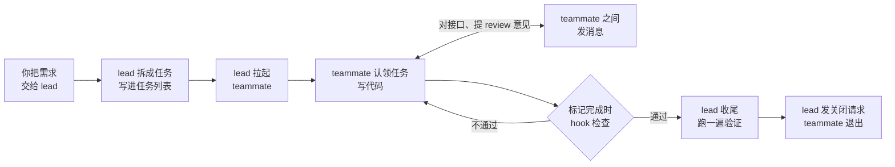
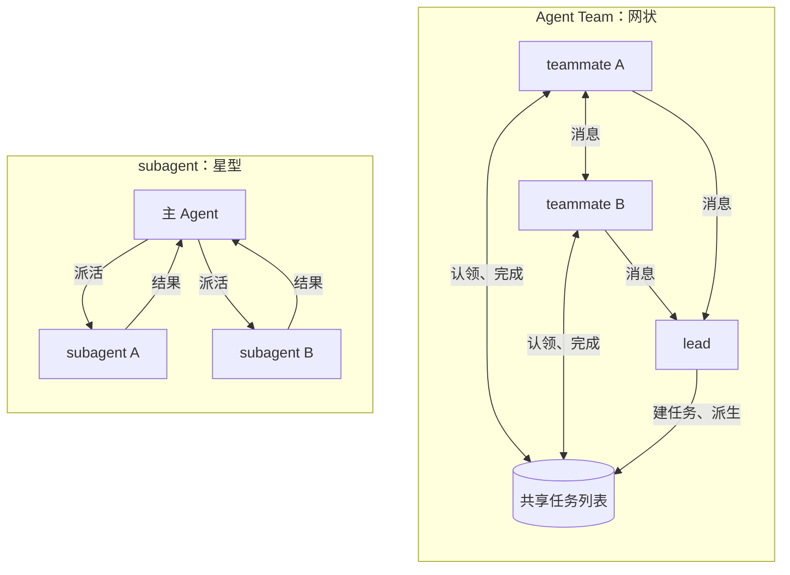
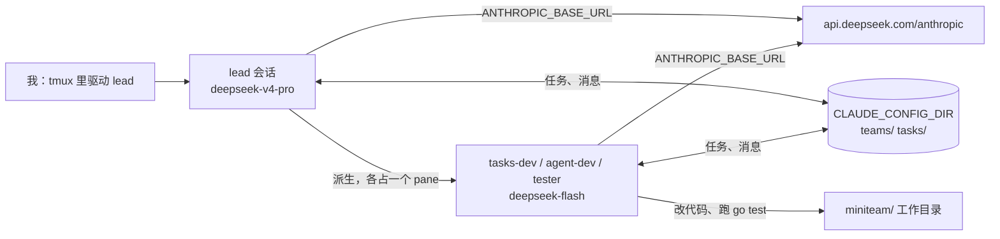
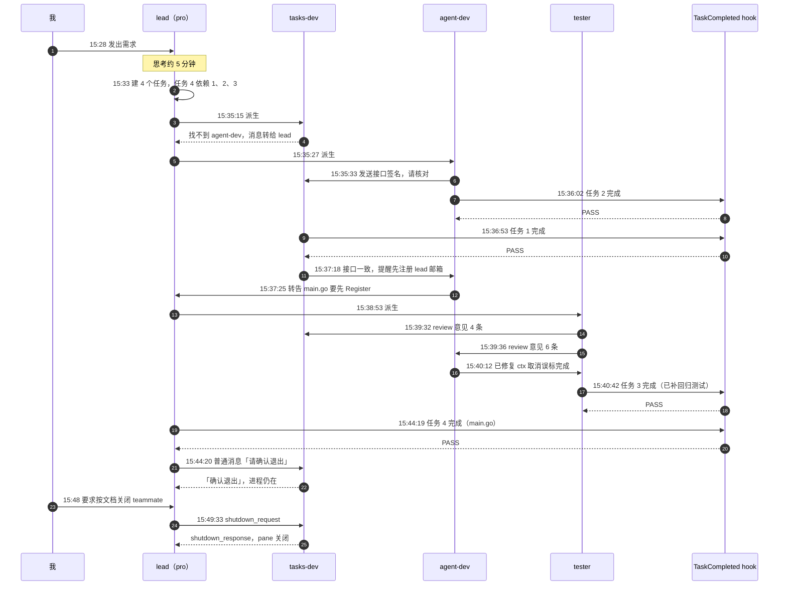
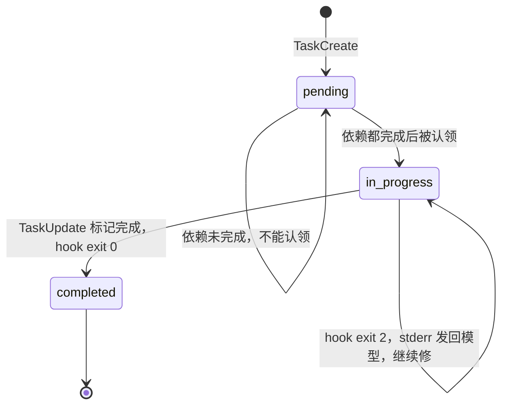
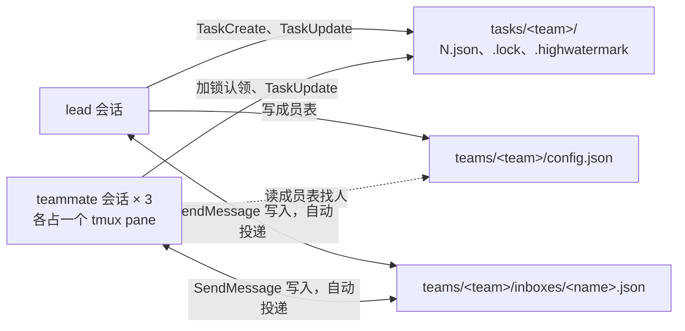
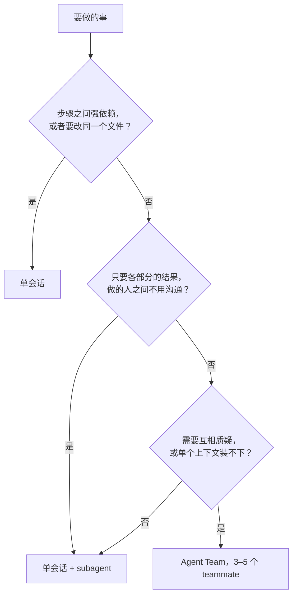
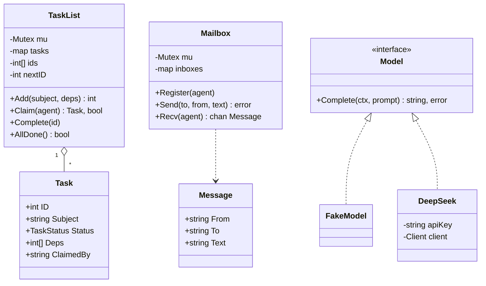
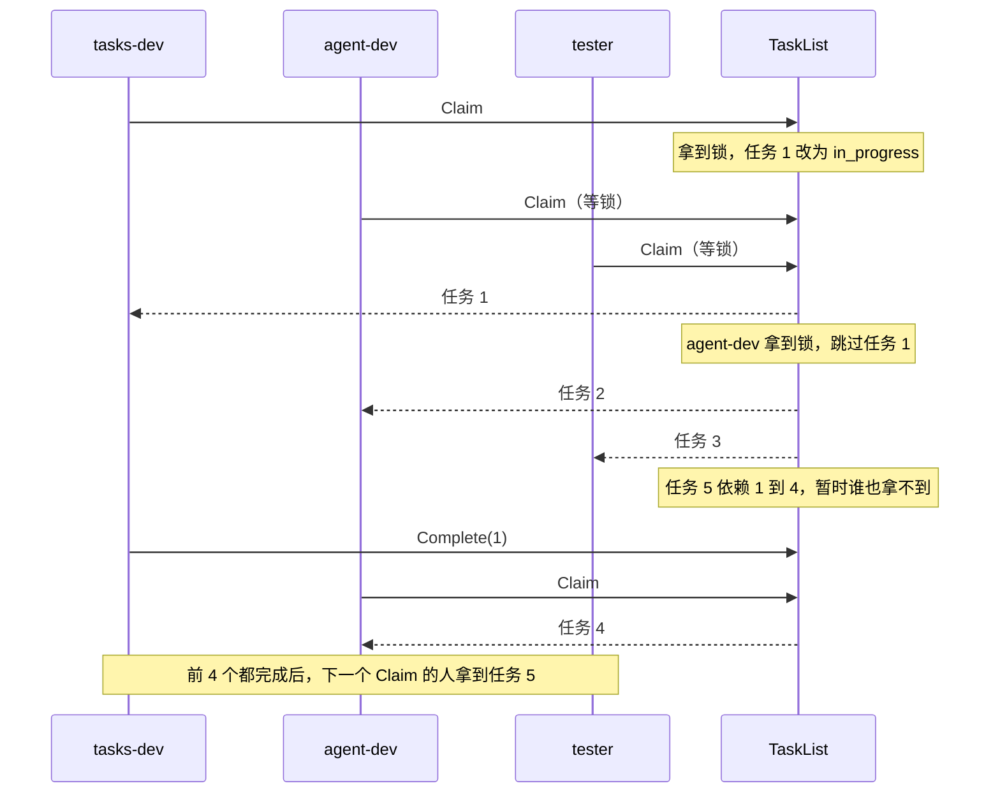

Claude Code 的 Agent Teams 能让几个 Claude Code 会话组成一个小团队。你只跟其中一个会话对话，它当负责人（lead），拆任务、拉人；被它拉起来的会话是成员（teammate），各自认领任务、写代码，遇到问题直接互相发消息。

这篇用一次实跑把整个过程走一遍：我把 Claude Code 接到 DeepSeek，让一个 lead 带三个 teammate 合写一个 600 多行的 Go 程序，再把同一份需求交给单个会话做一次，对比两边的过程、花费和代码。

先说结果。Agent Team 用了 16 分钟，按 token 用量和 DeepSeek 官方价格算约 3.55 元；单会话 4 分钟写完，约 0.48 元。两边的代码都能编译运行，但单会话的版本留着一个 bug：程序被中途取消时，它会把没做完的任务记成已完成。Team 里负责测试的 teammate 在 review 时抓到了同一个 bug，写这段代码的 teammate 改掉了它，测试的 teammate 又补了一个防止它复发的测试。即便如此，这种文件分工清楚、规模不大的活，我认为不值得开 Agent Team，理由在后文「我的判断」一节。

> Anthropic 不正式支持让 Claude Code 跑在非 Claude 模型上，Agent Teams 本身也还是实验功能。这篇记录的是一次能跑通的配置和它的毛病，不保证换个版本还是同样的行为。
{: .prompt-warning }

## 这篇适合谁

想弄明白 Agent Team 是什么、成员之间怎么分工和沟通、比一个会话多花多少钱，都可以从头读。用过 Claude Code 或别的 AI 编程工具会更容易代入，没用过也能读懂前半篇。想照着跑一遍，需要会用终端，还要有一个 DeepSeek 的 API key。Claude Code 的安装和基本用法这里不讲。

后半篇用 Go 把任务列表和邮箱重写了一遍，需要能读 Go 代码；只关心 Agent Team 怎么用的读者可以跳过。想先补一补单个 Agent 是怎么运转的，可以看本站的 [Agent Loop](/posts/agent-loop-go/) 和 [ReAct 与 Plan-and-Execute](/posts/agent-react-plan-and-execute/)。

## Agent Team 是什么

可以把它想成一个小项目组：组长接下需求，拆成任务贴到看板上；组员从看板上领任务干活，接口要对齐就私下商量，干完把任务挪到「已完成」。Agent Team 里的几样东西和项目组一一对应：

| 名称 | 相当于 | 在 Claude Code 里是什么 |
| --- | --- | --- |
| lead | 组长 | 你直接对话的那个 Claude Code 会话。它拆任务、拉起 teammate，最后收尾验收 |
| teammate | 组员 | lead 拉起来的独立 Claude Code 会话，有自己的上下文窗口，也就是模型每一轮能看到的全部对话和文件内容。本文里每个 teammate 占一个 tmux 分屏 |
| 共享任务列表 | 看板 | 磁盘上的一组 JSON 文件。每个任务记着状态（待办、进行中、已完成）、负责人和依赖，依赖没完成的任务领不了 |
| 邮箱 | 私信 | 每个成员一个收件文件。成员之间直接发消息，不用经过 lead 转达 |
| hook | 交付前的检查 | 某个事件发生时自动运行的脚本。本文把它挂在「任务标记完成」上，跑 `go vet` 和 `go test`，不通过就不让标记完成 |

一个团队从开工到解散，大致是下面这个流程，本文的实跑也按这个顺序展开：



## Agent Team 和 subagent 差在哪

Claude Code 里还有一个更早的功能叫 subagent，也是「多开几个 Agent」，两者很容易混。subagent 是主 Agent 临时派出去的帮手，干完把结果交回来就结束，帮手之间互不相识。Agent Team 里每个 teammate 都是一个完整的 Claude Code 会话，有自己的上下文窗口；它们共用一个任务列表，自己认领任务，还能直接给彼此发消息，不必经过 lead 转达。



官方文档的对比表我照搬了要点，又加了单会话一列：

| | 单会话 | subagent | Agent Team |
| --- | --- | --- | --- |
| 上下文 | 一个 | 各自独立，结果回到主会话 | 各自独立，完全分开 |
| 沟通 | 无 | 只把结果交回调用方 | teammate 之间直接发消息 |
| 协调 | 自己 | 主 Agent 统一管 | 共享任务列表加消息，自己协调 |
| 适合 | 顺序任务、改同一批文件 | 只要结果的专项任务 | 需要讨论、互相质疑的工作 |
| token 成本 | 最低 | 较低，结果会被总结后带回 | 高，每个 teammate 都是一个完整实例 |

官方推荐的场景有四类：多角度调研或 review、各自负责独立模块的新功能、带竞争假设的排障、跨前后端的改动。顺序任务、要改同一个文件的活、依赖很多的工作，官方建议用单会话或 subagent。我这次选的活属于第二类：每个 teammate 负责不同的文件，中间只有接口要对齐。

## 跟着做之前

文中的命令、配置、对话和输出都来自 2026-10-26 在 macOS 上的实跑：Claude Code v2.1.310、tmux 3.7c、Go 1.26.0。定稿那一轮跑在北京时间 15:28 到 15:50，正好是 DeepSeek 的高峰计价时段，下文的金额都按高峰价算。

有三个坑最容易踩，先列在这里，后文还会细讲：

- Claude Code 默认只给 Opus 4.7、Sonnet 4.6、Haiku 4.5 及更早的 Claude 模型提供 `TaskCreate` 这组任务工具。换成 DeepSeek 以后，lead 建不了共享任务列表，协调只能靠它派活时一次交代清楚、teammate 发消息汇报，用起来和 subagent 差不多；挂在任务完成上的 `TaskCompleted` hook 也一次都不会触发。启动前要设环境变量 `CLAUDE_CODE_ENABLE_TODO_TOOLS=1`。
- 关闭 teammate 要发专门的关闭请求。lead 用普通消息发「请确认退出」，teammate 回一句「确认退出」，进程却还在。要按官方文档的说法让 lead 去关（「Ask the ... teammate to shut down」），它才会发结构化的 `shutdown_request`，teammate 的分屏这时才关掉。
- `deepseek-v4-pro` 当 lead 时，第一轮光思考就用了 5 分钟左右，屏幕上只有一行 `Deliberating…`，余额也要过几分钟才扣。我第一次以为请求卡死了，中断后加上调试日志重跑，才看到请求一直在正常进行。

## 全景：Claude Code 怎么接到 DeepSeek

DeepSeek 提供了 Anthropic 兼容接口 `https://api.deepseek.com/anthropic`，Claude Code 只要把 `ANTHROPIC_BASE_URL` 指过去，再把几个模型别名映射到 DeepSeek 的模型名就行。



lead 用 pro、teammate 用 flash，这是照着 Anthropic「teammate 用便宜模型」的建议做的对应：lead 要拆任务、做协调，teammate 只写自己那几个文件。DeepSeek 官方给 Claude Code 的配置更省钱，所有槽位都用 `deepseek-flash`，想压成本可以直接照抄它。

两个模型当天的价格（人民币，每百万 token，高峰价；北京时间工作日 9–12 点、14–18 点为高峰，其余时段半价）：

| 模型 | 输入（缓存命中） | 输入（未命中） | 输出 |
| --- | --- | --- | --- |
| `deepseek-flash`（V4.1-Flash-1017） | 0.04 元 | 2 元 | 8 元 |
| `deepseek-v4-pro`（V4-Pro-0813） | 0.30 元 | 9 元 | 27 元 |

## 准备：一个和日常环境隔开的 Claude Code

我平时的 `~/.claude` 里装了一堆插件和 hook，混进演示会让 teammate 的行为不好解释。所以这次用 `CLAUDE_CONFIG_DIR` 指向一个单独的目录，里面只放这次要用的配置。下文为了好读，把这个目录写成 `~/agent-team-demo`（实际跑的是一个临时目录下的绝对路径，hook 的 `command` 也写的是绝对路径）；它在这里的角色，就是平时的 `~/.claude`。

目录结构：

```text
~/agent-team-demo/
├── .env                      # DEEPSEEK_API_KEY=sk-...
├── run.sh                    # 启动脚本
├── config/                   # CLAUDE_CONFIG_DIR
│   └── settings.json
├── hooks/
│   └── task-completed.sh
└── miniteam/                 # 工作目录，事先 go mod init miniteam
```

### 启动脚本

```bash
#!/bin/bash
set -a; source ~/agent-team-demo/.env; set +a
AT=$(cd "$(dirname "$0")" && pwd)
export CLAUDE_CONFIG_DIR=$AT/config
export ANTHROPIC_BASE_URL=https://api.deepseek.com/anthropic
export ANTHROPIC_AUTH_TOKEN=$DEEPSEEK_API_KEY
export ANTHROPIC_MODEL='deepseek-v4-pro[1m]'
export ANTHROPIC_DEFAULT_OPUS_MODEL='deepseek-v4-pro[1m]'
export ANTHROPIC_DEFAULT_SONNET_MODEL='deepseek-flash[1m]'
export ANTHROPIC_DEFAULT_HAIKU_MODEL=deepseek-flash
export CLAUDE_CODE_SUBAGENT_MODEL=deepseek-flash
export CLAUDE_CODE_SUBAGENT_MODEL_FORCE=1
export CLAUDE_CODE_ENABLE_TODO_TOOLS=1
unset ANTHROPIC_API_KEY TMUX
cd "$AT/miniteam"
tmux -L agentteam new-session -d -s agentteam -x 240 -y 60 claude "$@"
```

几行值得解释：

- `ANTHROPIC_AUTH_TOKEN` 放 DeepSeek 的 key，同时 `unset ANTHROPIC_API_KEY`，免得 Claude Code 拿错凭据。
- 带 `[1m]` 后缀的模型名是照 DeepSeek 文档写的，表示用 1M 上下文。
- `CLAUDE_CODE_SUBAGENT_MODEL_FORCE=1` 让所有 teammate 都用 `CLAUDE_CODE_SUBAGENT_MODEL`，不管 lead 在派生时点了哪个模型。不加的话，lead 在 spawn prompt 里写一句「用 opus」，teammate 就会被映射到 pro。
- `CLAUDE_CODE_ENABLE_TODO_TOOLS=1` 是探索时踩坑以后加上的，后面「踩过的坑」一节细说。
- 用 `tmux -L agentteam` 起一个独立的 tmux server。tmux server 会继承这个 shell 的环境变量，lead 后面再开 pane 派生 teammate 时，teammate 也就拿到了同一套 DeepSeek 配置。
- `"$@"` 用来透传参数，我排查问题时传过 `--debug-file`。

### settings.json

```json
{
  "env": {
    "CLAUDE_CODE_EXPERIMENTAL_AGENT_TEAMS": "1"
  },
  "permissions": {
    "allow": [
      "Bash(go build *)",
      "Bash(go test *)",
      "Bash(go vet *)",
      "Bash(go run *)",
      "Bash(gofmt *)",
      "Bash(go version)",
      "Bash(ls *)",
      "Bash(echo *)",
      "Bash(head *)",
      "Bash(tail *)",
      "Bash(grep *)"
    ],
    "defaultMode": "acceptEdits"
  },
  "hooks": {
    "TaskCompleted": [
      {
        "hooks": [
          {
            "type": "command",
            "command": "~/agent-team-demo/hooks/task-completed.sh"
          }
        ]
      }
    ]
  },
  "teammateMode": "tmux"
}
```

`CLAUDE_CODE_EXPERIMENTAL_AGENT_TEAMS=1` 是开关，不设它就不会建团队。`teammateMode: "tmux"` 让每个 teammate 占一个 tmux pane，我能用 `tmux capture-pane` 把每个 pane 的原文抓下来；默认的 `in-process` 模式把 teammate 都塞在主终端里，一次只能看一个。

权限给的是 `acceptEdits` 加一份 Bash 白名单。teammate 继承 lead 的权限模式，它们要跑白名单以外的命令时，审批请求会弹到 lead 的会话里，由我来批。白名单里那几个 `echo`、`ls`、`tail` 是探索时加的：模型很爱写 `go vet ./...; echo "exit: $?"` 这种复合命令，复合命令要每一段都在白名单里才免审批，只放 `go` 相关的命令会一直弹窗。

全新的配置目录会让 Claude Code 走一遍首次引导，还要确认是否信任工作目录。我事先在 `config/.claude.json` 里写了 `hasCompletedOnboarding` 和这个目录的 `hasTrustDialogAccepted`，跳过了这两步。启动后它还会问一次要不要把 auto mode 设成默认，我选了 No，保持 accept edits。

## 交给 lead 的需求

下面是我发给 lead 的原文，规格是事先定好的：单个 main 包、只用标准库、三个 teammate 各管各的文件。

```markdown
建一个 agent team，在当前目录（Go module `miniteam`，已 go mod init）写一个迷你版的 agent team：一个 lead 加若干 teammate goroutine，共享任务列表，互相发消息。只用 Go 标准库，单个 main 包。

文件和负责人（每人只改自己的文件，不碰别人的）：

- teammate `tasks-dev`：`tasks.go`、`mailbox.go`
  - `TaskList`：`Add(subject string, deps ...int) int`、`Claim(agent string) (Task, bool)`、`Complete(id int)`、`AllDone() bool`。任务三种状态 pending / in_progress / completed；依赖没完成的任务不能认领；mutex 保护，同一任务只能被认领一次。
  - `Mailbox`：每个 agent 一个带缓冲的 channel，`Send(to, from, text string) error`、`Recv(agent string) <-chan Message`。
- teammate `agent-dev`：`model.go`、`agent.go`
  - `Model` 接口：`Complete(ctx context.Context, prompt string) (string, error)`。两个实现：`FakeModel`（默认，不联网，随机等待 50–200ms 模拟模型延迟，再按 prompt 拼一句固定格式的回答）和 `DeepSeek`（读环境变量 `DEEPSEEK_API_KEY`，POST `https://api.deepseek.com/anthropic/v1/messages`，Anthropic Messages 格式，header `x-api-key` 和 `anthropic-version: 2023-06-01`，模型 `deepseek-flash`，超时 60 秒）。
  - `RunTeammate(ctx, name, *TaskList, *Mailbox, Model)`：循环 认领任务 → 调模型 → 把结果发消息给 lead → 标记完成；没有可认领的任务且全部完成时退出。
- teammate `tester`：`tasks_test.go`
  - 至少一个并发测试：多个 goroutine 同时 Claim 同一批任务，断言每个任务只被认领一次；再测依赖未完成时不能认领。必须能过 `go test -race ./...`。
  - 写完测试后 review `tasks.go` 和 `agent.go`，把发现的问题用消息直接发给对应负责人，不要自己改他们的文件。

接口细节由 `tasks-dev` 和 `agent-dev` 直接发消息商量，定下来再写。所有人用中文回复和发消息。

你（lead）先用共享任务列表给每个 teammate 建任务（`main.go` 那条任务依赖其余任务），再派生这三个 teammate，等他们的任务都完成后再写 `main.go`：建 5 个任务（其中第 5 个依赖前 4 个）、起 3 个 teammate goroutine、从 lead 的邮箱收消息打印出来、全部完成后输出一行汇总。命令行参数 `-model fake|deepseek`，默认 fake。

最后跑 `go vet ./...`、`go test -race ./...`、`go run .` 确认通过，然后逐个向三个 teammate 发关闭请求，等它们确认退出。
```

最后两段是探索之后改过的：明确要求先建共享任务列表、所有人用中文交流、FakeModel 带随机延迟、用关闭请求收尾。为什么要改，见「踩过的坑」。

## 实跑：16 分钟里发生了什么

### lead 先想了 5 分钟

15:28:32 发出需求。lead 的屏幕上只有一行 `Deliberating…`，过了很久才出现第一个工具调用。事后看界面，它先 `Thought for 4m 45s`，又看了一眼目录、确认 go 版本，15:33:53 才开始建任务：

- 任务 1：实现 `tasks.go` 和 `mailbox.go`
- 任务 2：实现 `model.go` 和 `agent.go`
- 任务 3：实现 `tasks_test.go` 并 review
- 任务 4：实现 `main.go`，被 1、2、3 阻塞

任务存在 `config/tasks/session-403ac496/` 下面，一个任务一个 JSON 文件。这是任务 4 刚建好时的样子：

```json
{
  "id": "4",
  "subject": "实现 main.go",
  "description": "负责文件：main.go（lead 负责）。建 5 个任务（第 5 个依赖前 4 个）、起 3 个 teammate goroutine、从 lead 邮箱收消息打印、全部完成后输出一行汇总；命令行参数 -model fake|deepseek（默认 fake）。依赖 #1、#2、#3 完成。",
  "activeForm": "实现 main.go",
  "status": "pending",
  "blocks": [],
  "blockedBy": [
    "1",
    "2",
    "3"
  ]
}
```

`blockedBy` 和 `blocks` 是双向的。任务 2 完成后，文件变成这样，多了 `owner`，状态变成 `completed`：

```json
{
  "id": "2",
  "subject": "实现 model.go 和 agent.go",
  "description": "负责文件：model.go、agent.go（只改这两个）。实现 Model 接口（Complete(ctx, prompt) (string, error)）、FakeModel（默认、不联网、随机 50–200ms 延迟 + 固定格式回答）、DeepSeek（读 DEEPSEEK_API_KEY，POST https://api.deepseek.com/anthropic/v1/messages，Anthropic Messages 格式，header x-api-key + anthropic-version: 2023-06-01，模型 deepseek-flash，超时 60s）、RunTeammate(ctx, name, *TaskList, *Mailbox, Model)（循环认领→调模型→发消息给 lead→标记完成；无可认领且全部完成时退出）。",
  "activeForm": "实现 model.go 和 agent.go",
  "status": "completed",
  "blocks": [
    "4"
  ],
  "blockedBy": [],
  "owner": "agent-dev"
}
```

### 派生、审批和第一个竞态

15:35:15 lead 派生 `tasks-dev`，12 秒后派生 `agent-dev`。tester 等到 15:38:53 才派生，lead 想让前两个先把代码写出来。

`tasks-dev` 一启动就去找 `agent-dev` 核对接口，可那时 `agent-dev` 还没被派生出来。它调 `ListAgents` 只看到 `team-lead` 和一个叫 `miniteam-47` 的本机会话（后来查到就是 lead 自己所在的 tmux pane），发给 `agent-dev` 的消息没送达，它就往另外两处各发了一条，然后按 lead 给的契约直接开写。lead 收到后把接口说明转给了 `agent-dev`。派生有先后，先起来的 teammate 找不到后起来的，这种情况 spawn prompt 里最好提前交代一句。

几乎同时，`tasks-dev` 想跑 `mkdir -p /tmp/tasksdev-check && cp tasks.go mailbox.go /tmp/tasksdev-check/`，把文件拷到项目外面单独编译。这条命令不在白名单里，审批弹到了 lead 的界面上，teammate 那边显示 `Waiting for team lead approval`。它要往项目外写文件，我拒了。被拒之后它换成在项目目录里直接 `go build ./...`。


这张图和下面两张，是我把定稿运行时每个 pane 的 `tmux capture-pane -e` 输出按原布局拼起来再截图得到的，内容没改过。

### 两个 teammate 自己对接口

`agent-dev` 15:35:33 给 `tasks-dev` 发了一份它打算引用的签名清单，15:36:02 就把任务 2 标成了完成。`tasks-dev` 15:36:53 完成任务 1，然后回消息确认接口一致，顺带提醒了一件事：

> 确认一致，无任何差异。tasks.go 和 mailbox.go 已写完并 gofmt，go build 仅剩预期的“main 未声明”错误，与你的 model.go/agent.go 类型自洽。补充一点：agent.go 向 "lead" 调用 mb.Send 时，main.go 需先 mb.Register("lead") 或 Recv 一次，否则 Send 返回未注册错误（当前 agent.go 忽略该错误）。

`agent-dev` 回复说这是 `main.go` 的职责，并把这条提醒同步给了 lead。lead 后来写 `main.go` 时，第一件事就是 `mb.Register("lead")`。这是整个过程中我最想看到的一幕：一个集成风险在两个负责人之间被发现，然后交到了该处理它的人手里，我没有插手。

### tester 的 review 抓到一个真 bug

tester 15:39:07 写完测试，跑通 `go test -race` 以后开始 review，15:39:32 和 15:39:36 分别给 `tasks-dev` 发了 4 条意见、给 `agent-dev` 发了 6 条。给 `agent-dev` 的第一条是这样写的：

> 1) 【较严重】ctx 取消后仍把任务标记为完成
> agent.go:26-32：模型调用返回错误时仍然执行 `tl.Complete(task.ID)`。当 ctx 被取消时，m.Complete(ctx,...) 返回 ctx.Err()，代码走 error 分支后照样 Complete，把根本没做完的任务标成 Completed，然后循环顶部才因 ctx.Err() 退出。建议：错误时不要 Complete（至少 ctx.Err()!=nil 时绝不 Complete）。

`agent-dev` 15:39:58 改了 `agent.go`，tester 15:40:27 在测试文件里加了 `TestRunTeammateCancellationDoesNotCompleteTask`，复核通过后才把任务 3 标成完成。`tasks-dev` 采纳了性能意见：`Claim` 原来每次都对任务 ID 排序，改成维护一个有序切片，复杂度从 O(n log n) 降到 O(n)；另外几条涉及接口契约的（任务卡在 InProgress 怎么回收、`Send` 会阻塞），它和 `agent-dev` 都表示留给 lead 裁定。

并行改代码也露出了一个小问题。`tasks-dev` 改 `tasks.go` 的那几秒里，`agent-dev` 正好在跑测试，看到了 `undefined: sort`，那是 `tasks-dev` 改到一半的中间状态。tester 后来专门发消息解释了这件事。各管各的文件，也挡不住编译时互相看到对方改了一半的代码。


### lead 收尾，以及一次假关闭

15:42:18 lead 开始写 `main.go`，15:44:19 标记任务 4 完成。我的 hook 在每次标记完成前跑 `go vet` 和 `go test -race`，四个任务都是一次通过：

```text
15:36:02 PASS [agent-dev] 实现 model.go 和 agent.go
15:36:53 PASS [tasks-dev] 实现 tasks.go 和 mailbox.go
15:40:44 PASS [tester] 实现 tasks_test.go 并 review
15:44:19 PASS [lead] 实现 main.go
```

需求最后一句要求「逐个向三个 teammate 发关闭请求，等它们确认退出」。lead 在 15:44:20 给三个人各发了一条普通消息，内容是「关闭请求：所有任务已完成并验证通过……请确认退出」。三个 teammate 都回了「确认退出」，lead 随即报告「三者均已确认退出」。可 tmux 里三个 pane 都还在，进程也都活着。

我照官方文档的写法补了一句 `Ask the tasks-dev, agent-dev and tester teammates to shut down`。lead 想了 1 分 29 秒，自己意识到了问题：「三个 teammate 之前只是『确认退出』，进程仍作为 pane 存续。现在用正式的 shutdown_request 让它们真正关闭。」这次它发的是结构化消息：

```json
{"to":"tasks-dev","message":{"type":"shutdown_request","reason":"所有任务已完成并验证通过，请关闭"},"type":"shutdown_request","recipient":"tasks-dev","recipient_kind":"name","content":"所有任务已完成并验证通过，请关闭"}
```

三个 teammate 在 3 秒内回了 `shutdown_response`，pane 随之关闭。


### 时间线

把四个会话 transcript 里的工具调用按时间排起来，就是下面这张图（北京时间）：



图里只画了 `tasks-dev` 的关闭往返，另外两个 teammate 同时进行，过程一样。

## 用 TaskCompleted hook 把关

`TaskCompleted` 在任务被标记为完成时触发，有两种情况：某个 Agent 通过 `TaskUpdate` 把任务改成 completed，或者 teammate 结束本轮时手里还有进行中的任务。hook 以 exit 2 退出，任务就不会被标记完成，stderr 的内容会作为反馈发回给模型。

我的 hook 脚本：

```bash
#!/bin/bash
INPUT=$(cat)
SUBJECT=$(echo "$INPUT" | jq -r '.task_subject')
WHO=$(echo "$INPUT" | jq -r '.teammate_name // "lead"')
LOG="$(dirname "$0")/../logs/hooks.log"
cd "$CLAUDE_PROJECT_DIR" || exit 1

if ! ls *.go >/dev/null 2>&1; then
  echo "$(date +%T) PASS(no go files) [$WHO] $SUBJECT" >> "$LOG"
  exit 0
fi

if ! OUT=$(go vet ./... 2>&1 && go test -race ./... 2>&1); then
  echo "$(date +%T) BLOCK [$WHO] $SUBJECT" >> "$LOG"
  echo "go vet / go test -race 没通过，修好再标记完成：$SUBJECT" >&2
  echo "$OUT" | tail -n 30 >&2
  exit 2
fi

echo "$(date +%T) PASS [$WHO] $SUBJECT" >> "$LOG"
exit 0
```

写日志那几行只是为了事后画时序图。hook 的输入里，`teammate_name` 在 lead 自己完成任务时是空的，所以脚本里给了个默认值 `lead`。

一个任务从创建到完成会经过这些状态：



定稿那一轮四次都直接 PASS，拦截那条路径没有走到。我在工作目录里放了一个编译不过的文件，手动喂给 hook 验证过：

```text
$ printf 'package main\nfunc broken() { return 1 }\n' > zz_broken.go
$ echo '{"task_subject":"demo fail","teammate_name":"tester"}' | CLAUDE_PROJECT_DIR=$PWD ../hooks/task-completed.sh; echo "exit=$?"
go vet / go test -race 没通过，修好再标记完成：demo fail
# miniteam
# [miniteam]
vet: ./zz_broken.go:2:24: too many return values
	have (number)
	want ()
exit=2
```

这个 hook 有个前提容易忽略：它只在任务列表存在时才有用。探索那一轮没有任务列表，它一次都没被调用。

## 磁盘上的团队

团队名是 `session-` 加会话 ID 的前 8 位，这次是 `session-403ac496`。运行中能看到这些文件：

```text
config/
├── teams/session-403ac496/
│   ├── config.json              # members 数组：名字、agent ID、tmux pane 等运行时状态
│   └── inboxes/
│       ├── team-lead.json
│       ├── tasks-dev.json
│       ├── agent-dev.json
│       └── tester.json
└── tasks/session-403ac496/
    ├── 1.json … 4.json
    ├── .highwatermark            # 内容是 4，已分配的最大任务 ID
    └── .lock                     # 空文件，认领任务时加文件锁用
```



几处和我预想的不一样：

- 邮箱文件我每次看都是 `[]`。消息投递以后就从文件里清掉了，想回看对话只能去翻 transcript。
- 四个任务全部完成后不到半分钟，`1.json` 到 `4.json` 就被删了，目录里只剩 `.highwatermark` 和 `.lock`。文档说任务目录在会话结束后会保留，目录确实还在，里面的任务文件没了。要留档的话，得在跑的过程中自己复制出来。
- lead 退出时整个 `teams/session-403ac496/` 被删掉了，`tasks/` 下的目录留着。
- 三个 teammate 关闭以后，`config.json` 的 `members` 里只剩 lead 一条，`tmuxPaneId` 是 `leader`。

## 踩过的坑：探索那一轮

定稿之前我先完整跑过一轮，需求只有几处不同。那一轮暴露的问题，就是前面那几处修改的来由。

### 没有任务列表

lead 自始至终没有调用 `TaskCreate`，任务目录一直是空的，hook 也没触发。查了 [工具文档](https://code.claude.com/docs/en/tools-reference#task-tool-availability) 才知道，Task 那组工具默认只给 Opus 4.7、Sonnet 4.6、Haiku 4.5 及更早的模型，Claude Code 不认识的模型名一律不给。三个 teammate 照样写完了代码，协调全靠 lead 在 spawn prompt 里分配、teammate 发消息汇报，看起来和 subagent 区别不大。加上 `CLAUDE_CODE_ENABLE_TODO_TOOLS=1` 以后，任务列表和依赖才出现。

### lead 看起来卡死了

第一次发出需求后，lead 的界面停在 `Deliberating…` 六分钟左右，这期间我查了两次余额，一分没动。我用 curl 直接测 DeepSeek 的接口，流式输出正常，于是中断了它，换成 `--debug-file` 重启。第二次能看到 `Stream started - received first chunk`，请求确实在跑；那一轮 lead 输出了 20,766 个 token，API 耗时 357 秒，几乎全是思考。余额是过了几分钟才开始扣的，第一次那个请求多半也一直在思考，只是被我中断了。

### 接口被 lead 写死了

需求说「接口细节由 tasks-dev 和 agent-dev 直接发消息商量」，lead 却在两个人的 spawn prompt 里放了一模一样的完整契约，两个 teammate 从头到尾只和 lead 说话。代码一次就编译通过了，可我想看的 teammate 互发消息一条也没有。定稿那一轮有了任务列表，teammate 之间才开始直接对话。我没法确定是哪处改动起的作用，两处是一起改的。

### 一个 teammate 包揽全部任务

那一轮的 FakeModel 立即返回，`go run .` 的 5 个任务全被 `teammate-1` 抢走了，看不出任何并发。加上 50–200ms 的随机延迟以后，任务才分散到三个 goroutine 上。

### review 意见和 teammate 的语言

需求要求 tester 把问题直接发给负责人，它发给了 lead，由 lead 转达。

那一轮的 teammate 还全程说英文，需求明明是中文写的。定稿时在需求里加了「所有人用中文回复和发消息」。

## 花了多少钱：和单会话比

为了核对「Agent Team 更费 token」到底费多少，我用同一份规格又跑了一次单会话：关掉 Agent Teams，只用 `deepseek-v4-pro`，需求里把三个 teammate 的分工改成「你一个人完成」。token 数取自各会话 transcript 里每次 API 响应的 `usage`，金额按上面的高峰价算：

| | Agent Team | 单会话 |
| --- | --- | --- |
| 模型 | lead `deepseek-v4-pro` + 3 个 `deepseek-flash` | `deepseek-v4-pro` |
| 从需求到代码写完 | 16 分钟（算上正式关闭 21 分钟） | 4 分钟 |
| 输入，未命中缓存 | 157,102 | 14,321 |
| 输入，缓存命中 | 4,576,896 | 85,248 |
| 输出 | 114,327 | 11,954 |
| 估算费用 | 3.55 元（lead 2.85 元，3 个 teammate 共 0.71 元） | 0.48 元 |
| 代码 | 648 行，3 个测试 | 460 行，2 个测试 |
| ctx 取消时误标完成 | review 发现，已修复并加回归测试 | 存在 |

估算没算 Claude Code 生成会话标题这类零星的 flash 调用，量很小。账户余额从 97.74 元降到 90.99 元，探索、定稿、单会话三次运行合计 6.75 元，扣掉后两次的估算，探索那一轮约 2.7 元。DeepSeek 扣费有几分钟延迟，单次运行的花费我没法靠余额差额算准，所以表里用的是估算。

lead 会话里 `/cost` 显示 `$2.82`，那是按 Claude 的价格估的，它自己也注明了 `costs may be inaccurate due to usage of unknown models`。split-pane 模式下 teammate 是独立进程，用量也不算在 lead 的 `/cost` 里。

官方 [成本文档](https://code.claude.com/docs/en/costs#manage-agent-team-costs) 有一句「teammate 在 plan mode 下运行时，Agent Team 大约比标准会话多用 7 倍 token」。我这次的费用比是 3.55 ÷ 0.48 ≈ 7.4 倍，碰巧接近；按 token 算，未命中缓存的输入加输出是 10.3 倍，算上缓存命中是 43 倍。条件也不一样：我没开 plan mode，teammate 用的是更便宜的模型，而且只跑了一次。这个数只能说明，在这种规模的任务上，差距是数倍量级。

钱之外，Agent Team 多花的时间主要在两处：lead 开局思考 5 分钟，tester 要等前两个人写完才派生。写代码的那几段，三个 teammate 是并行的，每个都只用了一两分钟。

## 我的判断：这类活不值得开 Agent Team

这次的活是 600 行左右、文件边界清楚的代码，我不会再为它开 Agent Team。单会话 4 分钟写完，再派一个 subagent 专门做 review，大概率也能抓到那个 ctx 取消的 bug，总花费应该还在 1 元以内（这是我的推断，没有实跑）。Team 这次多给我的是 review 和 teammate 之间的对话，这两样不必非得靠一个团队来拿。

我会改主意的情况：teammate 之间要反复讨论，彼此的结论需要被对方质疑（比如几个人各拿一个假设查一个 bug），或者改动横跨几层、每层都要读很多上下文，单个会话的窗口装不下。



## 拆开看：Go 版迷你 Agent Team

团队写出来的 `miniteam` 正好是 Agent Team 机制的一个缩小版：任务列表换成内存里加锁的 map，邮箱换成带缓冲的 channel，teammate 换成 goroutine。下面的代码都是团队的产出，我没有改动，只在讲解时指出它的毛病。

### 结构



`RunTeammate` 是一个函数，把这三样东西串起来：从 `TaskList` 认领，调 `Model`，往 `Mailbox` 发结果，再回 `TaskList` 标记完成。

和 Claude Code 的对照：

| Claude Code | miniteam | 差别 |
| --- | --- | --- |
| `tasks/<team>/N.json` | `TaskList.tasks` | 一个落盘、跨进程，一个只在内存里 |
| `.lock` 文件锁 | `sync.Mutex` | 进程之间要靠文件锁，同一进程里一把 mutex 就够 |
| `.highwatermark` | `nextID` | 都是递增的 ID 计数器 |
| `blockedBy` / `blocks` | `Deps` | miniteam 只存单向依赖，每次认领时现查 |
| `inboxes/<name>.json` | `map[string]chan Message` | Claude Code 写文件后自动投递，miniteam 靠 channel |
| teammate 是独立的 Claude Code 进程 | teammate 是 goroutine | |
| 依赖完成后自动解锁，并推送空闲通知 | 每 5ms 轮询一次 `Claim` | 后面会讲轮询的代价 |
| `shutdown_request` / `shutdown_response` | `AllDone()` 后自行退出，或 ctx 取消 | miniteam 没有关闭协议 |

### 任务列表：tasks.go

```go
package main

import "sync"

// TaskStatus 表示任务的生命周期状态。
type TaskStatus int

const (
	// Pending 表示任务尚未被认领。
	Pending TaskStatus = iota
	// InProgress 表示任务已被某个 agent 认领。
	InProgress
	// Completed 表示任务已完成。
	Completed
)

// String 返回状态的可读名称。
func (s TaskStatus) String() string {
	switch s {
	case Pending:
		return "pending"
	case InProgress:
		return "in_progress"
	case Completed:
		return "completed"
	default:
		return "unknown"
	}
}

// Task 是一个可被 agent 认领的工作项。
type Task struct {
	ID        int
	Subject   string
	Status    TaskStatus
	Deps      []int
	ClaimedBy string
}

// TaskList 是并发安全的任务列表。
// 必须通过 NewTaskList 构造；零值不可直接使用（内部 map 未初始化）。
// 不变式：tasks 与 ids 同步，且任务只增不删；若将来支持删除/Release，需同时维护 ids。
type TaskList struct {
	mu     sync.Mutex
	tasks  map[int]*Task
	ids    []int // 按添加顺序（即 ID 升序）保存的任务 ID，无删除操作，故始终有序
	nextID int
}

// NewTaskList 创建一个空的任务列表。
func NewTaskList() *TaskList {
	return &TaskList{
		tasks:  make(map[int]*Task),
		nextID: 1,
	}
}

// Add 添加一个任务并返回其 ID。deps 为依赖任务的 ID 列表。
// 调用方应确保 deps 中的 ID 已经存在：不存在（或永远不会被添加）的依赖
// 会使该任务一直不可认领，进而让 AllDone 一直为 false。
func (tl *TaskList) Add(subject string, deps ...int) int {
	tl.mu.Lock()
	defer tl.mu.Unlock()

	id := tl.nextID
	tl.nextID++

	depsCopy := make([]int, len(deps))
	copy(depsCopy, deps)

	tl.tasks[id] = &Task{
		ID:      id,
		Subject: subject,
		Status:  Pending,
		Deps:    depsCopy,
	}
	tl.ids = append(tl.ids, id)
	return id
}

// Claim 按 ID 升序查找第一个可认领的任务：状态为 Pending 且所有依赖均已完成。
// 认领成功后任务置为 InProgress 并记录 agent。没有可认领任务时返回 (Task{}, false)。
// 检查依赖和更新状态在同一把锁内完成，保证并发下同一任务只会被认领一次。
func (tl *TaskList) Claim(agent string) (Task, bool) {
	tl.mu.Lock()
	defer tl.mu.Unlock()

	// tl.ids 按 ID 升序保存，直接遍历即可保证升序认领。
	for _, id := range tl.ids {
		t := tl.tasks[id]
		if t.Status != Pending {
			continue
		}
		if !tl.depsCompletedLocked(t) {
			continue
		}

		t.Status = InProgress
		t.ClaimedBy = agent

		claimed := *t
		claimed.Deps = append([]int(nil), t.Deps...)
		return claimed, true
	}

	return Task{}, false
}

// depsCompletedLocked 判断任务的所有依赖是否都已完成。调用者必须持有 tl.mu。
func (tl *TaskList) depsCompletedLocked(t *Task) bool {
	for _, depID := range t.Deps {
		dep, ok := tl.tasks[depID]
		if !ok || dep.Status != Completed {
			return false
		}
	}
	return true
}

// Complete 将指定任务标记为已完成。
// id 不存在时静默忽略；本方法不做状态流转或认领者校验，
// 由调用方（如 RunTeammate）保证只完成自己认领的任务。
func (tl *TaskList) Complete(id int) {
	tl.mu.Lock()
	defer tl.mu.Unlock()

	if t, ok := tl.tasks[id]; ok {
		t.Status = Completed
	}
}

// AllDone 报告是否所有任务都已完成。空任务列表视为已完成（真空真）；
// 存在 InProgress 任务时返回 false。
func (tl *TaskList) AllDone() bool {
	tl.mu.Lock()
	defer tl.mu.Unlock()

	for _, id := range tl.ids {
		if tl.tasks[id].Status != Completed {
			return false
		}
	}
	return true
}
```

认领的关键在 `Claim`：检查依赖和改状态在同一把锁里完成，所以两个 goroutine 不可能同时拿到同一个任务。返回的是任务的副本，`Deps` 也复制了一份，调用方改不到列表内部。`ids` 切片是 review 之后加的，原来的写法每次 `Claim` 都要把 map 的 key 排一遍序。

三个 goroutine 抢同一批任务时是这样的：



### 邮箱：mailbox.go

```go
package main

import (
	"fmt"
	"sync"
)

// mailboxCapacity 是每个 agent 收件箱的缓冲容量。
const mailboxCapacity = 64

// Message 是 agent 之间传递的一条消息。
type Message struct {
	From string
	To   string
	Text string
}

// Mailbox 为每个 agent 维护一个有缓冲的收件箱，并发安全。
type Mailbox struct {
	mu      sync.Mutex
	inboxes map[string]chan Message
}

// NewMailbox 创建一个空的邮箱。
func NewMailbox() *Mailbox {
	return &Mailbox{
		inboxes: make(map[string]chan Message),
	}
}

// Register 预创建 agent 的收件箱。重复注册是幂等的。
func (mb *Mailbox) Register(agent string) {
	mb.mu.Lock()
	defer mb.mu.Unlock()

	if _, ok := mb.inboxes[agent]; !ok {
		mb.inboxes[agent] = make(chan Message, mailboxCapacity)
	}
}

// Send 向 to 的收件箱写入一条消息。若 to 尚未注册则返回错误。
// 写入可能阻塞，因此发送时不能持有 mb.mu，否则会与 Recv/Register 死锁。
func (mb *Mailbox) Send(to, from, text string) error {
	mb.mu.Lock()
	ch, ok := mb.inboxes[to]
	mb.mu.Unlock()

	if !ok {
		return fmt.Errorf("mailbox: agent %q is not registered", to)
	}

	ch <- Message{From: from, To: to, Text: text}
	return nil
}

// Recv 返回 agent 的只读收件箱。若 agent 尚未注册则自动创建。
func (mb *Mailbox) Recv(agent string) <-chan Message {
	mb.mu.Lock()
	defer mb.mu.Unlock()

	ch, ok := mb.inboxes[agent]
	if !ok {
		ch = make(chan Message, mailboxCapacity)
		mb.inboxes[agent] = ch
	}
	return ch
}
```

`Send` 先在锁里取出 channel，放锁以后再写入。如果持锁写 channel，一旦邮箱写满，`Send` 会一直占着锁，`Recv` 和 `Register` 就都进不来了。tester 的 review 专门确认过这一点。

它的问题是 `Send` 在邮箱满了以后会一直阻塞，而且不看 ctx。lead 如果不再读邮箱，第 65 条消息会把 teammate 永远卡住。另一个问题是 `Send` 要求收件人先注册，`Recv` 却会自动创建，两边语义不一致，`main.go` 必须先 `Register("lead")` 就是这么来的。

### teammate 循环：agent.go

```go
package main

import (
	"context"
	"fmt"
	"time"
)

const (
	// leadName 是队友汇报任务结果的收件人。
	leadName = "lead"
	// idlePollDelay 是无任务可领且尚未全部完成时的轮询间隔。
	idlePollDelay = 5 * time.Millisecond
)

// RunTeammate 让名为 name 的队友循环领取任务、调用模型执行，
// 并把结果通过信箱汇报给 lead，直到所有任务完成或 ctx 被取消。
func RunTeammate(ctx context.Context, name string, tl *TaskList, mb *Mailbox, m Model) {
	for {
		if ctx.Err() != nil {
			return
		}

		task, ok := tl.Claim(name)
		if ok {
			result, err := m.Complete(ctx, task.Subject)
			if err != nil {
				// ctx 已取消说明是整体退出：此时任务并没有做完，
				// 绝不能标记为 Completed，直接退出即可。
				if ctx.Err() != nil {
					return
				}
				// 按约定，模型失败（网络/限流/解析错误）也标记完成并只汇报一次，
				// 不做重试，避免失败任务被反复领取导致无限循环。
				// Send 的错误（例如 lead 尚未注册）按约定忽略，
				// 因此 main 必须在启动 RunTeammate 之前 Register("lead")。
				_ = mb.Send(leadName, name, fmt.Sprintf("任务 #%d(%s) 出错：%v", task.ID, task.Subject, err))
			} else {
				_ = mb.Send(leadName, name, fmt.Sprintf("任务 #%d(%s) 完成：%s", task.ID, task.Subject, result))
			}
			tl.Complete(task.ID)
			continue
		}

		if tl.AllDone() {
			return
		}

		timer := time.NewTimer(idlePollDelay)
		select {
		case <-ctx.Done():
			timer.Stop()
			return
		case <-timer.C:
		}
	}
}
```

`if ctx.Err() != nil { return }` 那段就是 review 之后的修复。单会话写出的版本在这里是这样的：

```go
result, err := model.Complete(ctx, task.Subject)
if err != nil {
	result = fmt.Sprintf("ERROR: %v", err)
}
text := fmt.Sprintf("task %d (%s): %s", task.ID, task.Subject, result)
_ = mb.Send("lead", name, text)
tl.Complete(task.ID)
```

ctx 一取消，`model.Complete` 返回错误，任务照样被标成完成。程序正常跑完时看不出问题，只有中途取消才会出错，所以 `go run .` 和它自带的两个测试都发现不了。

修复以后还剩一个没解决的问题：被取消的 teammate 会把任务留在 `in_progress`，别的 teammate 永远认领不到它，`AllDone()` 也永远是 false，它们只能一直轮询，直到自己的 ctx 也被取消。Claude Code 的已知限制里也有类似的一条，teammate 有时不把任务标成完成，依赖它的任务就会卡住。真要解决，得给 `TaskList` 加一个带超时的租约或 `Release`。tester 提了这一点，lead 判断超出了这次的范围。

### 模型：model.go

```go
package main

import (
	"bytes"
	"context"
	"encoding/json"
	"fmt"
	"io"
	"math/rand/v2"
	"net/http"
	"os"
	"strings"
	"time"
)

// Model 是所有大模型实现的统一接口。
type Model interface {
	Complete(ctx context.Context, prompt string) (string, error)
}

// FakeModel 是离线假模型：不发网络请求，随机等待 50–200ms 模拟推理延迟。
type FakeModel struct{}

// fakeAnswerPrefix 是 FakeModel 固定回答的格式前缀。
const fakeAnswerPrefix = "已完成："

// Complete 随机等待一小段时间后返回固定格式的回答，并尊重 ctx 取消。
func (FakeModel) Complete(ctx context.Context, prompt string) (string, error) {
	delay := time.Duration(50+rand.IntN(151)) * time.Millisecond

	timer := time.NewTimer(delay)
	defer timer.Stop()

	select {
	case <-ctx.Done():
		return "", ctx.Err()
	case <-timer.C:
	}

	// 到点后再检查一次，避免取消信号与定时器同时就绪时漏掉取消。
	select {
	case <-ctx.Done():
		return "", ctx.Err()
	default:
	}

	return fakeAnswerPrefix + prompt, nil
}

const (
	deepSeekEndpoint = "https://api.deepseek.com/anthropic/v1/messages"
	deepSeekModel    = "deepseek-flash"
	deepSeekVersion  = "2023-06-01"
	deepSeekMaxToken = 1024
)

// DeepSeek 通过 DeepSeek 的 Anthropic Messages 兼容接口调用模型。
type DeepSeek struct {
	apiKey string
	client *http.Client
}

// NewDeepSeek 从环境变量 DEEPSEEK_API_KEY 读取密钥并构造客户端。
func NewDeepSeek() (*DeepSeek, error) {
	apiKey := os.Getenv("DEEPSEEK_API_KEY")
	if apiKey == "" {
		return nil, fmt.Errorf("环境变量 DEEPSEEK_API_KEY 未设置")
	}
	return &DeepSeek{
		apiKey: apiKey,
		client: &http.Client{Timeout: 60 * time.Second},
	}, nil
}

type deepSeekMessage struct {
	Role    string `json:"role"`
	Content string `json:"content"`
}

type deepSeekRequest struct {
	Model     string            `json:"model"`
	MaxTokens int               `json:"max_tokens"`
	Messages  []deepSeekMessage `json:"messages"`
}

type deepSeekResponse struct {
	Content []struct {
		Type string `json:"type"`
		Text string `json:"text"`
	} `json:"content"`
}

// Complete 调用 DeepSeek Messages 接口并把返回的文本内容拼接后返回。
func (d *DeepSeek) Complete(ctx context.Context, prompt string) (string, error) {
	body, err := json.Marshal(deepSeekRequest{
		Model:     deepSeekModel,
		MaxTokens: deepSeekMaxToken,
		Messages:  []deepSeekMessage{{Role: "user", Content: prompt}},
	})
	if err != nil {
		return "", fmt.Errorf("序列化 DeepSeek 请求失败: %w", err)
	}

	req, err := http.NewRequestWithContext(ctx, http.MethodPost, deepSeekEndpoint, bytes.NewReader(body))
	if err != nil {
		return "", fmt.Errorf("构造 DeepSeek 请求失败: %w", err)
	}
	req.Header.Set("content-type", "application/json")
	req.Header.Set("x-api-key", d.apiKey)
	req.Header.Set("anthropic-version", deepSeekVersion)

	client := d.client
	if client == nil {
		client = http.DefaultClient
	}

	resp, err := client.Do(req)
	if err != nil {
		return "", fmt.Errorf("请求 DeepSeek 失败: %w", err)
	}
	defer resp.Body.Close()

	if resp.StatusCode != http.StatusOK {
		data, _ := io.ReadAll(io.LimitReader(resp.Body, 4096))
		return "", fmt.Errorf("DeepSeek 返回状态码 %d: %s", resp.StatusCode, strings.TrimSpace(string(data)))
	}

	var out deepSeekResponse
	if err := json.NewDecoder(resp.Body).Decode(&out); err != nil {
		return "", fmt.Errorf("解析 DeepSeek 响应失败: %w", err)
	}

	var sb strings.Builder
	for _, block := range out.Content {
		if block.Type == "" || block.Type == "text" {
			sb.WriteString(block.Text)
		}
	}
	if sb.Len() == 0 {
		return "", fmt.Errorf("DeepSeek 响应中没有文本内容")
	}
	return sb.String(), nil
}
```

`DeepSeek` 用的就是 Anthropic Messages 格式，和 Claude Code 连 DeepSeek 走的是同一个接口。解析响应时只取 `type == "text"` 的块，因为 DeepSeek 默认会返回 `thinking` 块，全拼起来的话，思考过程会混进答案里。这一轮 `agent-dev` 一开始就是这么写的；探索那一轮的版本没过滤，是被 tester 在 review 里指出来的。

### 入口：main.go

```go
package main

import (
	"context"
	"flag"
	"fmt"
	"log"
	"sync"
	"time"
)

func main() {
	modelName := flag.String("model", "fake", "使用的模型：fake|deepseek")
	flag.Parse()

	tl := NewTaskList()
	mb := NewMailbox()

	// 先注册 lead 的收件箱，避免 RunTeammate 向 lead 汇报时因未注册而静默丢失。
	mb.Register("lead")

	// 建 5 个任务，其中第 5 个依赖前 4 个。
	const taskCount = 5
	deps := make([]int, 0, 4)
	for i := 1; i <= 4; i++ {
		deps = append(deps, tl.Add(fmt.Sprintf("任务 %d", i)))
	}
	tl.Add("任务 5", deps...)

	// 选择模型。
	var model Model
	switch *modelName {
	case "fake":
		model = FakeModel{}
	case "deepseek":
		ds, err := NewDeepSeek()
		if err != nil {
			log.Fatalf("初始化 DeepSeek 失败: %v", err)
		}
		model = ds
	default:
		log.Fatalf("未知模型 %q（支持 fake|deepseek）", *modelName)
	}

	ctx, cancel := context.WithCancel(context.Background())
	defer cancel()

	// 起 3 个 teammate goroutine。
	names := []string{"tasks-dev", "agent-dev", "tester"}
	var wg sync.WaitGroup
	for _, n := range names {
		wg.Add(1)
		go func(name string) {
			defer wg.Done()
			RunTeammate(ctx, name, tl, mb, model)
		}(n)
	}

	// 从 lead 的邮箱收消息打印，直到全部完成且消息清空。
	leadMail := mb.Recv("lead")
	received := 0
	for {
		if tl.AllDone() && len(leadMail) == 0 {
			break
		}
		select {
		case msg := <-leadMail:
			fmt.Printf("[%s] %s\n", msg.From, msg.Text)
			received++
		default:
			time.Sleep(2 * time.Millisecond)
		}
	}

	// 等待所有 teammate 退出。
	wg.Wait()
	cancel()

	fmt.Printf("✓ 全部完成：共 %d 个任务，收到 %d 条汇报\n", taskCount, received)
}
```

主循环在 `AllDone()` 为真、并且 lead 的邮箱也读空以后才退出。这个判断没有竞态，因为 `RunTeammate` 总是先 `Send` 再 `Complete`，所以任务全部完成时，结果消息一定已经进了 channel。等消息用的是 `default` 分支加 2ms 睡眠，也是轮询。

### 测试：tasks_test.go

```go
package main

import (
	"context"
	"fmt"
	"sync"
	"testing"
	"time"
)

// TestConcurrentClaim 验证多个 goroutine 并发认领无依赖任务时：
// 成功认领的总数等于已添加的任务数，且每个任务 ID 恰好被认领一次。
func TestConcurrentClaim(t *testing.T) {
	const (
		numTasks   = 20
		numWorkers = 8
	)

	tl := NewTaskList()
	wantIDs := make(map[int]bool, numTasks)
	for i := 0; i < numTasks; i++ {
		id := tl.Add(fmt.Sprintf("task-%d", i))
		wantIDs[id] = true
	}

	// claimed 的容量等于任务总数，保证 worker 即使无人接收也不会阻塞。
	claimed := make(chan int, numTasks)

	var wg sync.WaitGroup
	wg.Add(numWorkers)
	for w := 0; w < numWorkers; w++ {
		agent := fmt.Sprintf("agent-%d", w)
		// 注意：worker goroutine 内不能调用 t.Fatal/t.Errorf，
		// 只负责把认领结果写入 channel，断言全部放到主测试 goroutine。
		go func() {
			defer wg.Done()
			for {
				task, ok := tl.Claim(agent)
				if !ok {
					return
				}
				claimed <- task.ID
			}
		}()
	}

	go func() {
		wg.Wait()
		close(claimed)
	}()

	seen := make(map[int]int, numTasks)
	total := 0
	for id := range claimed {
		seen[id]++
		total++
	}

	if total != numTasks {
		t.Errorf("成功认领的任务总数 = %d，期望 %d", total, numTasks)
	}
	for id := range wantIDs {
		if seen[id] != 1 {
			t.Errorf("任务 #%d 被认领 %d 次，期望恰好 1 次", id, seen[id])
		}
	}
	for id := range seen {
		if !wantIDs[id] {
			t.Errorf("认领到未添加的任务 #%d", id)
		}
	}
}

// TestDependencyBlocksClaim 验证依赖未完成时后继任务不可认领，
// 依赖完成后后继任务才可认领，同时检查 AllDone 的语义。
func TestDependencyBlocksClaim(t *testing.T) {
	tl := NewTaskList()
	a := tl.Add("任务 A")
	b := tl.Add("任务 B", a)

	// 此时唯一可认领的是 A。
	task, ok := tl.Claim("worker")
	if !ok {
		t.Fatalf("应能认领任务 A(#%d)，实际没有可认领任务", a)
	}
	if task.ID != a {
		t.Fatalf("应认领任务 A(#%d)，实际认领 #%d", a, task.ID)
	}

	// A 已认领但未完成，B 必须不可认领，且 A 也不能重复认领。
	if task, ok := tl.Claim("worker"); ok {
		t.Fatalf("A 未完成时不应有可认领任务，却认领到 #%d", task.ID)
	}
	if tl.AllDone() {
		t.Errorf("A 尚未完成，AllDone 应返回 false")
	}

	tl.Complete(a)

	task, ok = tl.Claim("worker")
	if !ok {
		t.Fatalf("A 完成后任务 B(#%d) 应可认领", b)
	}
	if task.ID != b {
		t.Fatalf("A 完成后应认领任务 B(#%d)，实际认领 #%d", b, task.ID)
	}

	// B 已认领但未完成，全部任务尚未完成。
	if tl.AllDone() {
		t.Errorf("B 尚未完成，AllDone 应返回 false")
	}

	tl.Complete(b)
	if !tl.AllDone() {
		t.Errorf("所有任务均已完成，AllDone 应返回 true")
	}
}

// cancelingModel 在第一次调用时取消 ctx 并返回错误，模拟任务执行中途被取消。
type cancelingModel struct {
	cancel context.CancelFunc
}

// Complete 取消 ctx 后立即返回 ctx 的错误。
func (m cancelingModel) Complete(ctx context.Context, _ string) (string, error) {
	m.cancel()
	return "", ctx.Err()
}

// TestRunTeammateCancellationDoesNotCompleteTask 是回归测试：
// ctx 在执行任务期间被取消时，任务并未完成，RunTeammate 不得把它标记为 Completed。
func TestRunTeammateCancellationDoesNotCompleteTask(t *testing.T) {
	tl := NewTaskList()
	tl.Add("未完成的任务")

	mb := NewMailbox()
	mb.Register(leadName)

	ctx, cancel := context.WithCancel(context.Background())
	defer cancel()

	done := make(chan struct{})
	go func() {
		defer close(done)
		RunTeammate(ctx, "worker", tl, mb, cancelingModel{cancel: cancel})
	}()

	select {
	case <-done:
	case <-time.After(2 * time.Second):
		t.Fatal("RunTeammate 在 ctx 取消后未退出")
	}

	if tl.AllDone() {
		t.Errorf("ctx 取消时任务未完成，不应被标记为 Completed（AllDone 应为 false）")
	}
}
```

`TestConcurrentClaim` 用 8 个 goroutine 抢 20 个任务，断言每个任务恰好被认领一次，配合 `-race` 跑。第三个测试是 tester 补的回归测试，用一个在调用时取消 ctx 的假模型复现那个 bug。

### 跑一下

```text
$ go test -race -count=1 -v ./...
=== RUN   TestConcurrentClaim
--- PASS: TestConcurrentClaim (0.00s)
=== RUN   TestDependencyBlocksClaim
--- PASS: TestDependencyBlocksClaim (0.00s)
=== RUN   TestRunTeammateCancellationDoesNotCompleteTask
--- PASS: TestRunTeammateCancellationDoesNotCompleteTask (0.00s)
PASS
ok  	miniteam	1.995s

$ go run .
[agent-dev] 任务 #2(任务 2) 完成：已完成：任务 2
[tasks-dev] 任务 #1(任务 1) 完成：已完成：任务 1
[tester] 任务 #3(任务 3) 完成：已完成：任务 3
[agent-dev] 任务 #4(任务 4) 完成：已完成：任务 4
[agent-dev] 任务 #5(任务 5) 完成：已完成：任务 5
✓ 全部完成：共 5 个任务，收到 5 条汇报
```

任务 5 在前四个都完成后才被认领，三个 goroutine 都拿到了活。

换成真模型：

```text
$ DEEPSEEK_API_KEY=sk-... go run . -model deepseek
[tasks-dev] 任务 #1(任务 1) 完成：请提供“任务 1”的具体要求或相关材料，我来帮你完成。
[agent-dev] 任务 #3(任务 3) 完成：请提供“任务 3”的具体内容或上下文，我才能继续执行。
[tester] 任务 #2(任务 2) 完成：请提供“任务 2”的具体内容或要求（例如题目、文件、背景材料、期望输出格式等），我才能继续完成。你也可以直接粘贴任务描述或上传相关文件。
[tasks-dev] 任务 #4(任务 4) 完成：请提供“任务 4”的具体内容或要求（例如任务说明、题目、背景资料），我才能帮你完成。
[tasks-dev] 任务 #5(任务 5) 完成：请提供“任务 5”的具体内容或任务列表/背景信息，我才能继续完成。你可以直接粘贴任务要求或上传相关文件。
✓ 全部完成：共 5 个任务，收到 5 条汇报
```

4.3 秒跑完，链路是通的。模型全在要「具体内容」，因为 `main.go` 里的任务标题只有「任务 1」这种占位文字。需求里我只要求「建 5 个任务」，没说任务内容是什么，lead 就照字面做了。想看到有意义的输出，把 `tl.Add` 的标题换成真实的问题就行。

## 参考资料

- Claude Code 文档，《Orchestrate teams of Claude Code sessions》：https://code.claude.com/docs/en/agent-teams
- Claude Code 文档，成本管理中的 Agent Team 部分：https://code.claude.com/docs/en/costs#manage-agent-team-costs
- Claude Code 文档，hooks 参考（TaskCompleted、TeammateIdle、TaskCreated）：https://code.claude.com/docs/en/hooks
- Claude Code 文档，Task 工具的可用范围：https://code.claude.com/docs/en/tools-reference#task-tool-availability
- DeepSeek API 文档，Anthropic API 兼容：https://api-docs.deepseek.com/guides/anthropic_api
- DeepSeek API 文档，接入 Claude Code：https://api-docs.deepseek.com/guides/coding_agents
- DeepSeek API 文档，模型与价格：https://api-docs.deepseek.com/zh-cn/quick_start/pricing
- 本站：[从零用 Go 写一个 Agent Loop](/posts/agent-loop-go/)、[用 Go 实现大模型工具调用](/posts/go-tool-calling/)、[ReAct 还是 Plan-and-Execute](/posts/agent-react-plan-and-execute/)
