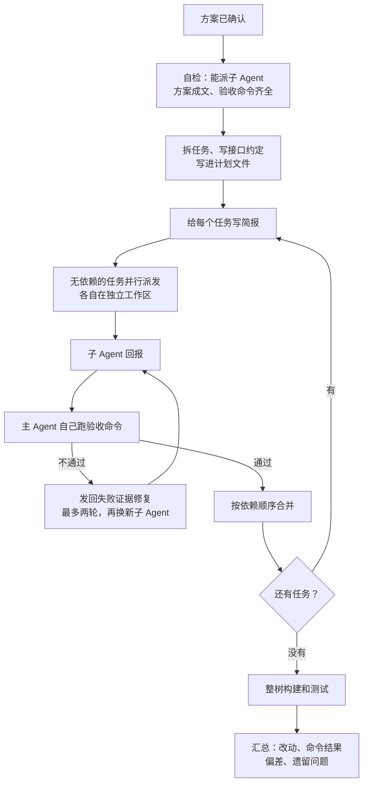

主会话里把需求和方案聊定以后，怎么把活交出去？我的做法是贴一段固定的执行提示词，让主会话从此只拆任务、写简报、派子 Agent、验收，不再自己写代码。提示词是通用版，全文在下面一个代码块里，复制后不用改，Claude Code 和别的能派子 Agent 的工具都能贴。

这样分工主要防两件事：主会话自己下场写，几千行 diff 和测试输出把上下文填满，做到第三个任务时已经压缩过一轮，前面定的接口约定记不全了；或者派了子 Agent 却只给一两句简报，子 Agent 回来都说「已完成、测试通过」，没人核对。

## 提示词全文（通用版）

方案确认之后，点代码块右上角的复制按钮，整段贴进主会话。前半是给主 Agent 的工作规则，末尾 `<任务简报模板>` 标签里是它给每个子 Agent 写简报用的模板；尖括号只出现在模板里，由主 Agent 按任务填。

```markdown
按本会话已确认的需求和设计方案开始实现。你是主 Agent：拆任务、写简报、派子 Agent、验收、合并，业务代码交给子 Agent 写。这样分工是为了让你的上下文只装任务状态和验收结果，不被 diff 和测试输出占满。

## 先自检

下面三项缺哪项先补哪项，补不了就停下来告诉我：

1. 当前环境能派子 Agent（subagent、Task/Agent 工具、后台 agent，叫法随工具）。不能派就直接说，不要自己扮演子 Agent。
2. 方案有一份成文的版本。散在对话里的，先整理成一份，写进计划文件。
3. 找得到格式化、静态检查、测试、构建命令。到仓库指令文件（CLAUDE.md、AGENTS.md 之类）、README、Makefile、包管理脚本、CI 配置里找。

## 角色

- 每个任务派一个全新的子 Agent。子 Agent 看不到本会话，它最多能读到仓库指令文件和你写的简报，所以对它的每一条要求都要写进简报。
- 例外：整个改动集中在一两个文件、不需要并行的，你自己写，再派一个子 Agent 审。
- 子 Agent 不再往下派子 Agent。

## 开工前

1. 把方案拆成任务。每个任务写明：一句话目标、改哪些文件、验收命令、依赖哪些任务。任务大小以改动集中、能独立验证、一个子 Agent 一次做完为准。
2. 并行任务之间共享的接口（类型、函数签名、API 字段、表结构、错误码）先写定再派发。改同一个文件的任务不并行，文件边界划不开的合成一个任务。
3. 任务清单、接口约定、每个任务的状态写进计划文件。仓库有放计划的目录就沿用，没有就建 `docs/plans/<日期>-<功能名>.md`。之后进度只更新这个文件；上下文被压缩或会话中断后，从它恢复。
4. 把任务清单发我一份，不等回复，直接开始。我有异议会打断你。

## 派发

- 每份简报按文末「任务简报模板」写，自包含，不引用「上面讨论过的」。
- 无依赖的任务并行，每个子 Agent 用独立工作区（工具自带的隔离选项，或 git worktree）。做不到隔离就不并行，按依赖顺序一个个做。
- 端口、本地数据库、临时目录这类共享资源，在简报里给每个并行任务分配不同的值。锁文件和生成代码只在合并时由你改。

## 验收

- 子 Agent 回报后，你到它的工作区把简报里的验收命令重跑一遍，以退出码为准，不接受「测试已通过」的自述。输出被工具压缩或摘要过的，也只看退出码。
- 一般任务你自己审 diff：有没有改范围外的文件，有没有动接口约定，测试有没有被放宽或跳过。涉及鉴权、资金、数据迁移、并发的任务，另派一个全新的子 Agent 审，只给它 diff、简报和验收标准，不给实现者的回报。
- 通过的任务按依赖顺序合并进主工作区，新增的未跟踪文件一起带过来，冲突由你解决。全部合并后跑一遍完整的构建和测试，不通过不算完成。
- 不通过：把失败证据（命令、输出、你判断的原因）发回原来的子 Agent 修，最多两轮。工具不支持继续同一个子 Agent 的，每轮派新的，附简报、失败证据和当前 diff。两轮后仍失败，换一个全新的子 Agent，只给简报和失败证据，不给之前的尝试过程。还不过，停下来找我，附上你的诊断。

## 过程中的问题

- 任务范围内顺手能修的小问题直接修，写进回报。
- 范围外的问题不修，记进计划文件的「遗留问题」：复现步骤或触发条件、预期行为、涉及文件、为什么现在不修。
- 已确认方案内的实现细节自行决定，不要来问。必须找我的情况：需求冲突、接口约定要改、要加新依赖、要改 CI、发布、鉴权配置或数据迁移、重大架构变更、不可逆或高风险操作、解决不了的阻塞。
- 非破坏性的构建、测试、调试和开发环境操作直接做。

## 提交

- 子 Agent 不提交。每个任务验收通过并合并后，由你提交一次，只包含这个任务的文件。提交信息沿用仓库已有的格式，没有约定就用 Conventional Commit。仓库规则禁止自动提交的，只 stage。
- 不 push，不发布。

## 收尾

每完成一个任务更新计划文件。全部完成后汇总：改了哪些文件；跑了哪些命令、结果如何；偏离方案的地方和理由；遗留问题；我自己复核时该跑的命令。

除上面列出的必须找我的情况外，不要在每一步等我确认。现在开始。

<任务简报模板>
# 任务：<一句话目标>

## 背景
<这个任务在整个方案里的位置，两三句。只给做这个任务需要知道的，不贴整个方案。>

## 范围
- 改：<文件列表>
- 不碰：<文件或目录>
- 需要改范围外的文件时停下来，在回报里说明，不要自己改。

## 必须遵守的接口
<类型、函数签名、API 字段、表结构、错误码，从计划文件原样复制。不许改；不够用就停下来回报。>

## 验收
按顺序跑，全部退出码为 0 才算完成：
1. <格式化或静态检查命令>
2. <测试命令>
3. <构建命令>
<手工验证步骤：做什么，期望看到什么。没有就删掉这行。>

## 要求
- 修 bug 或加校验：先写一个会失败的测试复现它，再改到通过。
- 只改完成任务必须改的代码，沿用文件既有风格。
- 不改接口约定，不加新依赖，不改 CI、发布、鉴权相关配置，不做不可逆的数据操作。
- 不 commit，不 push，不派子 Agent。
- 端口、临时文件、测试数据库用 <分配的值或获取方式>，不用默认值。

## 回报
完成后只回下面几项，不贴过程：
- 状态：完成 / 未完成（原因）
- 工作区：<路径和分支名>
- 改动文件：<路径，标 新增/修改/删除>
- 验收命令与退出码：<每条命令一行；失败的附最后 20 行输出>
- 偏离简报的地方：<没有写「无」>
- 顺手修的小问题：<没有写「无」>
- 需要主 Agent 决定的事：<没有写「无」>
</任务简报模板>
```

> 2026 年 11 月 11 日改版。旧版分两个代码块，提示词和简报模板分开贴，还要手工填计划文件路径；现在合成一个，也不再绑定 Claude Code。提示词里的做法一部分我日常在用，一部分是对照 Claude Code 文档和之前踩的坑补上的。本文没附完整的实跑记录，给其他工具留的几条退路也没在对应工具里跑过，哪几条在你的仓库里起作用要自己验。文中提到的 Claude Code 子 Agent 行为对照 2026 年 11 月 5 日的官方文档，改版时复查过，出处放在文末。
{: .prompt-info }

## 什么时候贴

它只在一个时刻用：需求讨论完了，技术方案确认了，接口和数据结构在对话里已经写出来了，下一步是写代码。更早贴，主 Agent 会拿着一个没定稿的方案去拆任务；等它已经开始写代码再贴，就晚了。

贴之前要你自己判断的只有一件事：这活值不值得派。改动集中在一两个文件、半小时内能做完的，主会话自己写更快，派一个子 Agent 做 review 就够，第 7 条细说。

方案有没有成文、验收命令找不找得到、工具能不能派子 Agent，这三样由提示词开头的「先自检」去查，缺了主 Agent 会停下来告诉你。其中第 1 条防的是工具没有子 Agent 能力时，主会话在同一个上下文里既当主 Agent 又当子 Agent，那样就没有上下文隔离，也没有独立验收。

贴下去以后，主会话的工作流大致是这样：



## 通用版通用在哪

提示词不绑定哪个工具。依赖工具能力的地方有四处，每处都写了没有这项能力时退到哪：

| 提示词里的说法 | 没有这项能力时 | Claude Code 里的对应物 |
| --- | --- | --- |
| 派子 Agent | 自检第 1 条：直接说不能派，停下 | Agent 工具派出的 subagent |
| 独立工作区 | 不并行，按依赖顺序一个个做 | Agent 工具的 `isolation: "worktree"` |
| 继续原来的子 Agent | 每轮派新的，附简报、失败证据和当前 diff | SendMessage |
| 仓库指令文件 | 命令到 README、Makefile、CI 配置里找，找不到就问你 | CLAUDE.md |

第三列只有 Claude Code，因为我只对照过它的文档。别的工具里这四样叫什么、有没有，要查它自己的文档。

本文说的「子 Agent」，在 Claude Code 文档里叫 subagent：主会话用 Agent 工具派出去的独立会话，有自己的上下文窗口，干完把一段总结交回来就结束。没用过的读者可以先看本站的 [Agent Team 实战](/posts/agent-team-deepseek/)，那篇讲了 subagent 和 Agent Team 的区别。

## 每条为什么这么写

### 1. 对子 Agent 的要求都写进简报

Claude Code 的子 Agent 是一个全新的上下文窗口。它启动时加载的是仓库的 CLAUDE.md，再加主 Agent 调用 Agent 工具时写的那段 prompt，没有别的。内置的 Explore 和 Plan 两种类型连 CLAUDE.md 都不加载。主会话里前面一小时的讨论、这段执行提示词、你对主 Agent 说过的每一句「别碰生产库」，它一个字都看不到。

所以「角色」一节有一句总则：对子 Agent 的每一条要求都要写进简报。「不加新依赖」「不做不可逆的数据操作」这几条最容易出事的边界，直接写死在模板的「要求」一段里，主 Agent 照模板填，它们就进了每一份简报。

反过来，长期不变的规则就不该每次写进简报。测试命令、代码风格、注释约定这类东西放仓库指令文件，每个子 Agent 启动时自己会读到。提示词和简报只装这次任务特有的内容。第 9 条有一张表说哪类约束放哪。

### 2. 简报要有固定结构

只跟主 Agent 说「给子 Agent 必要的背景、约束和验收标准」是不够的，「必要」由它临场判断，容易走到两个极端：把整个方案贴进去，子 Agent 读完还是不知道自己该改哪个文件；或者只有一句话任务，子 Agent 自己去猜接口。

模板把简报定成一句话目标加六段：背景、范围、必须遵守的接口、验收、要求、回报。

范围要写「不碰」。只说改哪些文件不够，子 Agent 发现别处有问题会顺手改过去，改到并行的另一个子 Agent 正在改的文件上。「需要改范围外的文件时停下来回报」这一句防的就是这个，比事后解决冲突便宜。

验收要写命令，不写形容词。「确保测试通过」没法核对，「`go test -race ./...` 退出码为 0」才能核对。手工验证步骤要写做什么、看到什么算对。

回报的七项里，「工作区」是给主 Agent 去跑验收和合并用的，第 3 条会说到文档没保证主 Agent 知道这个路径。「验收命令与退出码」让主 Agent 一眼看出子 Agent 到底跑了哪些命令，漏跑的一比对就露出来。

「偏离简报的地方」是最该读的一项，子 Agent 自己改了接口、换了实现方式，都会出现在这里；它写「无」而 diff 里有，就是审查要盯的地方。「需要主 Agent 决定的事」把子 Agent 卡住的地方显式交回来，省得它自己猜一个答案填上去。

### 3. 并行之前先冻结接口，隔开工作区

并行的子 Agent 彼此不认识，没有消息渠道。一个写存储层一个写服务层，中间的函数签名、错误码、数据结构如果没有事先写死，各写各的，合并时主 Agent 得重写一边。

上一篇 Agent Team 实跑里，lead 把完整接口契约一字不差地贴进了两个 teammate 的 spawn prompt，teammate 之间一条消息都没发。那在 Agent Team 里算毛病，因为我想看的是它们自己商量。换到子 Agent 这里，它就是正确做法：主 Agent 先把共享接口写进计划文件，再复制到每份简报的「必须遵守的接口」一段，子 Agent 只许实现，不许改。接口不够用就停下来回报，由主 Agent 改计划文件、通知受影响的任务。

改同一个文件的任务不并行，这是底线。文件边界划不开的，合成一个任务。

隔离在 Claude Code 里用 git worktree。Agent 工具有 `isolation: "worktree"` 选项，子 Agent 在一个从默认分支拉出来的临时 worktree 里工作，改动落在自己的分支上，不碰主工作区。文档说没有改动的 worktree 会自动清理，有改动的留在磁盘上等周期性清扫。文档没说会不会把 worktree 路径告诉主 Agent，所以回报格式里让子 Agent 自己写上路径和分支名，主 Agent 拿着它去跑验收和合并。

工具给不了隔离、你也不想让它手工建 worktree 的话，提示词的退路是不并行。两个子 Agent 在同一个目录里同时改，各自跑构建和测试时看到的都是对方写到一半的代码，失败了分不清是谁的问题。

代码之外还有几样共享资源：本地端口、本地数据库、`go.sum` 和 `package-lock.json` 这类锁文件、生成代码。两个子 Agent 同时跑集成测试抢同一个端口，表现是随机失败，很难查。简报里要写清用哪个端口，或者怎么拿一个空闲端口；锁文件只在合并时由主 Agent 改一次。

### 4. 验收：主 Agent 自己跑命令，合并后再跑一遍

子 Agent 的回报只是一份自述。它说「测试已通过」，可能真跑过，可能跑了一部分，也可能改了断言让它通过。做错的地方和真发现的东西，报上来都是同一种语气，主 Agent 光看文字分不出来。

验收只能由主 Agent 自己动手：到子 Agent 的工作区里把简报里的验收命令重跑一遍，看退出码。rtk 这类压缩终端输出的工具会把失败摘要成一句「No errors found」，所以以退出码为准，不读摘要。

代码审查的粒度看风险。一般任务主 Agent 自己读 diff 就行，代码不是它写的，它不会护着。涉及鉴权、资金、数据迁移、并发的任务，另派一个全新的子 Agent 审，只给它 diff、简报和验收标准，不给实现者的回报。先看到结论，审查者容易顺着去确认。

各任务分别通过，不等于合在一起能过。合并按依赖顺序做，全部合完以后在主工作区跑一遍完整的构建和测试，这一步不过就不算完成。冲突由主 Agent 解决，解决完再跑一遍。

合并时有一个容易漏的地方。子 Agent 不提交，它新建的文件在工作区里是未跟踪状态，`git diff` 里看不到。提示词在合并那一条里点了名，回报的「改动文件」要求标出新增，也是为了这个。

### 5. 修复最多两轮

子 Agent 卡住时，会把同一个补丁换着写法反复试，每轮都说这次好了。只说「验收失败就继续修」，就会一直这样绕下去。

提示词的规则是：每个任务最多两轮修复，发回去的是失败证据，也就是命令、输出、主 Agent 判断的原因，不是一句「再试一次」。两轮后仍失败，换一个全新的子 Agent，只给它简报和失败证据，不给前两轮的尝试过程，免得它顺着错的方向继续。还不过，停下来找你，附上主 Agent 自己的诊断。

两轮这个数来自我的[跨项目通用规范](/posts/agent-project-conventions/)里「卡住时换个思路」那张表：同一问题连续两次修复仍未通过验证，就该怀疑方向错了，回到验收标准重新推导，而不是再打一个补丁。

前两轮用原来那个子 Agent。Claude Code 允许主 Agent 用 SendMessage 继续一个已结束的子 Agent，它保留全部历史，知道自己改过什么，不用重读仓库。工具不支持这样继续的，前两轮也只能派新的，这时要多给一样东西：当前的 diff。新来的子 Agent 没有历史，不给 diff 它会从头再写一遍。

### 6. 进度写进计划文件

主会话只保留任务状态、关键决策和验收结果，这一条谁都会写，问题是保留在哪。只在上下文里的话，自动压缩一次就只剩一段摘要。Claude Code 在接近上下文上限时会自动压缩，压缩后从磁盘重新注入的是项目根目录的 CLAUDE.md、自动记忆、plan mode 里的计划，再加最近改过的几个文件。

所以「开工前」第 3 条要求主 Agent 把任务清单、接口约定、每个任务的状态写进一个计划文件，之后进度只更新这个文件。路径不用你填：仓库有放计划的目录就沿用，没有就建 `docs/plans/<日期>-<功能名>.md`，这是我自己用的路径。提交不提交看仓库习惯。它是进度的唯一事实源：压缩以后主 Agent 重读它接着干。会话断了，新开的会话读它也能接上。

### 7. 什么时候不该派子 Agent

派一个子 Agent 的固定开销是：主 Agent 写简报，子 Agent 从零读仓库，主 Agent 读回报再验收。改两个文件的活，这套开销比活本身大。

大多数日常改动不值得派。改动集中在一两个文件、半小时内能做完、不需要和别的改动并行，主会话自己写，派一个子 Agent 做 review 就够。值得派的是任务三个以上且互不依赖，或者单个任务要读的上下文多到主会话装不下。你的仓库如果测试慢，每个任务都要跑十分钟集成测试，并行的收益会更大，阈值可以放低。上一篇 Agent Team 的结论放到子 Agent 上同样成立：600 行、文件边界清楚的活，单会话 4 分钟写完。

「角色」一节留的那个例外就是为此：整个改动集中在一两个文件、不需要并行的，主 Agent 自己写。光说「原则上不写代码」是不够的，主 Agent 会把两个文件的改动也派出去。例外里没写「半小时」，因为主 Agent 估不准时间，文件数倒是数得清。

### 8. 谁来提交，范围外的问题记在哪

子 Agent 在自己的 worktree 里提交，主 Agent 合并时要处理一堆小提交；子 Agent 不提交，全部改动堆到最后一次提交，又丢了「每个提交都是验收过的单元」这个好处。两种都有代价，得选一种。

提示词选的是：子 Agent 不提交。每个任务验收通过、合并进主工作区以后，由主 Agent 提交一次，只包含这个任务的文件，提交信息跟仓库已有的格式走。仓库规则禁止自动提交的（比如这个博客仓库），只 stage 不 commit。任何情况下不 push，不发布。

范围外的问题，通用版让主 Agent 记进计划文件的「遗留问题」，不建 Issue。不是每个仓库都用 Issue，建 Issue 也是别人看得见的动作，不该默认做。用 GitHub Issue 的仓库，贴的时候在末尾补一句，旧版提示词里就是这么写的：

```text
范围外的问题先查已有 Issue，没有就建一个，标 ready-for-agent，链接记进计划文件。
```

记在哪都一样，得让下一个 Agent 看着条目就能直接动手。它看不到这次对话，条目里要有复现步骤或触发条件、预期行为、涉及的文件和函数，还有主 Agent 当时为什么没顺手修。只写一句「XX 有问题」，等于把查问题的活推给下一个人。

### 9. 提示词管不住的，交给指令文件和 hook

上下文隔离、并发、工作区隔离要靠工具支持，提示词保证不了。每类约束该放哪，我的分法是：

| 约束 | 放哪 | 为什么 |
| --- | --- | --- |
| 测试、构建、格式化命令；代码风格；不加新依赖；注释约定 | 仓库指令文件（CLAUDE.md、AGENTS.md） | 每个子 Agent 启动时自动加载，不用每份简报重复 |
| 这次任务的目标、文件范围、接口约定、验收命令 | 任务简报 | 只对这个任务有效 |
| 主 Agent 的工作方式：拆任务、派发、验收、修复上限、提交策略 | 执行提示词 | 只对这次运行有效，子 Agent 不需要知道 |
| 「测试不过不许结束」这类硬门禁 | hook | 提示词只是请求，hook 是强制 |

hook 这一行要多说几句，下面的写法只适用于 Claude Code。它有 `SubagentStop` 事件，在子 Agent 结束时触发。hook 脚本以退出码 2 退出，或者输出 `{"decision": "block", "reason": "..."}`，子 Agent 就停不下来，会拿着 reason 当下一条指令继续干。把测试命令挂在这里，子 Agent 就交不出一份测试失败的回报。

写这个 hook 要注意两个细节。输入 JSON 里的 `stop_hook_active` 为 true，说明这轮已经被 hook 拦回去过，脚本要看这个值，不然遇到永远满足不了的条件就会困在里面（Claude Code 自己也有保护，连续自动继续 8 次后会强制结束）。另一个是路径：子 Agent 在 worktree 里时，hook 的 `CLAUDE_PROJECT_DIR` 环境变量还指着主工作区，输入 JSON 里的 `cwd` 才是 worktree 的根目录，测试要在 `cwd` 里跑。

一个只跑 Go 测试的版本：

```bash
#!/bin/bash
INPUT=$(cat)
if [ "$(echo "$INPUT" | jq -r '.stop_hook_active')" = "true" ]; then
  exit 0
fi
cd "$(echo "$INPUT" | jq -r '.cwd')" || exit 1
[ -f go.mod ] || exit 0

if ! OUT=$(go vet ./... 2>&1 && go test -race ./... 2>&1); then
  echo "go vet / go test -race 没通过，修好再结束" >&2
  echo "$OUT" | tail -n 30 >&2
  exit 2
fi
exit 0
```

这个脚本我用一个只有 `main.go` 的临时模块手动喂过四种输入，没在真实的子 Agent 结束时触发过：

| 输入 | 退出码 |
| --- | --- |
| 正常模块 | 0 |
| 放进一个编译不过的文件 | 2，vet 的报错打到 stderr |
| 同样的坏文件，`stop_hook_active` 为 true | 0 |
| 目录里没有 `go.mod` | 0 |

`stop_hook_active` 为 true 时直接放行，意思是 hook 只拦一次：第一次测试不过把子 Agent 拦回去，它修完再次结束时就放行，剩下的交给主 Agent 验收。想拦到测试通过为止，去掉开头那个判断，靠 8 次上限兜底。注册在 `settings.json` 里，`matcher` 填子 Agent 的类型名：

```json
{
  "hooks": {
    "SubagentStop": [
      {
        "matcher": "implementer",
        "hooks": [{ "type": "command", "command": "$CLAUDE_PROJECT_DIR/.claude/hooks/subagent-stop.sh" }]
      }
    ]
  }
}
```

`matcher` 不填就对所有子 Agent 生效，Claude Code 自己跑的内部 agent（提示建议、`/btw` 提问）结束时也会触发它，所以最好填上。

这里的 `implementer` 是一个自定义子 Agent 的名字。自定义子 Agent 放在 `.claude/agents/` 下，每个一个 Markdown 文件，frontmatter 里可以写 `isolation: worktree`、限制 `tools`、设 `maxTurns`、指定 `model`。要是每次派发都要同一套隔离和限制，定义一个 `implementer` 比在提示词里反复交代省事。本文的提示词没有依赖它，用内置的 general-purpose 类型一样能跑。

还有个默认值要留意：子 Agent 自己也能往下派子 Agent，默认最多三层，环境变量 `CLAUDE_CODE_MAX_SUBAGENT_SPAWN_DEPTH` 可以改。提示词和简报里都禁了这件事，套到三层以后，回报传上来得经过两次转述，主 Agent 验收时追不回原始证据。

## 配合 /goal

Claude Code 有 `/goal <条件>` 命令：设一个完成条件，每一轮结束后由一个模型判断条件是否满足，没满足就自动开始下一轮，不用你再输入。配合这段提示词的用法是先设目标，再贴提示词，比如：

```text
/goal 计划文件里所有任务状态为已验收，整树构建和测试通过，汇总已输出
```

条件要能核对，「做完」这种写法判断不了。不用 Claude Code 的话跳过这步，提示词末尾那句「不要在每一步等我确认」是通用的。

## 参考资料

- Claude Code 文档，Subagents：https://code.claude.com/docs/en/sub-agents
- Claude Code 文档，Hooks reference：https://code.claude.com/docs/en/hooks
- Claude Code 文档，Worktrees：https://code.claude.com/docs/en/worktrees
- Claude Code 文档，Keep Claude working toward a goal：https://code.claude.com/docs/en/goal
- Claude Code 文档，Context window：https://code.claude.com/docs/en/context-window
- 本站：[Agent Team 实战](/posts/agent-team-deepseek/)、[给 AI 编程代理的跨项目通用规范](/posts/agent-project-conventions/)
